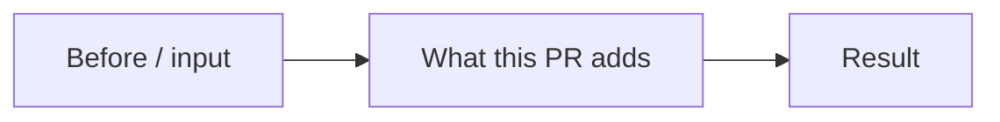

Closes #<!-- issue --> <!-- or "Refs #n" when a "Done when" box stays open: say which -->

## 🧭 In one paragraph
<!-- The whole change for someone who doesn't know the code: what was wrong or missing,
     what it does now, and the one number or result that shows it worked. No file names. -->

## 🔍 How it works
<!-- A few short paragraphs, mid-level: the cause, the idea of the fix, what was weighed
     and left out, what stays the same. Explain any term a non-programmer wouldn't know. -->

## 🔧 The details
<!-- Low level: files, functions, flags, constants, new tests (with counts). -->

## 🧪 Tests
- [ ] Automated: <!-- new tests + whole suite result -->
- [ ] Live: <!-- builds tried (Bforartists 5.2.3 / Blender 5.2.4 / 5.4), main vs branch -->
- [ ] **By hand:** <!-- one line per check: what to do → what you should see -->
- [ ] Not checked: <!-- and why -->

## 🔎 Review notes & follow-ups
<!-- Risks, interactions with other open PRs, upstream-tracking files touched,
     follow-ups (link the issue they went to). -->

## 🚦 Merge order
<!-- Independent, or "after #n / before #m" and why. -->

📜 Full evidence

<!-- Measurements, probe tables, logs, capture names. -->

