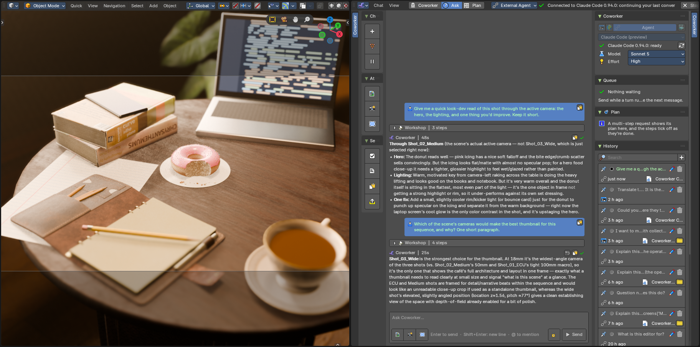
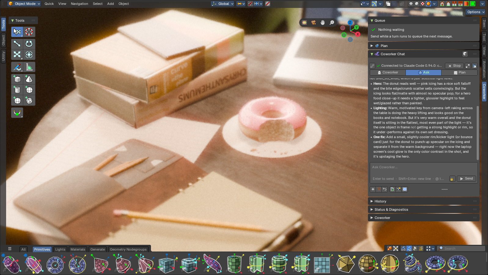
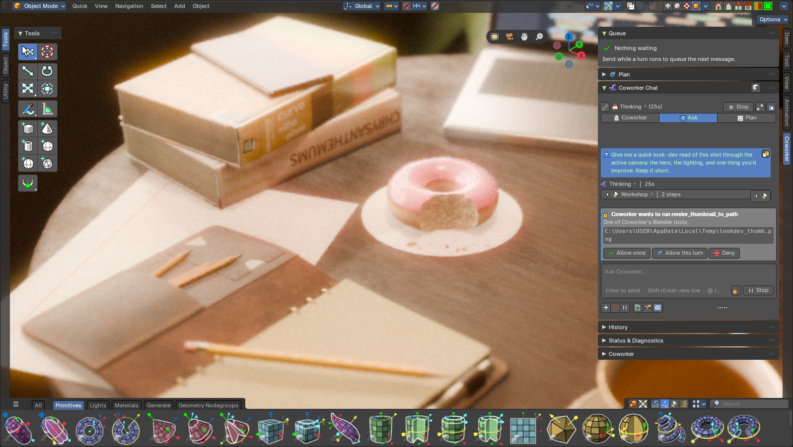

# Bforartists Coworker

**An AI coworker built right into Bforartists and Blender: in every editor, with your choice of model.**

Coworker is a self-contained add-on that puts an AI assistant inside the interface you already
use. It can look at your scene, explain any button, translate text, plan a multi-step job and
build it, with every change one undo away. You choose the model:

- a **local model** that runs on your own GPU;
- a **remote API**;
- **the agent app you already use**, such as Claude Code or OpenCode.



> **🚧 Work in progress:** an active fork under heavy development. Plans live in [`_misc`](_misc).
> **Windows is tested;** macOS and Linux are not yet.

---

## Why Coworker?

- **Local first, zero setup.** Download llama-server with one click, pick a model preset, start talking. No terminal, no Python environments, no API key needed. Your scenes never leave your machine.
- **Bring your own agent.** *External Agent* mode lets Claude Code, OpenCode, Codex, Gemini or Copilot do the work through Coworker's Blender tools, while you chat inside Bforartists. *External Harness* mode connects outside apps like Claude Desktop or Cursor.
- **In every editor.** The full **Coworker editor**, plus a compact chat in the sidebar of the 3D View, the node editors, the Sequencer, the Image, Text, Dope Sheet, Graph, NLA, Clip and Spreadsheet editors. It knows which editor you're in and what it shows.
- **Safe by default.** Permissions (Strict / Permissive / Auto) ask before changes. Every turn is one undo step you can **Revert**. Local servers only answer your own programs.
- **Actually useful.** 40+ tools to inspect scenes, run and check code, render previews, browse assets and Poly Haven, wire node groups and more, plus plans that tick off as Coworker works.

## What's new in 1.1.40

| | |
|---|---|
|  | **The Coworker tab in every editor.** The same chat in each editor's sidebar, with Queue, Plan, History and Status. *Use Editor Context Only* keeps Coworker to what that editor shows. |
|  | **Permissions and approvals.** A card asks before a tool runs: *Allow once*, *Allow this turn* or *Deny*. Switch between Strict, Permissive and Auto at any time. |

- **The Coworker editor:**
  - a full-size chat in your theme, with **@ mentions**, images, markdown and a foldable **Workshop** of tool steps;
  - pick it from any area's *Editor Type* menu, or open it in its own window.
- **External Agent mode:** chat with your own agent app (Claude Code, OpenCode and more), with approvals, resume and its own Mode / Model / Effort pickers.
- **Explain This / Translate:** right-click any setting, button, text field, text strip or the Text Editor.
- **Plan mode, Auto mode, Queue, History and Revert:** on every engine.

See the [release notes](https://github.com/Draise14/bfa_coworker/releases/tag/v1.1.40) and the [CHANGELOG](CHANGELOG.md).

---

## Quick Start

1. **Install.** Download `bfa_coworker_installer.zip` from the [latest release](https://github.com/Draise14/bfa_coworker/releases/latest) and drag it into Bforartists / Blender. It adds the Coworker update repository, so new versions appear in *Preferences → Get Extensions*.
2. **Pick a mode** in the Coworker panel's mode switcher:

   | Mode | What runs the chat | You need |
   |---|---|---|
   | **Local** | llama-server on your GPU | Nothing: the Local tab downloads llama-server and a model preset for you |
   | **Remote** | An OpenAI-compatible API (OpenRouter, OpenAI, Anthropic…) | An API key |
   | **Agent** | Your agent app (Claude Code, OpenCode, Codex, Gemini, Copilot) | The agent installed and logged in; Coworker checks both |
   | **Harness** | An outside MCP app (Claude Desktop, Cursor, VS Code…) | *Add to \<app\>* in Preferences writes its config |
3. **Press Start** and chat. Use the 3D View's sidebar (N → *Coworker*) or the Coworker editor.
4. **Try a right-click:** *Explain This* on any setting, or *Translate…* on a text object.

Full guides: [Wiki](https://github.com/Draise14/bfa_coworker/wiki) ·
[Quick Start](https://github.com/Draise14/bfa_coworker/wiki/Quick-Start) ·
[External Agent](https://github.com/Draise14/bfa_coworker/wiki/External-Agent) ·
[Chat Interface](https://github.com/Draise14/bfa_coworker/wiki/Chat-Interface)

---

## What Can It Do?

| Area | Try asking |
|------|----------|
| **Modeling** | "Create a stonehenge with 8 pillars in a circle" |
| **Materials** | "Apply a weathered stone material to all pillars" |
| **Lighting** | "Set up dramatic three-point lighting" |
| **Look-dev** | "Give me a quick read of this shot: the hero, the lighting, one thing to improve" |
| **Animation** | "Make the ball bounce with squash and stretch" |
| **Nodes** | Right-click the node editor → *Explain This Editor* |
| **Text** | Right-click a text strip → *Translate…* → Spanish |
| **Scene management** | "Organize everything into named collections" |
| **Assets** | "Download a forest HDRI from Poly Haven" |
| **Planning** | Plan mode: "Plan a cozy café scene", then *Carry Out the Plan* |

---

## Download

| | |
|---|---|
| **Latest release** | [Download v1.1.40](https://github.com/Draise14/bfa_coworker/releases/latest) |
| **All releases** | [GitHub Releases](https://github.com/Draise14/bfa_coworker/releases) |
| **Update repository** | `https://raw.githubusercontent.com/Draise14/bfa_coworker/main/extensions/index.json` |
| **Source code** | [Clone this repo](https://github.com/Draise14/bfa_coworker) |

Requirements: Bforartists or Blender 5.1+, and 4–28 GB RAM for local models depending on the model.

---

## How It Works

```
You chat in the Coworker editor or any editor's sidebar
        |
   One engine: Local LLM · Remote API · External Agent (ACP)   ← or an outside MCP app (Harness)
        |
   Coworker's MCP server: scene tools, plan, questions, approvals
        |
   The bridge runs each step on Blender's main thread, as one undo step per turn
        |
   You see the result live in your scene and editors
```

Everything starts from inside Bforartists / Blender: no external processes to manage, and the ports are found for you.

---

## Get Involved

Coworker is open source under GPL-3.0. Contributions are welcome: bug reports, feature ideas,
model testing, documentation and code.

- **Report issues:** [GitHub Issues](https://github.com/Draise14/bfa_coworker/issues)
- **Discuss ideas:** [GitHub Discussions](https://github.com/Draise14/bfa_coworker/discussions)
- **Read the docs:** [Wiki](https://github.com/Draise14/bfa_coworker/wiki)
- **Roadmap:** [Tier 4 tracker #97](https://github.com/Draise14/bfa_coworker/issues/97)

## License

GPL-3.0-or-later. See [LICENSE](LICENSE).
