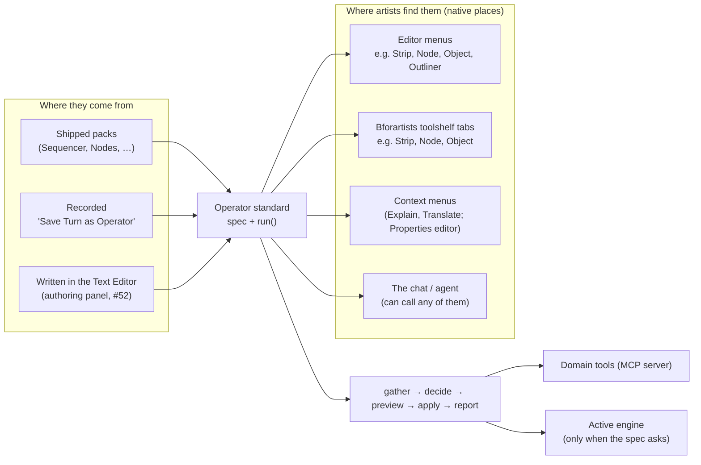
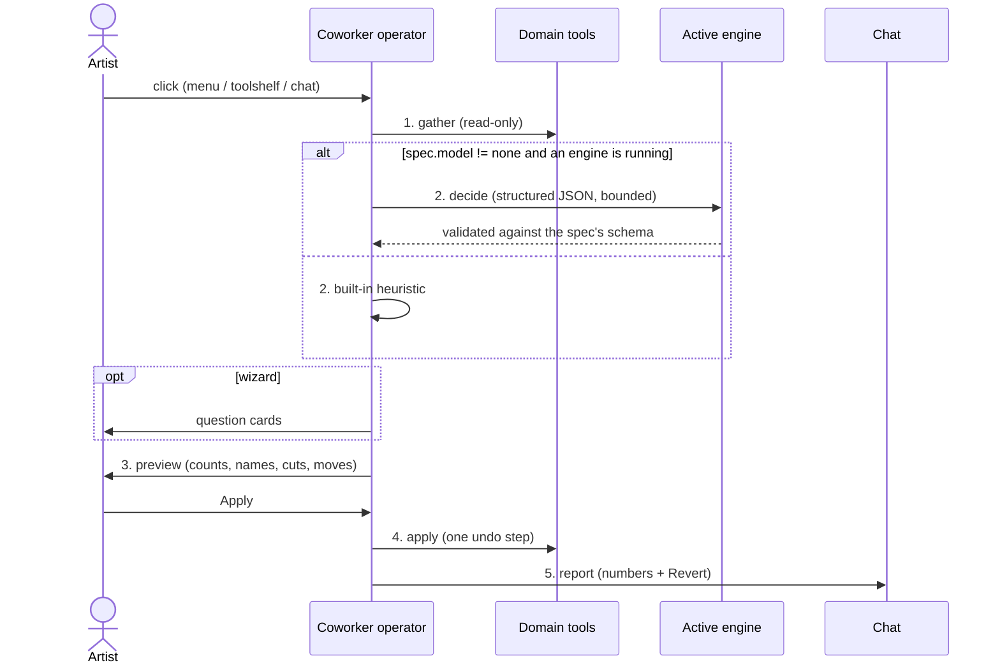
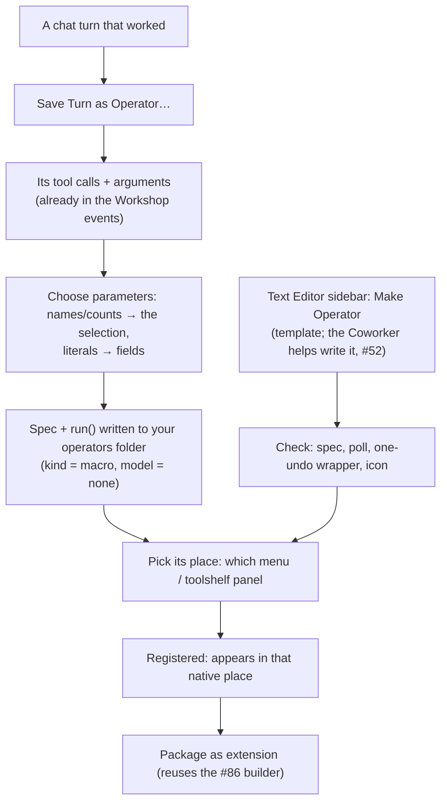
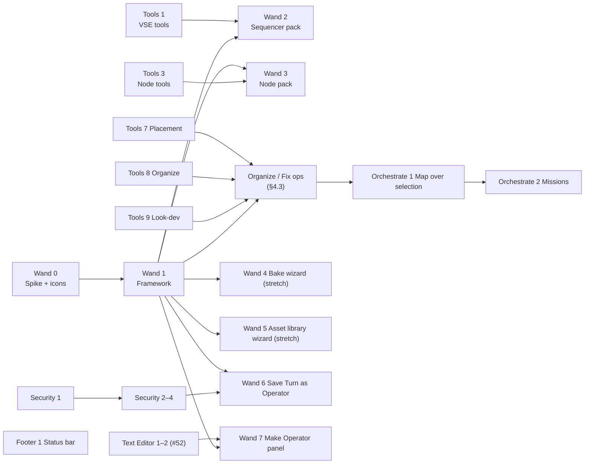

# Tier 4m — Coworker operators (wand icon) + the tasks around them (review document)

**Status**: 📝 For review, revision 2 (2026-10-21, your answers applied). Replaces the
"quick prompt menu" idea. Tasks: **Wand 0–7** (were "Magic 0–7"), **Tools 7–9**,
**Orchestrate 1–2**, **Footer 1**, **Security 1–5**. Explain (#290) and Translate (#42)
are this same kind of operator and are in progress with another agent; they become the
first members of the standard rather than being re-planned here.

**In one sentence**: Coworker adds ordinary-looking Blender operators — conventional
names and tooltips, a **wand badge** on a familiar icon — in the **same menus and
toolshelf panels where the native operators of that kind already live**. Each one turns
a chore (remove silences, vertical video, tidy and explain a node tree, organize the
scene, bake texture sets, prepare an asset library) into one click with a preview and
one undo. Mostly tested code; the active engine is asked only for the judgment calls.

## Decisions from review (2026-10-21)

| # | Question | Decision |
|---|---|---|
| 1 | Brand name | **No "Magic" word.** Conventional operator names and tooltips; the **wand badge** on the icon is the only mark (the Coworker uses a wizard hat, so the wand fits) |
| 2 | Placement | **Native contextual locations**, like Smart Mesh Blend: next to related native operators in the editor's menus and Bforartists toolshelf tabs. A dedicated panel only for **making** new operators |
| 3 | Which model decides | **The active engine** (simpler setup, no second model in RAM) |
| 4 | Order | **Sequencer pack first, then the Node pack**; both in this release |
| 5 | Icons | **Self-contained** SVG + PNG in the add-on (works in plain Blender and can be sold standalone); offering them to Bforartists is a later option |

---

## 1. Why operators, not canned prompts

| Option | Problem | Verdict |
|---|---|---|
| Prompt library (canned prompts in a menu) | Slow, inconsistent on 7–14B models, no preview, no guaranteed undo, tokens spent on chores | ❌ |
| No quick system | Loses the biggest day-to-day win | ❌ |
| Macro recorder only | Nothing out of the box; recordings break when names/counts change | Part of the answer |
| **Operator standard + three sources** (shipped, recorded, written) | Needs a small framework first (Wand 1) | ✅ |

The model is a **component inside** an operator, not the operator. Explain and
Translate already work this way: a native-feeling entry in a context menu, a bounded
question to the engine, a result applied or shown.

---

## 2. The big picture



**Fit with Tier 4**: tool first, model optional (master §0.2). Operators reuse the
domain tools (every engine can call them), question cards for wizards (Chat 5, GPU 6),
one undo per run (Engine 6), the active engine for decisions (engine seam), and the chat
for a short report with Revert.

---

## 3. The standard (Wand 1)

### 3.1 Spec — one per operator

```python
# addon/bfa_coworker/wand/packs/sequencer.py
SPEC = OperatorSpec(
    id="sequencer.remove_silences",            # bl_idname "coworker.sequencer_remove_silences"
    label="Remove Silences",                   # conventional name, no brand
    description="Cut quiet parts out of the selected sound strips and close the gaps",
    icon="SPEAKER",                            # base icon; the wand badge is added
    places=[                                   # where native operators of this kind live
        Place.menu("SEQUENCER_MT_strip", after="sequencer.split"),
        Place.toolshelf("SEQUENCE_EDITOR", category="Strip", panel="Split"),  # Bforartists
    ],
    kind="tool",                               # tool | macro | hybrid | wizard
    model="none",                              # none | small (one bounded call) | full (agent turn)
    scope="selection",
    preview=True,
    params=[Param("threshold_db", -40.0), Param("min_silence_s", 0.4), Param("padding_s", 0.08)],
)
```

| Field | Meaning |
|---|---|
| `places` | Native menus and Bforartists toolshelf panels to append to; a context menu only when that's the native place (Explain, Translate, Properties editor) |
| `kind` | **tool** deterministic · **macro** recorded replay · **hybrid** code + one engine decision · **wizard** question cards around tools |
| `model` | `none` works with no engine running · `small` one short structured call to the **active engine** · `full` an agent turn |
| `poll` | Greyed out when the context doesn't fit (no sound strip selected…) |

### 3.2 Run pipeline



A bad engine answer falls back to the heuristic; nothing is ever half-applied.

### 3.3 Icons — self-contained (Wand 0/1)

- **Set**: each operator's icon = a familiar base glyph + a small **wand badge** in the
  bottom-right corner. Shipped as **SVG sources + PNG renders** (32/64 px, light and dark
  variants) in `addon/bfa_coworker/icons/wand/`, loaded with `bpy.utils.previews` and
  drawn with `icon_value`. Works in plain Blender; no dependency on Bforartists icons.
- **Base glyphs**: drawn by us, matching the Blender/Bforartists icon style (flat,
  2-px strokes, theme-neutral), so they sit well in both apps. Bforartists' own icons
  are GPL (compatible) but we keep the add-on self-contained; offering the badge set to
  Bforartists later is optional.
- **Drawing**: menus use `layout.operator(…, icon_value=…)`. Bforartists' toolshelf
  helper (`OperatorEntry`) only takes icon *names*, so Wand 1 adds a tiny entry class with
  the same `draw(layout, as_icon=…)` contract using `icon_value`; it plugs into
  Bforartists' `draw_entries` (icon grid when narrow, text buttons when wide).
- **Build**: `_misc/build_icons.py` renders the SVGs to PNG (no Blender needed) and a
  test checks every spec's icon exists.

### 3.4 Placement rules

| Situation | Where | Example |
|---|---|---|
| A native menu holds operators of this kind | Append there, next to the related native operator | *Strip > Remove Silences* under *Split*; *Node > Tidy & Explain* near *Frame* |
| Bforartists tabbed toolshelf has a matching tab/panel | Add to that panel (Bforartists `ToolsystemPanel` conventions, poll on `show_toolshelf_tabs`) | *Strip* tab, next to *Split*; *Node* tab, *Frame Tools* panel |
| The native place is a context menu | Context menu | Explain, Translate; Properties editor |
| Making new operators | **One dedicated panel**: the Text Editor sidebar "Make Operator" (+ "Save Turn as Operator" in the chat) | Wand 6, Wand 7 |
| Hotkeys | None by default | Users bind their own |

No "Coworker" tab and no extra header menu: the operators should feel built in.

---

## 4. Packs — Sequencer first, then Nodes

### 4.1 Sequencer pack (Wand 2, first)

| Operator | Place | Kind / model | How |
|---|---|---|---|
| **Remove Silences** | *Strip* menu, Bforartists *Strip* tab | tool / none | Read the sound strip's samples → quiet ranges (threshold, min length, padding) → preview cut list → split, remove, close gaps; one undo |
| **Convert to Vertical (9:16)** | *Sequencer > View* or render-size area; *Strip* tab | hybrid / small | Set the output size → per strip scale/crop to fill → the engine suggests a focus side per shot from a thumbnail when asked |
| **Subtitles from Text** | *Add* menu | tool / none | Text block lines + timings → text strips |
| **Assemble Timeline from Scenes** | *Add* menu | tool / none | Scene strips in shot order with handles (idea from recipe → shots → timeline workflows) |
| **Export Review Video** | *Render* area | tool / none | Fast preview render of the edit with burned-in shot names |

### 4.2 Node pack (Wand 3, second)

| Operator | Place | Kind / model | How |
|---|---|---|---|
| **Tidy & Explain Tree** | *Node* menu, Bforartists *Node* tab (*Frame Tools*) | hybrid / small | Gather nodes/links → the engine groups them by purpose and writes a label + short note per group → frames, aligned columns, notes (5.3 node notes API to verify in Wand 0) |
| **Frame Selected by Purpose** | same | hybrid / small | As above for the selection only |
| **Explain This Tree** | (Explain, #290) | — | Covered by the Explain operator |

### 4.3 Other packs (stretch or Tier 5)

| Operator | Place | Kind | Tier |
|---|---|---|---|
| **Organize into Collections**, **Rename to Convention**, **Clean Up File** | *Outliner* context/header, *Object* menu | hybrid / tool | Release (with Tools 8) |
| **Drop to Floor**, **Align / Distribute**, **Fix Common Problems**, **Frame Camera** | *Object > Snap / Transform*, Bforartists *Object* tab | tool | Release (with Tools 7, 9) |
| **Bake Texture Sets…** (wizard) | *Object > Bake* area, *Render* properties | wizard / small | Stretch (Wand 4) |
| **Prepare Assets for a Library…** (wizard: thumbnails, location, author, catalogs) | *Asset Browser* menu, *File* | wizard / small | Stretch (Wand 5) |
| **Block Out Scene…** (description → coloured greybox in its own collection; rebuild/clear) | *Add* menu | hybrid / full | Tier 5 |
| **Check Asset Quality**, **Make LODs**, **Export for Unity/Unreal/Godot** | *Object*, *File > Export* | tool | Tier 5 (Skills 7 first) |
| **Time of Day…**, **Weather…** | *World* properties | wizard | Tier 5 |
| **Stress-Test Poses**, **Add Face Shape Set** | *Armature / Shape Keys* | tool | Tier 5 |

---

## 5. Making your own (Wand 6, Wand 7)



The **Make Operator** panel is the only dedicated Coworker panel in this design.

---

## 6. Ideas taken from outside projects (clean room: needs only)

Read 2026-10-21: the user guide and UI style guide of the Scenario Blender plugin
(GPL-3.0) and the public skill catalogue reviewed for lane S (MIT). Recorded as needs and
our own designs; no code or text consulted while implementing (4b §4).

| Need observed | Our design |
|---|---|
| Turn a description into a quick greybox that can be rebuilt without touching the rest of the scene | *Block Out Scene…* builds into its own collection; rebuild/clear only touch that collection (Tier 5) |
| Apply a generated or computed result only to an explicitly chosen target | Every operator's apply step names its target in the preview (strip, material slot, collection) |
| Multi-step production (shots → timeline → review → export) with a confirmation per step | Sequencer pack: Assemble Timeline, Export Review Video; Orchestrate 2 missions confirm per step |
| Show the cost before a heavy run | Preview shows an engine-call estimate when `model != none` on a Remote engine |
| Agents finish without evidence; asset QA, baking, LODs, export presets, rig stress tests | Tools 8, Skills 7 and the Tier 5 packs in §4.3 |
| Downloads verified by checksum | Security 5 |
| Local server limited to loopback with origin checks; code execution off by default | Security 1 audits our bridge/MCP against this |
| Say plainly what Blender can't do instead of faking it | UI rule for our panels and the GPU chat |

---

## 7. Task cards



### Wand 0 — Spike + icon set (S)
- **What**: one operator end to end (Remove Silences): appended to *Strip* menu and the
  Bforartists *Strip* tab, a badged icon via `icon_value`, the pipeline with a preview.
  Draw the first 8 icons (SVG → PNG) and the badge. Probe the 5.3 sound-sample API and
  node notes.
- **Why**: proves native placement and icon look in both themes before building the
  framework; de-risks the two packs.
- **Done when**: screenshots in Bforartists and plain Blender 5.3; spec fields frozen.

### Wand 1 — Framework (M)
- **What**: `OperatorSpec`, registry (shipped + user folder), operator factory, placement
  (menus, Bforartists toolshelf, context menus), icon loading, the 5-stage pipeline with
  schema-checked decisions on the **active engine** and a heuristic fallback, preview,
  one undo, chat report, `run_operator` MCP tool so the agent can call them.
- **Done when**: a test pack (one of each kind) runs from its menu, its toolshelf panel
  and the chat; bpy-free tests for registry and pipeline. Explain/Translate can adopt the
  spec without behaviour change.

### Wand 2 — Sequencer pack (M) · **first**
- **What**: Remove Silences, Convert to Vertical, Subtitles from Text, Assemble Timeline
  from Scenes, Export Review Video.
- **Why**: the least-served domain today and pure drudgery; your priority.
- **Done when**: a 2-minute talk clip loses its pauses with closed gaps in one undo; a
  16:9 edit becomes 9:16 with every strip filling the frame; works with no engine
  (vertical uses centre focus without one).

### Wand 3 — Node pack (M) · **second**
- **What**: Tidy & Explain Tree, Frame Selected by Purpose.
- **Done when**: a 60-node shader tree is framed into labelled groups with notes on a 7B
  local model; layout and frames revert in one undo.

### Wand 4 — Bake wizard (M, stretch) · Wand 5 — Asset library wizard (M, stretch)
- As §4.3. Done when: two material sets bake to a folder and a working material from
  three answered cards; 10 props become a library with thumbnails, catalogs and author.

### Wand 6 — Save Turn as Operator (M)
- **What**: §5 recorder with a parameter card and a place picker.
- **Done when**: "rename the selected lights by colour", recorded once, replays on another
  selection with no engine, from the menu it was placed in.

### Wand 7 — Make Operator panel in the Text Editor (M, after Text Editor 1–2)
- **What**: template, checks, place picker, Register, Package as extension.
- **Done when**: a user-written operator appears in its chosen native menu and ships as a zip.

### Tools 7 — Placement (S) · Tools 8 — Organize (M) · Tools 9 — Look-dev & fix (M)
- As on the board; they are the engines under the Organize/Fix operators (§4.3) and the
  validator pass.

### Orchestrate 1 — Map over selection (M) · Orchestrate 2 — Missions with evidence (M)
- Map one instruction or operator over the selection with one undo; plan steps with
  their own checkpoints ending in an audit report.

### Footer 1 — Agent status in the status bar (S)
- Engine icon + state (*Thinking · step 3/7 · Waiting for you*) in the global status bar,
  pulse while an approval waits, click focuses the chat; reads `chat_status` only.

### Security 1–5
| Task | What | Done when |
|---|---|---|
| 1 Threat model (S) | Bridge, MCP (loopback + origin checks), ACP processes, harness configs with the token, downloads, extension repo, user operator folders | `_misc/security_model.md` reviewed |
| 2 Secrets (S) | No keys/tokens in logs, exports, Copy Error, recorded operators | Grep after a session finds none |
| 3 Code & file guard (M) | Writes outside project/temp ask; network from generated code flagged; repeat guard on every engine | A write to a system folder asks |
| 4 Untrusted content (S) | Scene/file/download text is data, never instructions | A text block saying "delete everything" changes nothing |
| 5 Supply chain + shared operators (S) | Hash-check downloads; shared operator packs show their source and ask once | Tampered download and unknown pack both stopped |

---

## 8. Still open

1. Convert to Vertical's place: *View* menu, the render-size panel, or the *Strip* menu?
2. Should recorded operators be per user (default) or saved into the .blend so a file
   carries its own tools?
