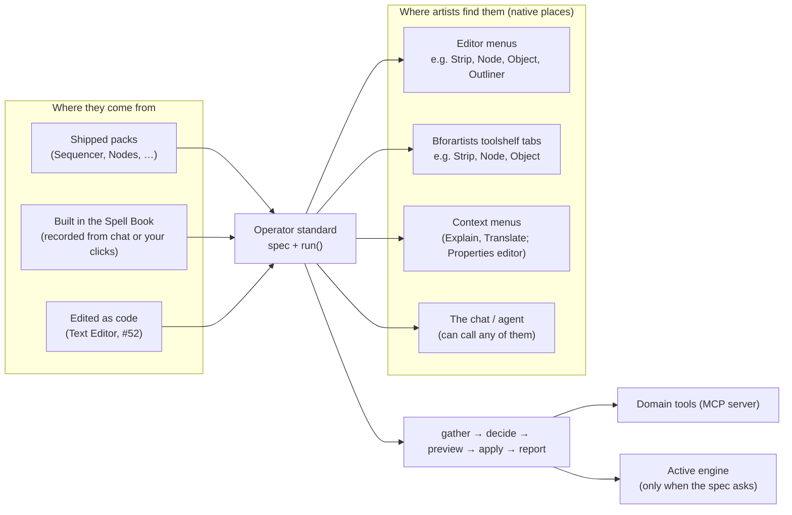
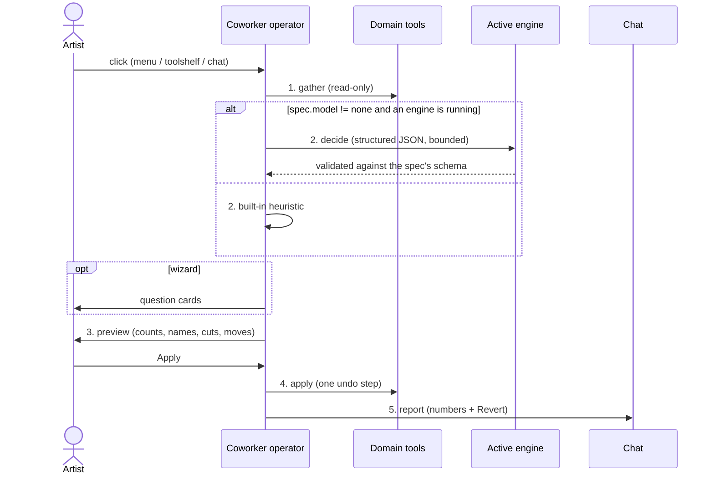
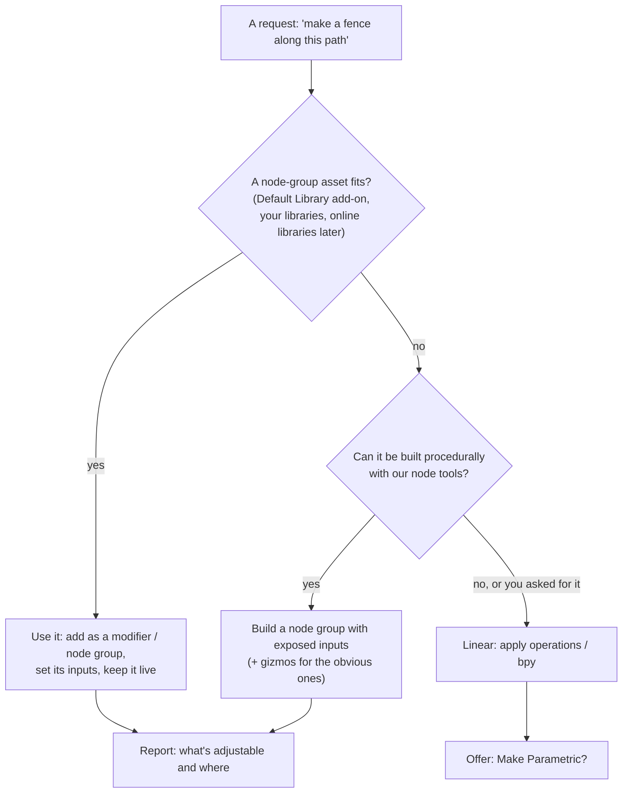
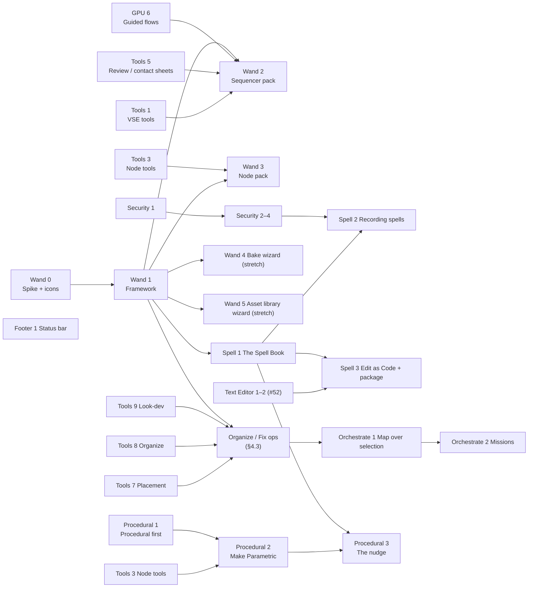

# Tier 4m — Coworker operators (wand icon) + the tasks around them (review document)

**Status**: 📝 For review, revision 3 (2026-10-21: Spell Book, creative Sequencer edit, procedural first, the four workflows). Replaces the
"quick prompt menu" idea. Tasks: **Wand 0–5, Spell 1–3** (were "Magic 0–7"), **Tools 7–9**,
**Orchestrate 1–2**, **Footer 1**, **Security 1–5**. Explain (#290) and Translate (#42)
are this same kind of operator and are in progress with another agent; they become the
first members of the standard rather than being re-planned here.

**In one sentence**: Coworker adds ordinary-looking Blender operators — conventional
names and tooltips, a **wand badge** on a familiar icon — in the **same menus and
toolshelf panels where the native operators of that kind already live**. Each one turns
a chore (remove silences, vertical video, tidy and explain a node tree, organize the
scene, bake texture sets, prepare an asset library) into one click with a preview and
one undo. Mostly tested code; the active engine is asked only for the judgment calls.

## Decisions from review (2026-10-21)

| # | Question | Decision |
|---|---|---|
| 1 | Brand name | **No "Magic" word.** Conventional operator names and tooltips; the **wand badge** on the icon is the only mark (the Coworker uses a wizard hat, so the wand fits) |
| 2 | Placement | **Native contextual locations**, like Smart Mesh Blend: next to related native operators in the editor's menus and Bforartists toolshelf tabs. A dedicated panel only for **making** new operators (the Spell Book) |
| 3 | Which model decides | **The active engine** (simpler setup, no second model in RAM) |
| 4 | Order | **Sequencer pack first, then the Node pack**; both in this release |
| 5 | Icons | **Self-contained** SVG + PNG in the add-on (works in plain Blender and can be sold standalone); offering them to Bforartists is a later option |
| 6 | Toolshelf buttons (2026-10-21) | **Icon buttons in Bforartists' tabbed toolshelf, never a dropdown.** Confirmed possible add-on-side (§3.3). Plain Blender has no tabbed toolshelf: menus only. Migrating the icons into Bforartists itself → **Tier 5**, after the tools are built |
| 7 | Convert to Vertical | **Sequencer > View** (not *Strip*, which is per-strip) |
| 8 | Recorded operators | **Per user** (§5) |
| 9 | Building them | A dedicated **Spell Book** (renamed from "Vault": a vault stores, a spell book *runs*) to build and run **spells** — your own operators and workflows: record, pick icon and name, **publish** into Bforartists' collapsible toolshelf panels (§5). Replay never needs the model |
| 10 | Wizard workflows | Some jobs are neither scriptable nor purely procedural: they need *looking at the material* and proposing (e.g. cutting footage). These are **wizard spells**: tools + the engine's eyes + your choices, shipped in the Spell Book and placed natively (§4.1) |
| 11 | Procedural first | Prefer node-group assets (Bforartists Default Library add-on, your libraries, later the online libraries) and parametric results; go linear only when asked (master §0.0) |
| 12 | Quick prompts (#300) | Kept, as the lightest spell: a **prompt spell** whose one step sends a prompt to the chat; shown under the sidebar chat and in the Coworker editor's toolshelf |

---

## 1. Why operators, not canned prompts

| Option | Problem | Verdict |
|---|---|---|
| Prompt library (canned prompts in a menu) | Slow, inconsistent on 7–14B models, no preview, no guaranteed undo, tokens spent on chores | ❌ |
| No quick system | Loses the biggest day-to-day win | ❌ |
| Macro recorder only | Nothing out of the box; recordings break when names/counts change | Part of the answer |
| **Operator standard + three sources** (shipped, recorded, written) | Needs a small framework first (Wand 1) | ✅ |

The model is a **component inside** an operator, not the operator. Explain and
Translate already work this way: a native-feeling entry in a context menu, a bounded
question to the engine, a result applied or shown.

---

## 2. The big picture



**Fit with Tier 4**: tool first, model optional (master §0.2). Operators reuse the
domain tools (every engine can call them), question cards for wizards (Chat 5, GPU 6),
one undo per run (Engine 6), the active engine for decisions (engine seam), and the chat
for a short report with Revert.

---

## 3. The standard (Wand 1)

### 3.1 Spec — one per operator

```python
# addon/bfa_coworker/wand/packs/sequencer.py
SPEC = OperatorSpec(
    id="sequencer.remove_silences",            # bl_idname "coworker.sequencer_remove_silences"
    label="Remove Silences",                   # conventional name, no brand
    description="Cut quiet parts out of the selected sound strips and close the gaps",
    icon="SPEAKER",                            # base icon; the wand badge is added
    places=[                                   # where native operators of this kind live
        Place.menu("SEQUENCER_MT_strip", after="sequencer.split"),
        Place.toolshelf("SEQUENCE_EDITOR", category="Strip", panel="Split"),  # Bforartists
    ],
    kind="tool",                               # tool | macro | hybrid | wizard
    model="none",                              # none | small (one bounded call) | full (agent turn)
    scope="selection",
    preview=True,
    params=[Param("threshold_db", -40.0), Param("min_silence_s", 0.4), Param("padding_s", 0.08)],
)
```

| Field | Meaning |
|---|---|
| `places` | Native menus and Bforartists toolshelf panels to append to; a context menu only when that's the native place (Explain, Translate, Properties editor) |
| `kind` | **tool** deterministic · **macro** recorded replay · **hybrid** code + one engine decision · **wizard** question cards around tools |
| `model` | `none` works with no engine running · `small` one short structured call to the **active engine** · `full` an agent turn |
| `poll` | Greyed out when the context doesn't fit (no sound strip selected…) |

### 3.2 Run pipeline



A bad engine answer falls back to the heuristic; nothing is ever half-applied.

### 3.3 Icons — self-contained (Wand 0/1)

- **Set**: each operator's icon = a familiar base glyph + a small **wand badge** in the
  bottom-right corner. Shipped as **SVG sources + PNG renders** (32/64 px, light and dark
  variants) in `addon/bfa_coworker/icons/wand/`, loaded with `bpy.utils.previews` and
  drawn with `icon_value`. Works in plain Blender; no dependency on Bforartists icons.
- **Base glyphs**: drawn by us, matching the Blender/Bforartists icon style (flat,
  2-px strokes, theme-neutral), so they sit well in both apps. Bforartists' own icons
  are GPL (compatible) but we keep the add-on self-contained; offering the badge set to
  Bforartists later is optional.
- **Drawing — no dropdown**: menus use `layout.operator(…, icon_value=…)`. In Bforartists'
  tabbed toolshelf the buttons are the **same square icon buttons** as the native ones
  (text buttons when the shelf is wide). Checked in Bforartists' source
  (`space_toolsystem_common.py`): `draw_entries` → `draw_icon_buttons` only calls
  `entry.poll` and `entry.draw(row, as_icon=True)`, with no type check, and any panel can
  pass `icon_value`. Bforartists' own `OperatorEntry` takes icon *names* only, so Wand 1
  ships a small `CoworkerEntry` with the same two members that draws with `icon_value`.
  Nothing in Bforartists has to change.
- **Plain Blender**: no tabbed toolshelf, so operators appear in menus only (the menu
  icons still show the badge).
- **Tier 5 (logged)**: migrate the icon set into Bforartists so the operators can use
  native icon names there (faster drawing, theme-aware), keeping the add-on's own copies
  for plain Blender.
- **Build**: `_misc/build_icons.py` renders the SVGs to PNG (no Blender needed) and a
  test checks every spec's icon exists.

### 3.4 Placement rules

| Situation | Where | Example |
|---|---|---|
| A native menu holds operators of this kind | Append there, next to the related native operator | *Strip > Remove Silences* under *Split*; *Node > Tidy & Explain* near *Frame* |
| Bforartists tabbed toolshelf has a matching tab/panel | Add to that panel (Bforartists `ToolsystemPanel` conventions, poll on `show_toolshelf_tabs`) | *Strip* tab, next to *Split*; *Node* tab, *Frame Tools* panel |
| The native place is a context menu | Context menu | Explain, Translate; Properties editor |
| Making new operators | **One dedicated panel: the Spell Book** (Coworker editor sidebar) + *Save as Spell* on chat replies and *Add to Spell Book* on right-click | Spell 1–3 |
| Hotkeys | None by default | Users bind their own |

No "Coworker" tab and no extra header menu: the operators should feel built in.

---

## 4. Packs — Sequencer first, then Nodes

### 4.1 Sequencer pack (Wand 2, first)

The headline is a **wizard spell that edits with you**, not a template you adjust.

**Edit from Footage…** (*Sequencer > View* and the Spell Book) · wizard / full
1. **Look**: sample frames from each clip (contact sheets, one image per clip), read the
   audio (loudness, silences, beats) and, when available, a transcript.
2. **Propose**: the engine sees the material and proposes an edit: which takes to keep,
   cut points (on silences, beats, action), order, and for vertical output a **reframe per
   shot** (subject-aware: follow the person, punch in on detail, split-screen two
   speakers) — creative choices, explained in one line each.
3. **You choose** with question cards: pace (tight / relaxed), length, format (16:9, 9:16,
   1:1), keep the B-roll?, music on the beat?
4. **Build**: cuts and order through the VSE tools; reframes as a small **compositor node
   group per shot** (crop, scale, pan/zoom keyframes) or strip transforms, so every choice
   stays editable afterwards; markers name each decision.
5. **Review**: plays the proposal; *Accept*, *Try another take on shot 3*, or *Revert* (one
   undo for the whole edit).

| Operator | Place | Kind / model | How |
|---|---|---|---|
| **Edit from Footage…** | *Sequencer > View*; Spell Book | wizard / full | As above: look → propose → choose → build → review |
| **Reframe for Vertical…** | *Sequencer > View* | wizard / small–full | The reframe half of the above for an existing edit: per-shot subject-aware crops as compositor node groups; centre crop with no engine |
| **Remove Silences** | *Strip* menu, Bforartists *Strip* tab | tool / none | Quiet ranges from the samples (threshold, min length, padding) → split, remove, close gaps |
| **Subtitles from Text** | *Add* menu | tool / none (small with a transcript) | Text lines + timings → text strips |
| **Assemble Timeline from Scenes** | *Add* menu | tool / none | Scene strips in shot order with handles |
| **Export Review Video** | Bforartists *Sequencer > Export*; *View* in Blender | tool / none | Fast preview render with burned-in shot names |

### 4.2 Node pack (Wand 3, second)

| Operator | Place | Kind / model | How |
|---|---|---|---|
| **Tidy & Explain Tree** | *Node* menu, Bforartists *Node* tab (*Frame Tools*) | hybrid / small | Gather nodes/links → the engine groups them by purpose and writes a label + short note per group → frames, aligned columns, notes (5.3 node notes API to verify in Wand 0) |
| **Frame Selected by Purpose** | same | hybrid / small | As above for the selection only |
| **Explain This Tree** | (Explain, #290) | — | Covered by the Explain operator |

### 4.3 Other packs (stretch or Tier 5)

| Operator | Place | Kind | Tier |
|---|---|---|---|
| **Organize into Collections**, **Rename to Convention**, **Clean Up File** | *Outliner* context/header, *Object* menu | hybrid / tool | Release (with Tools 8) |
| **Drop to Floor**, **Align / Distribute**, **Fix Common Problems**, **Frame Camera** | *Object > Snap / Transform*, Bforartists *Object* tab | tool | Release (with Tools 7, 9) |
| **Bake Texture Sets…** (wizard) | *Object > Bake* area, *Render* properties | wizard / small | Stretch (Wand 4) |
| **Prepare Assets for a Library…** (wizard: thumbnails, location, author, catalogs) | *Asset Browser* menu, *File* | wizard / small | Stretch (Wand 5) |
| **Block Out Scene…** (description → coloured greybox in its own collection; rebuild/clear) | *Add* menu | hybrid / full | Tier 5 |
| **Check Asset Quality**, **Make LODs**, **Export for Unity/Unreal/Godot** | *Object*, *File > Export* | tool | Tier 5 (Skills 7 first) |
| **Time of Day…**, **Weather…** | *World* properties | wizard | Tier 5 |
| **Stress-Test Poses**, **Add Face Shape Set** | *Armature / Shape Keys* | tool | Tier 5 |

---

### 4.4 Procedural first — and promoting results to assets

Rule (master §0.0): **prefer procedural, go linear only when asked.**



- **Finding assets**: `find_procedural_asset(intent)` ranks node groups from the enabled
  asset libraries by name, tags, catalog and description (`search_assets` exists; this adds
  intent matching and reads each group's inputs). Bforartists' **Default Library** add-on
  is the first source; online libraries plug in later.
- **Make Parametric** (*Object* menu, Bforartists *Object* tab; also offered after a chat
  build): turns something built linearly into a Geometry Nodes group — chosen values
  become inputs, native gizmo nodes for length/count/radius, marked as an asset in your
  library. Deterministic node building; the engine only picks which values become inputs.
- **The nudge** (a CHOYA rule): after a third similar request — "Save this as a spell?";
  after a procedural-looking build — "Want sliders for this?". One suggestion button,
  easy to ignore, never a pop-up.

## 5. Making your own — the Spell Book (Spell 1, 2, 3)

### 5.1 What the Spell Book is

The Spell Book is **the one dedicated Coworker panel**: where your own operators are built,
kept and published. Everything else stays in native places.

- **Lives** in the Coworker editor's sidebar (*Spell Book* panel), with a *Save as Spell* button
  on chat replies and an *Add to Spell Book* entry in every button's right-click menu.
- **Holds three kinds of spells**: **shipped wizard spells** (Edit from Footage, Bake,
  Prepare Assets…), **prompt spells** (one step: send a prompt to the chat — the quick
  prompts of #300, shown under each sidebar chat and in the Coworker editor's toolshelf),
  and **your own** spells.
- **Keeps** your own spells per user (your Blender user folder; the same in every .blend;
  survives add-on updates). Each one is a small folder: `operator.toml` (name, tooltip,
  icon, place, run mode, fields) + `steps.json` (the steps). Data, not a Python script.
- **Publishes** each operator into the place you pick: a collapsible panel ("▾") in a
  Bforartists toolshelf tab — an existing tab such as *Object*, or your own tab such as
  *My Tools* — as a square icon button, and/or a native menu. Plain Blender: menus only.
- **Replays with no model.** The model may help **once, while saving** (name it, suggest
  an icon, turn hard-coded names into "the selection", label each step), never while
  running.

```
 Coworker editor ▸ sidebar ▸ Spell Book
 ┌──────────────────────────────────────────────────┐
 │ Spell Book                             [+] [⏺ Record] │
 │ ┌──────────────────────────────────────────────┐ │
 │ │ [💡] Rename Lights by Colour    Each ▾     ⋮ │ │ ← click the icon to change it,
 │ │ [🎞] Trim Intro + Fade           All  ▾     ⋮ │ │   double-click the name to rename,
 │ │ [📁] Sort Props into Kits        All  ▾     ⋮ │ │   run mode: All at once / Each selected
 │ └──────────────────────────────────────────────┘ │
 │ Steps of "Rename Lights by Colour"               │
 │  ☑ 1 Read the selection                 (tool)   │ ← tick to switch a step off,
 │  ☑ 2 Rename by light colour, warm first (tool)   │   drag to reorder,
 │  ☐ 3 Colour-tag the collection          (tool)   │   double-click to edit
 │  [+ Last Action] [+ From Chat] [+ Repeat/Wait…]  │
 │ Fields: Warm first ☑                              │
 │ Place: Toolshelf ▸ Object ▸ ▾ My Tools · Menu: Object │
 │ [▶ Test] [Publish] [Edit as Code] [Export…]      │
 └──────────────────────────────────────────────────┘
   (every icon carries the small wand badge)

 Published (Bforartists toolshelf, narrow):   │Object│My Tools│
                                              ▾ My Tools
                                               [💡][🎞][📁]
```

### 5.2 Where steps come from (Spell 2)

| Source | How | Robustness |
|---|---|---|
| **From a chat turn** (*Save as Spell* on a reply) | The turn's tool calls + arguments, already in the Workshop events | High: tools take "the selection" and names, not context |
| **Record what you do** (*⏺ Record* … *Stop*) | The operators you run while recording, with their settings | Medium: raw operators depend on context; the save step offers to swap known operators for tools and names for "the selection" |
| **Add Last Action** | Your most recent operator as one step | Medium |
| **Add to Spell Book** (right-click any button or property) | That button's operator, or that property's new value, as a step | Medium |
| **Control steps** | *Repeat N times*, *For each selected*, *Wait*, *After render completes*, *Ask me* (a field at run time), *Run text block* | — |
| **Edit as Code** (Spell 3) | Opens it in the Text Editor as a readable script + spec (#52 tech-artist path) | You own it |

### 5.3 Saving and replay

```mermaid
sequenceDiagram
    actor You
    participant Spell Book
    participant Eng as Active engine (optional, once)
    participant Folder as Your user folder
    participant Shelf as Toolshelf / menus
    You->>Spell Book: Save as Spell (from a reply) or Record … Stop
    Spell Book->>Eng: (optional) name, icon, which values are "the selection", step labels
    Eng-->>Spell Book: suggestions (you confirm or edit)
    You->>Spell Book: icon, name, run mode, fields, place → Publish
    Spell Book->>Folder: operator.toml + steps.json
    Spell Book->>Shelf: register: the ▾ My Tools panel gets a new icon button
    Note over Shelf: Click → steps run through the tool layer, no model;<br/>preview → apply as one undo → short report in the chat
```

| Question | Answer |
|---|---|
| Several objects? | **Run mode**: *All at once* (the steps see the whole selection) or *Each selected* (once per object, still one undo) |
| A step used generated code? | Kept as a code step, badged; asks once before its first run (Security 5) |
| Different names next time? | Values marked as fields or "the selection" are filled at run time; the operator greys out when the context doesn't fit |
| Share? | *Export…* writes a small zip; *Import* shows its source and asks once. Several can be packaged as an extension (Spell 3, reuses #86) |
| In the .blend? | No, per user (your decision). A "keep a copy in this file" option can come later |
| Secrets? | Never recorded (Security 2) |

---

## 6. Ideas taken from outside projects (clean room: needs only)

Read 2026-10-21: the user guide and UI style guide of the Scenario Blender plugin
(GPL-3.0) and the public skill catalogue reviewed for lane S (MIT). Recorded as needs and
our own designs; no code or text consulted while implementing (4b §4).

| Need observed | Our design |
|---|---|
| Turn a description into a quick greybox that can be rebuilt without touching the rest of the scene | *Block Out Scene…* builds into its own collection; rebuild/clear only touch that collection (Tier 5) |
| Apply a generated or computed result only to an explicitly chosen target | Every operator's apply step names its target in the preview (strip, material slot, collection) |
| Multi-step production (shots → timeline → review → export) with a confirmation per step | Sequencer pack: Assemble Timeline, Export Review Video; Orchestrate 2 missions confirm per step |
| Show the cost before a heavy run | Preview shows an engine-call estimate when `model != none` on a Remote engine |
| Agents finish without evidence; asset QA, baking, LODs, export presets, rig stress tests | Tools 8, Skills 7 and the Tier 5 packs in §4.3 |
| Downloads verified by checksum | Security 5 |
| Local server limited to loopback with origin checks; code execution off by default | Security 1 audits our bridge/MCP against this |
| Say plainly what Blender can't do instead of faking it | UI rule for our panels and the GPU chat |
| (ActionRecorder, GPL-3, README + user docs only) Turn repeated work into one click: record steps, toggle/reorder/edit them, pick an icon and label, run on all selected or each selected, add loops and waits, add any button from its right-click menu, keep actions per file or shared | **The Spell Book** (§5): the same everyday model, but steps are **tools** where possible (robust to names and context), the model helps once at save time, results publish as native toolshelf icon buttons, per user |

---

## 7. Task cards



### Wand 0 — Spike + icon set (S)
- **What**: one operator end to end (Remove Silences): appended to *Strip* menu and the
  Bforartists *Strip* tab, a badged icon via `icon_value`, the pipeline with a preview.
  Draw the first 8 icons (SVG → PNG) and the badge. Probe the 5.3 sound-sample API and
  node notes.
- **Why**: proves native placement and icon look in both themes before building the
  framework; de-risks the two packs.
- **Done when**: screenshots in Bforartists and plain Blender 5.3; spec fields frozen.

### Wand 1 — Framework (M)
- **What**: `OperatorSpec`, registry (shipped + user folder), operator factory, placement
  (menus, Bforartists toolshelf, context menus), icon loading, the 5-stage pipeline with
  schema-checked decisions on the **active engine** and a heuristic fallback, preview,
  one undo, chat report, `run_operator` MCP tool so the agent can call them.
- **Done when**: a test pack (one of each kind) runs from its menu, its toolshelf panel
  and the chat; bpy-free tests for registry and pipeline. Explain/Translate can adopt the
  spec without behaviour change.

### Wand 2 — Sequencer pack (M→L) · **first**
- **What**: **Edit from Footage…** (wizard spell: look → propose → choose → build → review),
  **Reframe for Vertical…** (per-shot compositor node groups), Remove Silences, Subtitles
  from Text, Assemble Timeline from Scenes, Export Review Video.
- **Why**: the least-served domain, and the clearest case of "not scriptable, not purely
  procedural, needs eyes": the engine looks at the footage and proposes creative cuts and
  reframes instead of the artist adjusting a template.
- **How it fits**: Tools 1 (VSE tools) + Tools 5 (contact sheets) for looking; question
  cards (GPU 6) for choices; compositor node groups keep reframes editable; one undo.
- **Done when**: three talking-head clips become a 30-second vertical edit with cuts on
  pauses and per-shot reframes the artist can tweak; Remove Silences and the centre-crop
  reframe also work with no engine.

### Wand 3 — Node pack (M) · **second**
- **What**: Tidy & Explain Tree, Frame Selected by Purpose.
- **Done when**: a 60-node shader tree is framed into labelled groups with notes on a 7B
  local model; layout and frames revert in one undo.

### Wand 4 — Bake wizard (M, stretch) · Wand 5 — Asset library wizard (M, stretch)
- As §4.3. Done when: two material sets bake to a folder and a working material from
  three answered cards; 10 props become a library with thumbnails, catalogs and author.

### Spell 1 — The Spell Book (M)
- **What**: the Spell Book panel (§5.1): list (icon picker, rename, run mode), steps (toggle,
  reorder, edit), fields, place picker (a Bforartists toolshelf tab + collapsible panel,
  your own tab, native menus), Test, Publish, Export/Import; per-user storage; your
  toolshelf panels registered at start.
- **Why**: one home for user-made tools; publishing straight into the toolshelf makes them
  feel built in.
- **Done when**: an operator built in the Spell Book shows as an icon button in *▾ My Tools*
  after a restart, runs with no engine, one undo.

### Spell 2 — Recording spells (M)
- **What**: Save as Spell from a chat reply; ⏺ Record … Stop of your own actions; Add Last
  Action; *Add to Spell Book* in every button's right-click menu; control steps (repeat, each
  selected, wait, after render, ask me, run text block); the optional one-time model pass
  at save.
- **Done when**: the same task, recorded once from a chat turn and once from manual
  clicks, replays on a new selection with no engine.

### Spell 3 — Edit as Code + package (M, after Text Editor 1–2)
- **What**: open a Spell Book operator in the Text Editor as a readable script + spec; write one
  from a template with the Coworker's help (#52); package several as an extension.
- **Done when**: an edited operator republishes from the Text Editor; a set ships as a zip.

### Tools 7 — Placement (S) · Tools 8 — Organize (M) · Tools 9 — Look-dev & fix (M)
- As on the board; they are the engines under the Organize/Fix operators (§4.3) and the
  validator pass.

### Orchestrate 1 — Map over selection (M) · Orchestrate 2 — Missions with evidence (M)
- Map one instruction or operator over the selection with one undo; plan steps with
  their own checkpoints ending in an audit report.

### Footer 1 — Agent status in the status bar (S)
- Engine icon + state (*Thinking · step 3/7 · Waiting for you*) in the global status bar,
  pulse while an approval waits, click focuses the chat; reads `chat_status` only.

### Security 1–5
| Task | What | Done when |
|---|---|---|
| 1 Threat model (S) | Bridge, MCP (loopback + origin checks), ACP processes, harness configs with the token, downloads, extension repo, user operator folders | `_misc/security_model.md` reviewed |
| 2 Secrets (S) | No keys/tokens in logs, exports, Copy Error, recorded operators | Grep after a session finds none |
| 3 Code & file guard (M) | Writes outside project/temp ask; network from generated code flagged; repeat guard on every engine | A write to a system folder asks |
| 4 Untrusted content (S) | Scene/file/download text is data, never instructions | A text block saying "delete everything" changes nothing |
| 5 Supply chain + shared operators (S) | Hash-check downloads; shared operator packs show their source and ask once | Tampered download and unknown pack both stopped |

---

### Procedural 1 — Procedural first (S)
- **What**: the rule in the system prompt and skills; `find_procedural_asset(intent)`;
  node-group inputs read so the agent sets them instead of rebuilding.
- **Why**: keeps work editable and reusable — the technical-artist habit, out of the box.
- **Done when**: with the Default Library add-on enabled, "a stone wall along this curve"
  uses a library node group with its inputs set, not hand-made meshes.

### Procedural 2 — Make Parametric (M, after Tools 3)
- **What**: §4.4: linear result → node-group asset with inputs and gizmos, in your library.
- **Done when**: a chat-built fence becomes an asset with Length / Post Spacing / Height
  inputs and a length gizmo; dragging it from the Asset Browser works.

### Procedural 3 — The nudge (S)
- **What**: two CHOYA suggestions: *Save as Spell?* on repeats, *Make Parametric?* after a
  build. Off with one toggle.
- **Done when**: shown at most once per pattern per session; never interrupts a turn.

## 8. Still open

1. Should a recorded operator be able to ask the engine at replay time (a *hybrid*
   recording), or stay model-free only? Proposal: model-free by default; "ask the
   engine for …" as an explicit step type later.
