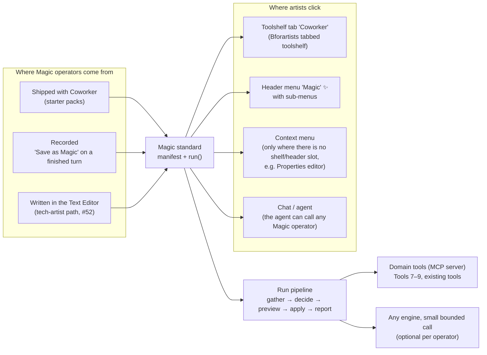
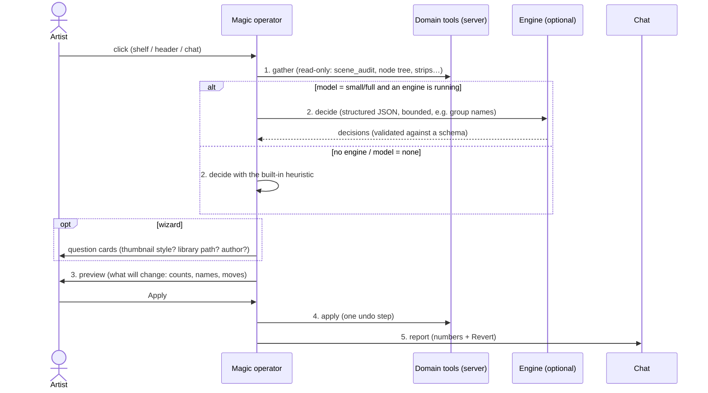
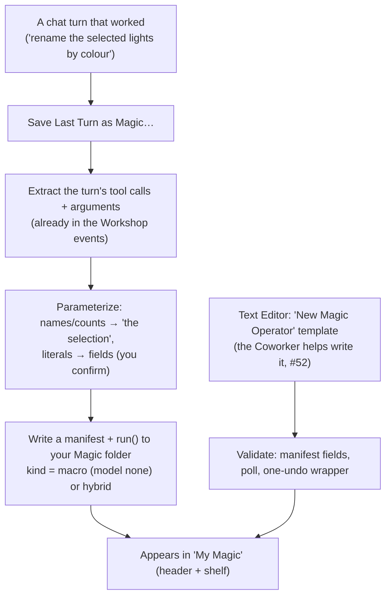
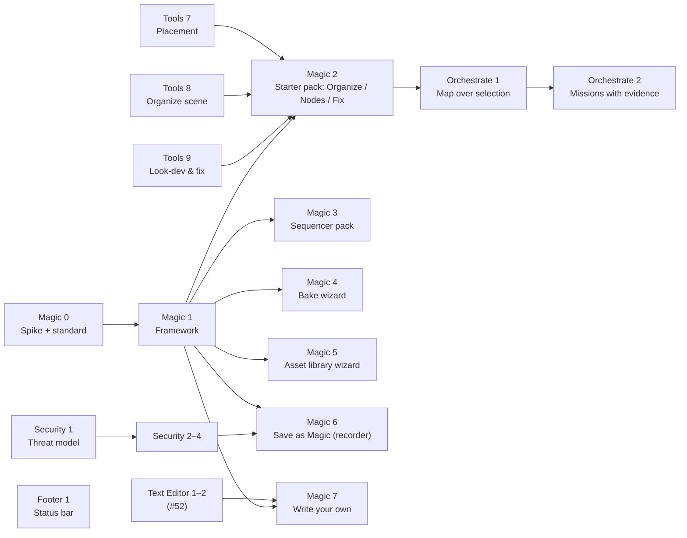

# Tier 4m — Magic operators + the tasks around them (review document)

**Status**: 📝 For review (2026-10-20). Replaces the "quick prompt menu" idea (Quick 1/2,
Wizard 1) on the board. Covers the tasks I'm planning: **Magic 0–7**, **Tools 7–9**,
**Orchestrate 1–2**, **Footer 1**, **Security 1–5**. The 🟡 tasks (Explain, Translate,
sidebars) are in progress with another agent and are only referenced here.

**In one sentence**: a small **standard for Coworker "Magic" operators** (icon with a
magic-wand badge, placed in the editor's toolshelf tab and header menu) that turns
drudgery like *organize the scene*, *tidy and explain this node tree*, *remove silences*,
*bake all texture sets* or *prepare an asset library* into one-click, previewable,
one-undo operations. Each one is mostly deterministic code, with a small, bounded LLM
step only where context matters. Artists get it built into the interface; tech artists
can **record** or **write** their own with the same standard.

---

## 1. Why not a prompt library, and why not nothing

| Option | What it gives | Problem | Verdict |
|---|---|---|---|
| **A. Prompt library** (my first idea: a quick menu that sends canned prompts) | Fast to build | It's just text sent to the model: slow, inconsistent on 7–14B models, no preview, no guaranteed undo, burns tokens for chores that never need intelligence | ❌ Dropped |
| **B. No quick system** | Nothing to maintain | Loses the biggest day-to-day win for artists; everything stays behind typing | ❌ |
| **C. Macro recorder only** | Users capture their own repeats | Cold start (nothing out of the box); recordings break when context changes (names, counts) | Part of the answer |
| **D. Magic operator standard + three sources** (shipped, recorded, written) | Real operators: icons, poll, preview, one undo, run with or without a model. Out-of-the-box value **and** user-made tooling through the same door | Needs a framework first (Magic 1) | ✅ **Recommended** |

The key shift: **the model is a component inside an operator**, not the operator. Most
of each Magic operator is code we test; the model fills in only the judgment calls
(what to call a collection, how to group nodes, what the tree does) as small,
structured answers.

---

## 2. The big picture



**How it fits Tier 4**: Magic operators are the "tool first, model optional" principle
(master §0.2) made visible. They reuse the domain tools (every engine can call them),
the question cards (wizards = Chat 5 cards in GPU 6), Revert / one-undo (Engine 6) and
the engine seam (any engine answers the small decision call). Their output lands in the
chat as a short report, so the conversation knows what happened.

---

## 3. The Magic standard (Magic 1)

### 3.1 Manifest — one per operator

```python
# addon/bfa_coworker/magic/packs/outliner.py  (shipped)  or  <user magic dir>/my_op.py
MAGIC = MagicSpec(
    id="outliner.organize_contextual",          # stable id → bl_idname "magic.outliner_organize_contextual"
    label="Organize into Collections",
    description="Sort the scene into collections by what things are, with a preview",
    editors={"OUTLINER", "VIEW_3D"},           # where it appears
    group="Organize",                            # shelf panel / header sub-menu
    icon="OUTLINER_COLLECTION",                  # any Bforartists/Blender icon; gets the wand badge
    kind="hybrid",                               # tool | macro | hybrid | wizard
    model="small",                               # none | small | full  (what it needs from an engine)
    scope="selection_or_scene",                  # what it acts on by default
    preview=True,                                # dry run shown before apply
    params=[Param("rules", enum=["by type", "by name prefix", "by material", "smart (AI)"])],
)
```

| Field | Meaning | Why |
|---|---|---|
| `kind` | **tool**: deterministic only. **macro**: replay of recorded steps. **hybrid**: code + one bounded model decision. **wizard**: question cards around tools | Tells the UI what to expect (instant vs needs an engine vs asks questions) |
| `model` | `none` runs offline; `small` = one short structured call; `full` = an agent turn | A `none` operator works with no engine running; `small` stays fast on 7B |
| `scope` | selection / active collection / editor context / whole file | "Selection is the scope" by default |
| `preview` | dry-run report first | Trust; nothing changes until you confirm |
| `poll` (optional fn) | when it's available | Greyed out instead of failing |

### 3.2 Run pipeline (every Magic operator)



Rules: the **decide** step returns JSON validated against the operator's schema (bad
answer → fall back to the heuristic, never half-apply). **Apply** is one undo step
(Engine 6 already does this per turn). The **report** is a normal chat message with
Revert, so the agent can follow up ("now colour-tag them").

### 3.3 Icons — Bforartists icons with a magic badge

- Base icon: any Bforartists/Blender icon name, so it looks native in both themes.
- **Badge**: a small wand/sparkle in the corner marks "this is Coworker magic". Built at
  build time: our exported full-colour Bforartists icons (already used by the GPU chat) +
  a badge overlay → PNGs in a `bpy.utils.previews` collection → drawn with `icon_value`.
- Bforartists' `OperatorEntry` takes icon **names** only, so Magic 1 adds a tiny
  `MagicEntry` with the same `draw(layout, as_icon=…)` contract that uses `icon_value`.
  It drops into Bforartists' `draw_entries` icon-grid / text-button switch unchanged.
- Fallback with no badge image: the plain icon name (still native).

### 3.4 Placement rules

| Editor has… | Where Magic goes | How |
|---|---|---|
| **Bforartists tabbed toolshelf** (3D View, Node editors, Sequencer, Image/UV, Clip…) | A **"Coworker" tab** in the toolshelf, one panel per group (*Organize · Build · Fix · Explain*), like Bforartists' *Object → Snap* panel | Subclass Bforartists' panel pattern: `bl_region_type='TOOLS'`, `bl_category="Coworker"`, poll on `space.show_toolshelf_tabs`, `bl_options={'HIDE_BG'}`, entries drawn with `draw_entries` (icon grid when narrow, text buttons when wide) |
| A header (every editor) | A **"Magic" ✨ menu** in the header with sub-menus per group | `<EDITOR>_HT_header.append(...)` or the editor's menu bar; one menu, never scattered items |
| Neither a shelf nor a useful header slot (Properties editor) | A **Coworker ▸** sub-menu in the context menu | Last resort only |
| Blender (no tabbed toolshelf) | Header menu + a "Magic" panel in the Coworker sidebar tab | Same entries, same code |
| Hotkeys | None by default (master §6.4) | Users can bind any Magic operator themselves |

Mock-ups:

```
 Toolshelf (Bforartists, narrow = icon grid)      Toolshelf (wide = text buttons)
 ┌──────────────────────────┐                    ┌──────────────────────────────────┐
 │ Coworker │ Object │ ...   │ ← tabs             │ ▾ Organize                        │
 │ ▾ Organize               │                    │   ✨📁 Organize into Collections  │
 │  [✨📁][✨🏷][✨🧹]        │                    │   ✨🏷  Rename to Convention       │
 │ ▾ Fix                    │                    │   ✨🧹 Clean Up File               │
 │  [✨⬇][✨↔][✨🔧]          │                    │ ▾ Fix                             │
 │ ▾ Explain                │                    │   ✨⬇  Drop to Floor               │
 │  [✨❓]                   │                    │   ✨🔧 Fix Common Problems         │
 └──────────────────────────┘                    └──────────────────────────────────┘

 Header:  View  Select  Add  Node   ✨ Magic ▾
                                     ├ Organize ▸  Tidy & Explain Tree
                                     │             Group by Function
                                     ├ Build ▸     …
                                     ├ ───────────
                                     ├ My Magic ▸  (recorded / written by you)
                                     └ Save Last Turn as Magic…
```

---

## 4. Starter packs (what ships) — your examples first

| Editor | Magic operator | Kind / model | How it works (gather → decide → apply) | Task |
|---|---|---|---|---|
| Node editors | **Tidy & Explain Tree** | hybrid / small | gather the tree (nodes, links, positions) → model groups nodes by purpose and writes a one-line label + a short markdown note per group → apply: frames with labels, aligned columns, a comment/note per frame (5.3 node-editor text/markdown support to verify in Magic 0) | Magic 2 |
| Outliner / 3D View | **Organize into Collections** | hybrid / small (or none with a rule) | `scene_audit` → rules or the model proposes collection names from object names/types/materials → preview moves → apply moves + colour tags | Magic 2 (uses Tools 8) |
| Outliner | **Rename to Convention**, **Clean Up File** | tool / none | `batch_rename`, `cleanup` with preview | Magic 2 |
| Sequencer | **Remove Silences** | tool / none (+ small for "keep breaths?") | read the sound strip's samples (numpy over `aud` / sound data) → silence ranges by threshold + min length → preview cut list → split + remove + close gaps (ripple) | Magic 3 |
| Sequencer | **Convert to Vertical (9:16)** | hybrid / small | set render size → per strip: transform/scale to fill, optional crop centre → model suggests a focus (left/centre/right) per shot from a thumbnail when asked | Magic 3 |
| Sequencer | **Subtitles from Text** | tool / none | text block lines + timings → text strips | Magic 3 |
| 3D View | **Set Up & Bake Texture Sets** | wizard / small | gather: high/low pairs by name (or ask), material sets → cards: maps (normal, AO, curvature, base colour), size, folder → create images, cage/extrusion, bake each set, save, wire into a material → report | Magic 4 |
| Asset Browser / File | **Prepare Assets for a Library** | wizard / small | gather candidates (objects, materials, node groups) → cards: *thumbnail style* (camera angle, background, lighting), *library location*, *author*, *catalogs* → mark as assets, generate thumbnails, assign catalogs, metadata (author, description written by the model), save to the library → report | Magic 5 |
| 3D View | Drop to Floor · Align / Distribute · Fix Common Problems · Frame Camera · Make Turntable | tool / none | Tools 7, Tools 9 | Magic 2 |
| Text Editor | **Make Operator from This Script** | hybrid / small | wraps the active script as a Magic operator manifest + `run()` → registers it | Magic 7 |

---

## 5. Making your own: recorder and Text Editor (Magic 6, Magic 7)



- **Recorder (Magic 6)**: the tool-call history of a turn is already recorded (Workshop
  events, Engine 3). "Save as Magic" turns it into a replayable macro **that needs no
  model to run**. Generated `execute_blender_code` snippets are kept as code steps; tool
  calls stay tool calls (more robust). You confirm which literals become parameters.
- **Text Editor (Magic 7)**: the tech-artist path from #52. A template with the manifest
  and `run()`, the Coworker helps write and test it, *Register* adds it to My Magic,
  *Package* turns a folder of Magic operators into an extension (reusing #86's builder).
- Both produce the **same standard**, so a recorded macro can be opened and refined in
  the Text Editor later.

---

## 6. Task cards



### Magic 0 — Spike + standard (S)
- **What**: prototype one Magic operator end to end in Bforartists 5.3: a "Coworker"
  toolshelf tab (Bforartists panel conventions), a header "Magic" menu, a badged icon via
  `icon_value`, and the 5-stage pipeline with a fake decision.
- **Why**: confirm the shelf/header placement looks native, that `draw_entries` works
  with our entries, how the 5.3 node editor stores frame text / markdown notes (Tidy &
  Explain), and how badges look in light/dark themes.
- **Done when**: screenshots in 3D View, Node editor and Sequencer; the manifest fields
  frozen; decisions recorded here.

### Magic 1 — Framework (M)
- **What**: `magic/` package: `MagicSpec`, registry (shipped packs + user folder), operator
  factory (one `bpy.types.Operator` per spec), placement (toolshelf panels, header menus,
  Properties context fallback, Blender fallback), badge icons, the run pipeline with
  schema-validated decisions and the heuristic fallback, preview dialog, one undo, chat
  report, `magic_run` MCP tool so the agent can call them too.
- **Why**: everything in §4–5 plugs into this; without it every chore is a one-off.
- **How it fits**: decide-step uses the engine seam; preview/questions use the Chat 5
  cards; one undo uses Engine 6; reports use chat_state.
- **Done when**: a test pack with one tool / hybrid / wizard / macro operator each runs
  from shelf, header and chat; bpy-free tests for the registry and pipeline.

### Magic 2 — Starter pack: Organize, Nodes, Fix (M)
- **What**: Organize into Collections, Rename to Convention, Clean Up File, Tidy &
  Explain Tree, Drop to Floor, Align/Distribute, Fix Common Problems, Frame Camera.
- **Why**: the most common drudgery across all artists; proves hybrid + tool kinds.
- **Done when**: each runs with no engine (heuristic) and with a 7B local model; preview
  matches apply; one undo each; the quick benchmark set is unaffected.

### Magic 3 — Sequencer pack (M)
- **What**: Remove Silences, Convert to Vertical, Subtitles from Text.
- **Why**: video editing is the least-served domain today and pure drudgery.
- **How**: silence detection from the sound strip's samples (threshold, min length,
  padding) — probe the 5.3 sound API in Magic 0; vertical = resolution + per-strip
  transform; Tools 1 (VSE tools) supplies reads/edits.
- **Done when**: a 2-minute talk clip loses its pauses with ripple edit in one undo; a
  16:9 edit becomes 9:16 with every strip filling the frame.

### Magic 4 — Bake wizard (M)
- **What**: Set Up & Bake Texture Sets as a wizard (pairs, maps, size, folder) → bake →
  wire a material.
- **Why**: one of the most error-prone manual workflows; high value for game artists.
- **Done when**: a high/low pair with two material sets bakes normal + AO + base colour
  into a folder and a working material, from three answered cards.

### Magic 5 — Asset library wizard (M)
- **What**: Prepare Assets for a Library: candidates → cards (thumbnail style, library
  location, author, catalogs) → mark, thumbnails, catalogs, metadata, save.
- **Why**: turning a project file into a reusable library is hours of clicking today.
- **Done when**: a file with 10 props becomes a library with thumbnails in the chosen
  style, catalogs and author, visible in the Asset Browser.

### Magic 6 — Save as Magic (recorder) (M)
- **What**: turn the last successful turn into a macro (§5), with a parameter review card.
- **Why**: users' own repeats without writing code; replay needs no model.
- **Done when**: "rename the selected lights by colour" recorded once, replayed on a
  different selection with no engine running.

### Magic 7 — Write your own in the Text Editor (M, after Text Editor 1–2)
- **What**: template, validator, Register, Package as extension.
- **Why**: the tech-artist path (#52): build pipeline tools quickly with Coworker's help.
- **Done when**: a user-written operator appears in My Magic and ships as an extension zip.

### Tools 7 — Placement & orientation (S)
- **What**: `place(on_top_of / next_to / inside, gap)`, `align`, `distribute`,
  `drop_to_floor`, reading world-space bounds.
- **Why**: models (even large ones) get bounding-box maths wrong (#219); placement is in
  almost every scene-building request.
- **Done when**: "put the lamp on the table, 5 cm from the edge" is right on a 7B model.

### Tools 8 — Organize my scene (M)
- **What**: `scene_audit`, `organize_scene(rules)`, `batch_rename`, `cleanup`,
  `relink_missing`, all with dry run.
- **Why**: the engine under Magic 2 and the validator pass (Orchestrate 2).
- **Done when**: a messy test scene is audited, sorted, renamed and cleaned; numbers before/after.

### Tools 9 — Look-dev & prep helpers (M)
- **What**: `frame_camera`, `make_turntable`, `material_from_folder`, `fix_common`.
- **Done when**: each runs from chat and as a Magic operator with a preview.

### Orchestrate 1 — Map over selection (M)
- **What**: one instruction or Magic operator applied per selected item with a progress
  row; stop or continue on error; one undo for the batch.
- **Why**: "do this to each of these" is the most common repeat; today it's one long
  fragile turn.
- **Done when**: 30 rocks get individual materials in one undo.

### Orchestrate 2 — Missions with evidence (M)
- **What**: each plan step gets a checkpoint (a failed step reverts only itself); the
  mission ends with a validator pass (`scene_audit` + mesh quality) and reports numbers.
- **Done when**: a 5-step mission with one failing step recovers and ends with an audit.

### Footer 1 — Agent status in the status bar (S)
- **What**: one item appended to Blender's global status bar
  (`STATUSBAR_HT_header`): engine icon + state (*Idle · Thinking · step 3/7 · Waiting
  for you*), a pulse while an approval waits; click focuses the chat. Toggle in
  Preferences.
- **Why**: you see what the agent is doing from any workspace without opening the chat;
  approvals stop going unnoticed. Replaces the per-viewport dot (Editors 5).
- **How**: draw reads `chat_status` only (no timers of its own); redraw on the existing
  status updates.
- **Done when**: status follows a turn in every workspace; an approval is visible with the
  chat closed.

### Security 1–5
| Task | What | Why | Done when |
|---|---|---|---|
| **1** Threat model (S) | One page: bridge, MCP HTTP, ACP agent processes, External Harness configs (they carry the token), downloads, the extension repo, Magic user folder | Magic operators and the recorder make running code easier; know the attack surface first | `_misc/security_model.md` reviewed; findings filed |
| **2** Secrets (S) | Keys/tokens never in logs, session exports, Copy Error, recorded macros; settings backup handles them separately | Recorded macros and logs get shared | Grep after a full session finds no secret |
| **3** Code & file guard (M) | Writes outside the project/temp ask first; network from generated code flagged; repeat guard on every engine | Magic + recorder replay code without a model watching | A write to a system folder asks |
| **4** Untrusted content (S) | Scene/file/download text is data, never instructions; risky steps right after reading it ask | Organize/explain read names and text the user didn't write | A text block saying "delete everything" changes nothing |
| **5** Supply chain + Magic packs (S) | Hash-check llama-server and deps; user Magic packs show their source and ask once before first run | Shared Magic packs are code from someone else | A tampered download and an unknown pack are both stopped |

---

## 7. Open questions for you

1. **Name**: "Magic" (menu + badge) — or "Coworker", "Assist", "Do it for me"?
2. **Tab vs. merge**: one "Coworker" toolshelf tab per editor, or Magic panels inside
   the existing Bforartists tabs (e.g. *Object → Organize*)?
3. **Default model use**: should hybrid operators use the active engine, or a dedicated
   small local model for decisions (fast, offline) when one is configured?
4. **Ship order**: Magic 2 (organize/nodes) first, or the Sequencer pack (Magic 3)?
5. **Bforartists upstream**: should the badge icons / `MagicEntry` go upstream to
   Bforartists so other add-ons can use the same convention?
