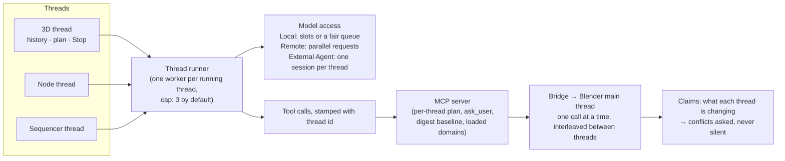
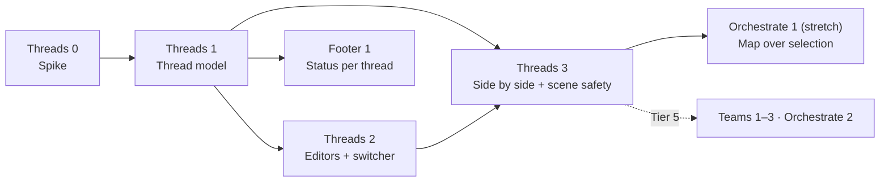

# Tier 4o — Orchestration layer: threads per editor, side by side (#71)

**Status**: 🚧 Threads 0–2c shipped in 1.1.42 (2026-11-10): one thread per editor, one turn at a time across threads,
chat tabs; History by file (#431) shipped in 1.1.43 (#462). **Threads 3** (#359) is 1.1.44, after #430 and the
Sequencer core, and starts with the §6 corrections.
Reviewed 2026-10-21; Threads 0 measured 2026-11-07 (§6). New tasks **Threads 0–3**; Footer 1 becomes
thread-aware; Orchestrate 2 and agent teams move to Tier 5 and are rebuilt on threads.
**Clean room**: our own design from the add-on's current code and Blender's own
behaviour (undo stack, main-thread execution); spike probes before code.

## 1. The problem

You build a scene in the 3D View, tidy a node group in the Node Editor and translate a
text strip in the Sequencer. Those are three separate trains of thought. Today they are
**one conversation**:

| Today (main @ b89d568) | Where | Effect |
|---|---|---|
| One conversation history | `agent_controller._agent_state.conversation_history` | The node question lands in the middle of the scene build; every turn carries the other jobs' context |
| One turn at a time | `run_conversation_turn` re-entrancy guard (`_agent_state.turn_active`) | The Sequencer job waits until the 3D build finishes |
| One Stop, one Queue | module-level `_stop_event`, `_message_queue` | Stop in the Node Editor stops the 3D build |
| One chat shown everywhere | `ui_chat._CHAT` (the chat being shown); every sidebar draws the same chat state | The Sequencer sidebar shows the 3D conversation |
| One plan, one pending question, one scene lock | Engine 6 tools, co-work scene lock | A question from one job blocks the others |

The sidebars (#298, #325) already tag each message with the editor it came from — the
seam is there; the state behind it is still single.

## 2. What a thread is

A **thread** is one conversation that can run **alongside the others**: its own history,
engine session, Stop, Queue, plan, pending question/approval, Workshop and status. It is
the same thing as a chat in the History panel (Chat 7) — a thread is simply a chat that is
*live* in an editor.

```
            ┌────────────── Blender window ──────────────┐
 3D View    │ Coworker ▸ 🧊 Scene build   ● Thinking 3/7 │  ← thread A
 Node Ed.   │ Coworker ▸ 🔗 Rock material  ✔ Done         │  ← thread B
 Sequencer  │ Coworker ▸ 🎞 Translate titles ⏸ Waiting    │  ← thread C (asks you)
            └────────────────────────────────────────────┘
 Status bar:  Coworker  🧊 3/7 · 🔗 ✔ · 🎞 ⏸ 1 question     (Footer 1)
```

### 2.1 Which thread an editor shows

1. **Each editor kind has its own thread** in a window: the 3D View thread, the Node
   Editor thread, the Sequencer thread, the Text Editor thread… Two 3D Views share one.
2. **Right-click operators start in that editor's thread**: *Translate…* on a strip goes to
   the Sequencer thread; *Explain This* in the Node Editor goes to the Node thread.
3. **The sidebar header names the thread** (icon + title + status) with three buttons:
   *New thread here*, *Switch…* (pick any chat from History), *Open in Coworker editor*.
   *New thread here* pins that one area to a fresh thread (two 3D Views, two jobs).
4. **The Coworker editor shows every live thread** as a list on its left toolshelf
   (icon, title, editor, status, unread dot) and the chosen one in the center. It is the
   overview, not a fourth conversation.
5. **Saved per .blend**: reopening a file brings back each editor's last thread
   (extends Chat 7's `last_for_blend` with the editor kind). Area pins fall back to the
   editor kind after a reload.

### 2.2 What stays shared

The engine choice and settings, the bridge, the MCP server, permissions, and **the scene
itself**. Each thread sees the others in one cheap line of its context ("Other threads:
Node Editor is editing *Rock Material*") so it does not trample them.

### 2.3 Context folders (Chat 10, #367)

Each thread can carry **folders** next to its attachments: a reference-image folder, a
brief, a texture set, the `textures/` next to the .blend. The agent lists, searches and
reads them on demand with three read-only tools (every engine); paths outside the
thread's folders are refused. The scene build's thread can hold the moodboard folder
while the Sequencer thread holds the subtitles script: folders belong to the job, like
the history.

### 2.4 One shared thread: the multi-domain chat (your note, 2026-10-22 / 25)

Turning **Use Editor Context Only** off in an editor's sidebar moves that sidebar to a
**shared thread** that spans every editor: today's single multi-domain chat. So the chat
gets **thread tabs** in its header (*All editors* plus one tab per editor thread, a dot when
one is busy or waiting), and the toggle simply picks the tab. Nothing is lost for people
who prefer one big conversation: the shared thread is the default for anyone who never
turns editor focus on.

**Locally this needs thought** (Threads 0 measures it): one llama-server slot means
threads take turns per request; two or three slots split the context window. Proposal:
on **Local**, only one thread runs at a time by default (the others queue, shown on their
tabs), and the shared thread is recommended for small models; Remote and External Agent
run threads side by side.

## 3. Running side by side



### 3.1 The model, per engine

| Engine | Side by side how | Trade-off |
|---|---|---|
| **Local** (llama-server) | Default **one slot**: threads take turns per request in a fair queue; a waiting thread shows *Waiting for the model*. Option **Run threads side by side** starts llama-server with 2–3 slots | Slots split the context window (32K ÷ 2 = 16K each) and memory bandwidth; the spike measures tok/s and quality on the 7–14B presets. Connects to Runtime 3 (parallel slots) |
| **Remote** | Parallel requests | Rate limits: a 429 backs off that thread only |
| **External Agent** (ACP) | One ACP **session** per thread on the same agent process (`session/new`); fall back to one process per thread if an agent can't run sessions concurrently | The spike checks OpenCode and Claude Code |
| **External Harness** | The outside client is one thread, *External*, read-only as today | — |

Smaller histories are a win on their own: a node-tidy thread no longer carries the scene
build's 20 tool results, which matters most on Local 16K.

### 3.2 Blender, one call at a time

Blender only changes data on its main thread, and the bridge already runs one call at a
time there. Threads therefore **interleave at tool-call granularity**; they never run
Python against Blender truly at once. What threads add:

- **Thread id on every call.** Our loop sends it as a header; each ACP session gets an MCP
  URL with its thread id; the MCP server stamps it into the bridge payload the same way
  #85 stamps the window session. Plan, `ask_user`, scene digest *since*, loaded tool
  domains (Engine 7), `read_tool_output` handles and the scene checkpoint become
  per-thread on the server.
- **Claims.** Write tools record what they change (object, node tree, strip, text block,
  collection). A thread's claims last for its running turn. When another thread's tool
  wants to write something claimed, that call **waits for the other turn** or asks you
  (*"The 3D thread is changing Cube — wait / go ahead"*). Generated code
  (`execute_blender_code`) can't be analysed precisely, so it counts as a whole-scene
  write: it waits while another thread is mid-write on a claim it might touch, and its
  own changes are claimed after it runs (from the depsgraph updates).
- **A per-editor scope by default.** The Node thread's tools default to the active tree,
  the Sequencer thread's to its scene's strips, the Text thread's to its text block (Chat 4
  context chip, *Use editor context only*). Most real conflicts disappear here.

### 3.3 Undo and Revert with several threads

Blender has **one linear undo stack** per file. Threads must respect it:

1. Every undo step is named with its thread: *Coworker (3D): add campfire*, so
   *Edit ▸ Undo History* shows who did what.
2. **Revert this turn** is offered directly when no other thread has pushed undo steps
   since that turn began (the common case).
3. Otherwise Revert offers what is true: *Revert both turns* (it walks back through the
   other thread's steps and tells that thread), or a **scoped restore** where we keep our
   own snapshot (a node tree, a text block, the strips of a scene — copied at turn start
   by the scene checkpoint), or *Cancel*. Never a silent partial revert.

### 3.4 Stop, questions and approvals

- **Stop** stops that thread only; the status-bar popover has *Stop all*.
- A thread that asks a question or an approval **pauses alone**; the others keep going.
  Its editor's sidebar shows the card; the status bar shows a pulse and the count; the
  popover can answer simple ones (Allow / Deny, a choice).
- A thread that finishes in an editor you aren't looking at shows an unread dot in that
  editor's Coworker tab and in the Coworker editor's list.

### 3.5 Limits and settings

| Setting | Default |
|---|---|
| Running threads at once | 3 (queued beyond that) |
| Local: run threads side by side (slots) | Off (1 slot, fair queue) |
| One thread per editor kind | On (off = one shared thread, today's behaviour) |
| Conflicts | Ask (or: always wait) |

## 4. How the rest of orchestration fits

| Piece | Where now |
|---|---|
| **Threads 0–3** | Tier 4 — the orchestration layer this release ships |
| **Footer 1** status bar | Tier 4, now thread-aware (one row per live thread) |
| **Orchestrate 1** map over selection | Tier 4 *stretch*: runs inside a thread, one undo |
| **Orchestrate 2** missions with checkpoints | **Tier 5**, with teams: a mission becomes a thread that spawns helper threads per step |
| **Teams 1–3** (planner → specialists → validator, co-pilot, critic) | **Tier 5**, built on threads: a planner thread starts specialist threads in the right editors and reads their results; the co-pilot and the critic are background threads |
| Handing off between threads ("ask the Node thread to…") | Tier 5, with teams |
| **Helper chats** (sub-agents, #479) | Tier 4, 1.1.44 — see §4.1 |

### 4.1 Helper chats — a chat hands work to sub-agents (#479)

A chat calls **`delegate_task(task, editor, title)`** (surface tool, every engine that runs
Coworker's tools: Local / Remote through our loop, External Agent through MCP). Coworker
opens a **helper tab** (a normal thread with its own editor context, history, Stop and
permissions; no area switches to it), queues the task there as its first message
(`[Helper for "<asking chat>"] <task>` plus "end with a short, concrete result") and
**answers at once** — the asking turn never waits. When every helper of the asking chat's
open batch has finished (done, failed or stopped), **one** message starting `[Helpers]`
with each helper's final answer (trimmed to 1500 characters, with a note) is queued to the
asking chat, and the normal queue starts its next turn. While they work, the asking chat
shows a **Helpers card** above the input (a row per helper with its status, a click shows
its tab), its status says *Waiting for N helpers*, and Stop stays at hand.

- **Schedule**: today's rule (one turn at a time across tabs) runs the helpers one after
  another after the asking turn, on every engine — the chained schedule Local needs. The
  thread runner of Threads 3 can run them side by side online; helper chats rely only on
  the thread/queue entry points below, so nothing changes for them.
- **Limits**: a helper can't delegate (the tool is not offered to it, and refused if
  called); at most *Helpers per Turn* (default 4, Preferences) per asking turn; External
  Harness refuses it (the client has its own sub-agents). In Ask mode the tool itself never
  asks: each helper asks for its own steps in its own tab.
- **Stop** in the asking chat stops its queued and running helpers and **no results
  message is sent**. Stop in a helper's tab, or closing a waiting helper's tab, counts as
  *stopped* in the results. Closing the asking tab leaves the helpers as plain chats.
- **Entry points used** (keep them for Threads 3): `ui_chat._editor_thread(editor)` (new
  tab), `ui_chat._thread_engine(thread)` with `.submit(prompt, config)` / `.enqueue(...)`
  and `agent_controller.turn_blocked(thread)` (start or queue, like Send),
  `agent_controller.thread_queue(thread).enqueue(...)` (the results, from the helper's
  worker), `LoopEngine.on_turn_finished` (worker, before the next queued message starts)
  with `LoopEngine.last_stop_reason` / `last_error`, `AcpEngine.on_turn_end(thread,
  stop_reason, error)` (main thread, from drain), `agent_controller.thread_state(thread)`,
  `THREADS.get / live / remove`, `request_stop` via the engine's `cancel()`.

**External Harness, several sub-agents at once** (measured on Blender 5.2.4, 2026-11-14,
`_scratch/s479`): an outside client's sub-agents share its one MCP server. Calls are
**serialised safely**: every call runs on Blender's main thread through the bridge, one at
a time, each answers with its own result (two clients × 5 interleaved calls, 10/10 right,
~0.2 s each; two calls in flight on one server, and two at once on the HTTP server: both
right, the second waits for the first's 3 s script). Two things were shared:
1. **FastMCP ran every plain (non-`async`) tool on the server's event loop**, so while one
   call waited — a long script, or a risky step waiting for the user's approval card — every
   other request to that server waited too: another sub-agent's call didn't answer for as
   long as the card stayed open (and on the add-on's HTTP server, another thread's call).
   Fixed: plain tools run in a worker thread (`bounded_output.off_the_loop`), with their
   context (thread id, tool name); Blender still runs them one at a time.
2. **The bridge's repeat count** (Runtime 1) sees one client: identical reads from two
   sub-agents in a row add up (the 5th identical read asks, the 6th is refused); any other
   call in between resets it. Left as is — a client's sub-agents can't be told apart over
   MCP; the card says what happens.

## 5. Tasks



### Threads 0 — Spike (S)
- **What**: measure, don't build. (1) llama-server with 1 vs 2–3 slots on two presets:
  tok/s, context per slot, a quick-challenge score. (2) OpenCode and Claude Code: two ACP
  sessions prompting at once on one process. (3) Two threads interleaving tool calls
  through the bridge with a fake engine; undo history names; what `undo_history` does when
  steps interleave. (4) A list of every module-level singleton that has to become
  per-thread (start from §1's table).
- **Done when**: findings and numbers in this doc (§6); the per-thread state list frozen.

### Threads 1 — The thread model (M) · **1.1.42**
*2026-10-25:* **one turn at a time across all threads**: the others wait on their tabs. Today's turn guard stays global, so turns never interleave and undo, Revert and the scene lock work as today. Running side by side moves to Threads 3.
- **What**: a bpy-free `threads.py`: `Thread` (id, chat id, editor kind, engine session,
  history, queue, stop event, plan, pending question/approval, status, claims) and a
  `ThreadRegistry` (create, get by editor/area, list live, cap). Move today's globals in
  `agent_controller` / `engine_loop` / `chat_state` behind it; **one thread behaves
  exactly like today** (the "one shared thread" setting). Thread id stamped on MCP calls;
  the server keeps plan / ask_user / digest / domains / handles per thread.
- **Done when**: all existing tests and the quick challenges pass unchanged with one
  thread; new bpy-free tests run two threads on the fake engine with separate histories,
  queues and Stop.
- **Note**: touches `agent_controller.py` and `ui_chat.py` heavily — the board's
  one-open-PR rule applies; schedule it between the other agent's PRs.

### Threads 2 — Threads in the editors (M) · **1.1.42**
*2026-10-25:* includes the chat's **thread tabs** (*All editors* + one per editor thread) and §2.4: turning editor focus off joins *All editors*.
- **What**: §2.1: each editor kind's sidebar shows its own thread; the header (icon,
  title, status, *New thread here*, *Switch…*, *Open in Coworker editor*); right-click
  operators start in their editor's thread; the Coworker editor's thread list with unread
  dots; saved per .blend.
- **Done when**: a 3D question and a node question asked from their sidebars land in two
  chats in History; reopening the .blend restores both.

### Threads 3 — Side by side, safely (L) · *1.1.44, after the Sequencer core*
- **What**: the thread runner (cap, fair model queue, Local slots option, one ACP session
  per thread, Remote back-off per thread); claims and conflict asking; per-thread undo
  names and the Revert rules of §3.3; Stop all; the "other threads" context line.
- **Done when** (the user's example, Test 7): a scene build in the 3D View, a node-group
  tidy and a strip translation run at the same time on Remote and on External Agent, and
  on Local with the fair queue; each finishes in its own chat; Stop in one leaves the
  others running; a deliberate conflict (both threads renaming the same object) asks
  instead of overwriting; Revert in one thread never silently undoes another.

### Footer 1 — Agent status in the status bar (S, after Threads 1)
- One compact item: an icon per live thread with its state (*3/7*, ✔, ⏸ + pulse when it
  waits for you); the popover lists threads with Stop / answer / focus; click focuses that
  thread's editor. With one thread it looks like the original Footer 1.

## 6. Spike findings

Threads 0 (#356), measured 2026-11-07 on main @ ed4a0a5: Bforartists 5.4.0 Alpha dev
build, RTX 4090 24 GB, llama-server b10154 (CUDA). Scripts and how to rerun them:
`_misc/spikes/threads/` (README). No change to the shipped add-on.

### 6.1 Headline

| Question | Answer |
|---|---|
| Bridge with two turns at once | **Serial, on the main thread, through the timer**: 12 calls from two fake-engine turns ran `ABABABABABAB`, 0 overlapping, at most 1 in flight, all on the main thread via `execute_interactive.run`. Wall time 0.69 s for 12 × 50 ms of work (0.60 s ideal); one idle call costs ~51 ms (the timer tick). With 300 ms calls, each thread's call waits for the other's: 0.31 → 0.61 s per call |
| Undo with interleaved steps | **One linear stack, steps in call order, names kept**: `Coworker (3D): add cube`, `Coworker (Node): add tree`, `Coworker (3D): add light`… Undo is by position, never by thread (details §6.3) |
| ACP: two sessions, one process | **Claude Code (claude-agent-acp 0.94.0): concurrent.** Two 80-line prompts: alone 2.0 s; together both finish in 2.2 / 2.9 s with overlapping streams (serial would be ~4 s). `session/cancel` on one → `cancelled` after 1 chunk; the other streams on to `end_turn` (55 chunks). OpenCode: not installed on the test machine, not measured |
| Local slots | **Today's add-on already runs 4 slots**: it passes no `-np`, and b10154's default is *auto* = 4 slots on one **unified** 32K KV (each slot may use the whole window). Qwen3.5-9B Q4_K_M, 32K: **127 tok/s alone, 111 each with 2 at once (221 total), 98 each with 3 (295 total)**. Split slots (`-np 2` / `-np 3`) give the same speed but a hard **16K / 11K per request** (HTTP 400 above it). A thread switch on one slot keeps the other thread's prompt cache (0.11 s prefill instead of 0.95 s for 8K). Mid (14–24B) not measured: no such model on the machine |

### 6.2 Bridge interleaving (`bridge_interleave_spike.py`)

Two `engine.FakeEngine` turns (thread "A" and "B") whose tool steps send the same
payload as `blmcp`'s `send_code` to `mcp_to_blender_server`, each stamped with an extra
`thread` key (the bridge accepts unknown keys today, so stamping needs no bridge change).

- The bridge services every connected client in one `poll()` on the timer, one request
  after the other, so free-running turns come out strictly alternating.
- Tool-call latency for a thread is its own call plus whatever the other threads queued
  ahead of it. Fine for scene edits (tens of ms); a long call (a render, a 5 s
  `execute_blender_code`) stalls every thread's next call. Threads 3's runner should
  show *Waiting for Blender* when a call waits behind another thread's.

### 6.3 Undo with two threads

Interleaved run (A and B alternating, each push named per thread):

| Action | Undo stack after (active ▸) | Objects after |
|---|---|---|
| A, B alternate 6 pushes | Original · 3D: before turn · Node: before turn · 3D: add cube · Node: add tree · 3D: add light · ▸Node: add group | A_Cube A_Light B_Tree B_Group |
| **A's failure rollback** (the loop's one-step `ed.undo()`, `agent_controller.py` ~L7352) | … ▸3D: add light · Node: add group | A_Cube A_Light B_Tree — **B's last step is gone, A's failed step is not** |
| Redo | ▸Node: add group | all four back |
| **Revert A's turn** (`undo_history` to A's *before turn*, as `coworker_api.revert_turn`) | ▸3D: before turn | **none** — all of B's work went too, silently |
| A pushes a new step | Original · 3D: before turn · ▸3D: after revert | A_After — **B's steps are now gone from redo for good** |

Today's single-slot helpers, driven by two turns:

- `coworker_api._turn` (one dict): B's `turn_started` is ignored while A's is open, so
  B gets **no "Before" step** and no turn step of its own; B's edits after A finished
  are counted as *user* edits (`_edits`), so A's Revert reports "The scene changed".
- `agent_controller._undo_code("push", name)` puts the name in `message='…'` unescaped:
  a label with an apostrophe (*Coworker (3D)'s turn*) is a syntax error. Per-thread
  labels must be passed with `repr()`.

So: per-thread names work and read well in *Edit ▸ Undo History*; everything that
*undoes* is positional and must become thread-aware before two turns can interleave
(Threads 3): the failure rollback must use the step's own cleanup (already there:
`_build_cleanup_code`) instead of `ed.undo()` when another thread pushed since, and
Revert must follow §3.3 (the measured outcome above is exactly the "silent partial
revert" §3.3 forbids). Threads 1 keeps one turn at a time, so none of this bites there.

### 6.4 ACP sessions (`acp_sessions_spike.py`)

One `claude-agent-acp` process, two `session/new` (no MCP servers), model set to
`haiku` per session through `session/set_config_option`.

| Run | Session 1 | Session 2 |
|---|---|---|
| 12 numbers, alone | — | 1.6 s |
| 12 numbers, both at once | 1.4 s | 1.8 s |
| 80 words, alone | — | 2.0 s |
| 80 words, both at once | 2.9 s (stream 1.4–2.9 s) | 2.2 s (stream 1.1–2.2 s) |
| 80 words, cancel 1 after its first chunk | `cancelled` at 2.0 s | `end_turn` at 2.8 s, 55 chunks |

- Every `session/update` carries `params.sessionId` (0 without), but
  **`acp_client._dispatch` hands `on_update` only `params.update`**
  (`acp_client.py` ~L258), so today's client can't tell two sessions' streams apart.
  One-line fix in Threads 3: pass the session id along.
- Each `session/new` takes its own `mcpServers` list (`engine_acp.py:128-131` passes
  one stdio `blmcp` per session), so an ACP thread can carry its thread id as an env var
  (`BFACW_THREAD_ID`) on its own server entry. If the agent starts one server process
  per session (not traced here; the spike sessions had none), that process's
  `tool_domains._state` is per thread for free.
- OpenCode: not installed here (`opencode` not on PATH). Rerun the script where it is;
  until then the plan's fallback (one process per thread) stays for agents that
  serialize.

### 6.5 Local slots (`llama_slots_spike.py`)

Qwen3.5-9B Q4_K_M (the Low preset's 9B; the only GGUF downloaded for the spike, to F:),
`--ctx-size 32768`, the add-on's own GPU flags (`llm_manager.start_local_llama` ~L3197:
`--jinja --n-gpu-layers 99 --batch-size 2048 --ubatch-size 512 --cache-reuse 256`, no
`-np`), RTX 4090 shared with an open Bforartists. The flag is `-np` / `--parallel N`
(default `-1` = auto); `--kv-unified` is on by default only when the slot count is auto.
On this model the server logs `cache_reuse is not supported by this context, it will be
disabled`: `--cache-reuse 256` does nothing for Qwen3.5; the prompt cache below still works.

| `-np` | Slots × ctx per slot | Decode tok/s per request, 1 / 2 / 3 at once | Total | One prompt > ctx ÷ N | Quiz solo / N at once |
|---|---|---|---|---|---|
| *(none: today)* | 4 × 32 768 (unified) | 127 / 111 / 98 | 127 / 221 / 295 | ✔ (26K ok) | 16/16 · 16/16 |
| 1 | 1 × 32 768 | 125 / — / — | 125 | ✔ | 16/16 |
| 2 | 2 × 16 384 | 128 / 112 / — | 128 / 224 | ✘ 18.4K → HTTP 400 `exceed_context_size_error` | 16/16 · 16/16 |
| 3 | 3 × 11 008 | 128 / 112 / 99 | 128 / 224 / 296 | ✘ 12.9K → HTTP 400 | 16/16 · 16/16 |
| 3 `--kv-unified` | 3 × 32 768 (unified) | 106 / 92 / 85 | 106 / 183 / 256 | ✔ (26K ok) | 16/16 · 16/16 |

*(The `3 --kv-unified` run is ~15 % slower across the board, including alone, where it
does the same work as the others: read it as run-to-run noise on a GPU shared with the
viewport, not as a cost of unified KV; *auto* is unified too and was the fastest.)*

Two threads taking turns (alternating requests with two different ~8K histories,
`cache_prompt` on as the add-on sends it):

| `-np` | First request each | Every later request |
|---|---|---|
| *(none)*, 1, 2, 3 `--kv-unified` | 8 152 tokens prefilled, ~0.95 s | 516 prefilled, 7 636 from cache, ~0.11 s |

Even with **one** slot the other thread's prefix comes back (llama-server's RAM prompt
cache, `--cache-ram` 8 GiB by default in this build), so a fair queue on one slot does
not pay a full re-prefill per switch. Two prompts of 55 % of the window at once (18.6K
each, 37K together): on the unified 32K KV both succeed (the second waits, 3.7 / 5.0 s);
on `-np 2` both are refused.

The quiz (8 exact-answer questions × 2, temperature 0) is a coarse proxy, not the
add-on's quick challenges: it shows no answer changes with parallel requests, nothing
finer. The quick challenges need the full UI and were not run.

What this means for the plan's Local row (§3.1, §3.5):

- The "one slot, fair queue" default in §3.1 describes a server we don't run: today it
  is 4 unified slots. Running threads side by side locally costs **~13 % per thread for
  two, ~23 % for three** on this model and card, and **no context split** as long as the
  KV stays unified.
- **Never split the window** (`-np N` without `--kv-unified`): a thread whose history
  outgrows ctx ÷ N fails hard with HTTP 400, worst on the 16K presets.
- Mid / High (14–27B) are more bandwidth-bound; their per-thread cost with 2–3 at once
  is unmeasured and likely higher. Rerun `llama_slots_spike.py` on one before Threads 3
  turns the Local option on by default.

### 6.6 Per-thread state list (frozen for Threads 1)

**Thread** = moves into the `Thread` object. **Shared** = stays one per window.
**Shared + tag** = one object, but every entry carries the thread id and lookups filter
by it. ⚠ = the scary ones: they break silently with two threads.

| # | State | Where (main @ ed4a0a5) | Becomes | Why |
|---|---|---|---|---|
| 1 | `conversation_history` | `agent_controller.py:1819` | Thread | The thread's own history |
| 2 | Live readout: `is_thinking`, `thinking_start_time`, `status_text`, `streaming_text`, `reasoning_text`, `thinking_dots`, `turn_phase`, `ui_status` | `agent_controller.py:1807-1831` | Thread | Each tab shows its own status |
| 3 | `error`, `error_full`, `error_kind`, `warning` | `agent_controller.py:1810-1813`; written by `llm_transport.py:401-880` | Thread | A failed request belongs to one thread |
| 4 | `ctx_size_used`, `prompt_budget`, `last_prompt_tokens` | `agent_controller.py:1816-1817, 1849` | Thread | Context fill differs per history |
| 5 | `turn_usage`, `session_usage`, `last_timings`, `last_turn_cost` | `agent_controller.py:1843-1859` | Thread | Usage per chat; a window total is a sum |
| 6 | `turn_active`, `turn_token` | `agent_controller.py:1923, 1928` | Thread (+ one global "a turn runs" gate in Threads 1) | Threads 1 keeps one turn at a time across threads; the per-thread guard is for Threads 3 |
| 7 | `_pending_image`, `user_attachments`, `user_attachment_names` | `agent_controller.py:1931, 1943-1944` | Thread | Attachments ride with the turn |
| 8 | `prefetched_system_prompt` | `agent_controller.py:1836`; editor line appended at `ui_chat.py:2232` | Thread | Carries "where the user is" for that editor |
| 9 | `prefetched_polyhaven_resolution` | `agent_controller.py:1837` | Shared | A preference |
| 10 | Service status: `mcp_server_running`, `llm_connected`, `tool_count`, liveness, `*_port_actual`, `_shutting_down` | `agent_controller.py:1805-1818, 1915-1920, 1949-1954` | Shared | One bridge, MCP server and llama-server per window |
| 11 | `_message_queue` | `agent_controller.py:2056` | Thread | Each tab's queue (the class is reusable) |
| 12 | ⚠ `_stop_event` | `agent_controller.py:2083`; `clear_stop()` at every turn start `:5907`; bound once into the transport `:4090` → `llm_transport.py:94-102, 131` | Thread | A new turn in B clears A's Stop; the transport checks the one global event. The transport must take the turn's stop event and state per call |
| 13 | `_loop`, `_loop_thread` | `agent_controller.py:2108-2109` | Shared | One asyncio loop is enough |
| 14 | `_mcp_server_process`, retry, shutdown flags | `agent_controller.py:2136-2138` | Shared | One MCP server; thread id in a header (`_mcp_headers`) |
| 15 | `_system_prompt_cache` | `agent_controller.py:245` | Shared | Keyed by variant, no thread content |
| 16 | `_prompt_calibration` | `agent_controller.py:1469` | Shared | Per model, not per chat |
| 17 | `_TOOL_CALL_WATCHDOG_LAST` | `agent_controller.py:4081` | Shared | A debounced log line |
| 18 | ⚠ `_code_sequence_counter` / `_clear_coworker_text_blocks` | `agent_controller.py:5146, 5156`; New Thread `ui_chat.py:2266` | Shared counter + per-thread ownership | New Thread deletes **every** `Coworker_*` text block, other threads' too |
| 19 | ⚠ Co-work scene lock: `_active_lock_mcp_port`; `co_work_guard._MANAGED_*`, `_LOCKED`, `_PRIOR_KNOWN_*`, `_SESSION_*` | `agent_controller.py:5373, 5432, 5498`, release at every turn end `:5639`; `co_work_guard.py:59-74, 164-165`; cleared on New Thread / Stop `ui_chat.py:2264, 2356, 4171, 4202` | Shared + tag | One registry: the first turn to end unlocks every thread's datablocks; Stop or New Thread in one clears the others' session set. Keep one hide_select registry (priors are per datablock), add who holds each name |
| 20 | `_session_turn_count` | `agent_controller.py:5648` | Thread | Memory-block "last updated" stamps |
| 21 | `_session_loaded_domains` | `agent_controller.py:5655` | Thread | Engine 7 domains the loop loaded for this chat |
| 22 | ⚠ Turn-local undo: `_undo_pushed`, the `bfa_coworker_pre_script` push, the one-step `ed.undo()` on failure | `agent_controller.py:6031, 7352-7356, 7408-7413` | Thread (logic change in Threads 3) | Measured: A's rollback undid B's step (§6.3) |
| 23 | `session_memory.store` (memory block, checkpoints, retired history, goal plan) + `store_lock` | `session_memory.py:749, 754`; reset on New Thread `ui_chat.py:2259` | Thread (one store each; the lock may stay global) | The chat's memory and plan |
| 24 | Server-side plan: `update_plan` writes `session_memory.store.goal` | `coworker_api.py:59-65` | Thread (by the payload's thread id) | Two threads' plans would overwrite each other |
| 25 | ⚠ `ask_user` questions: `_questions`, `_ids`, `_lock` | `coworker_api.py:40-43`; `current_question` `:94`, `answer_question` `:103`, `cancel_questions` `:122` | Shared + tag | The chat shows and answers the oldest question of **all** threads; Stop cancels everyone's |
| 26 | `coworker_api.auto_answer` | `coworker_api.py:46` | Thread | Auto mode runs in one thread |
| 27 | ⚠ Turn checkpoint `_turn` | `coworker_api.py:135` | Thread | Measured: the second turn gets no Before step (§6.3) |
| 28 | `_edits` depsgraph counter | `coworker_api.py:136` | Shared counter, per-thread baseline | Scene-wide, but "changed since my turn" must not count the other thread's turn as a user edit |
| 29 | Digest `_snapshots` (cap 8) | `coworker_api.py:225-226` | Shared | Content-addressed by hash; the `since` baseline is in each thread's own history. Raise the cap to 8 × running threads |
| 30 | `attached_image()` (the WM attach socket) | `coworker_api.py:239` | Shared (one socket) until Threads 2 gives each editor its own input | External Harness only |
| 31 | `tool_domains._state` | `mcp/blmcp/tool_domains.py:77` | Shared per MCP process = per thread on ACP | Each ACP session starts its own `blmcp` (§6.4); the loop uses row 21 |
| 32 | `read_tool_output` handles | `mcp/blmcp/tools_helpers/bounded_output.py` | Shared | Files on disk, a handle is only known to the thread that got it |
| 33 | Bridge payload stamps (`session`, `token`) | `mcp/blmcp/tools_helpers/connection.py:48-70` | Shared + `thread` | Add `thread` next to `session` (measured: accepted today) |
| 34 | `engine_loop.LoopEngine` | `engine_loop.py:81-95`; reads `controller._agent_state.turn_active` `:106, 122` and `controller._stop_event` `:122, 231` | Thread (one engine per thread) | Bus, config, queue hand-off per thread; give it the Thread, not the controller module |
| 35 | `engine_acp.AcpEngine` | `engine_acp.py:60-100` | Split: `client` per agent process (Shared), `session_id`, `applier`, `_queue`, `_turn_id`, `_turn_mode`, `_forced_stop`, `config_options`, `preferred` per Thread | One session per thread (§3.1), measured concurrent |
| 36 | ⚠ `acp_client.AcpClient._dispatch` → `on_update(update)` | `acp_client.py:250-258` | Shared client, route by `sessionId` | Drops `params.sessionId`, so two sessions' streams can't be told apart |
| 37 | `chat_state.ChatStateApplier` | `chat_state.py:45-60` | Thread | Turn id, segment, text, tools; writes that thread's history |
| 38 | `ui_chat._engine`, `ui_chat._acp` | `ui_chat.py:76, 79` | Registry of per-thread engines | One AcpClient per agent process underneath |
| 39 | `ui_chat._CHAT` | `ui_chat.py:1686` | Per editor kind / area | The Threads 2 editor → thread map (extends `last_for_blend`) |
| 40 | `_TURN_SEEN` | `ui_chat.py:2896` (drives `turn_started` / `turn_finished` `:4287`) | Thread | Watches one `is_thinking` today |
| 41 | `_PLAN_CARD` | `ui_chat.py:2837` | Thread | The Plan card after a Plan turn |
| 42 | `_plan_last_written` (plan text block) | `ui_chat.py:6445` | Thread | One plan text block per thread |
| 43 | `_AUTO`, `risky_steps.auto_declines` | `ui_chat.py:5250`; `risky_steps.py:41` | Thread | Auto mode belongs to one thread |
| 44 | `_last_applied_ui_status`, `_last_ui_signature`, `_last_idle_redraw` | `ui_chat.py:4239-4246` | Thread | The status mirror per thread |
| 45 | WM `bfacw_chat_props`: `chat_input`, `chat_image`, `chat_status`, `chat_mode`, `chat_auto_mode` | `ui_chat.py:1822-1874, 6625` | Split: input/image/status per editor (Threads 2), mode per Thread; filter and sort Shared | One WindowManager pointer today |
| 46 | `_sticky_attachment` | `ui_chat.py:1729` | Thread (with `chat_image`) | The pinned attachment |
| 47 | `_AGENT_MODE`, `_OPTION_ITEMS`, `_PICKER_ITEMS` | `ui_chat.py:340, 451, 281` | Thread (per ACP session) | The agent's mode / model are per session |
| 48 | ⚠ `risky_steps.APPROVALS` | `risky_steps.py:40`; `new_turn()` at every turn start `ui_chat.py:407`; `cancel_all()` on Stop `:2770` | Shared + tag ("Always" stays shared) | Any turn start ends every thread's "Allow this turn"; Stop declines every thread's waiting step |
| 49 | `activity._entries` | `activity.py:50-51` | Shared + tag | One activity log, stamp the thread |
| 50 | `session_identity.SESSION_ID`, token | `session_identity.py:61, 156` | Shared | Per window; the thread id sits next to it |
| 51 | Bridge `_state`, `deferred_tool._deferred_clients` | `mcp_to_blender_server.py:231`; `deferred_tool.py:75` | Shared | One serial queue on the main thread (measured) |
| 52 | Blender's undo stack | — | Shared | One linear stack per file (§6.3) |
| 53 | `_history_save_lock`, `_RECENT`, chat index | `ui_chat.py:1957, 2279` | Shared | The History list |

Count: **30 Thread** (two of them split, rows 35 and 45), **15 Shared**, **8 Shared +
tag** (53 rows). The eight ⚠ rows (12, 18, 19, 22, 25, 27, 36, 48) are the ones
Threads 1's two-thread fake-engine tests must cover first. Rows 22 and 27 only bite once
turns interleave (Threads 3); the other six already need the thread id when threads
merely take turns (Stop pressed in the waiting thread's editor, a question or approval
shown in the wrong sidebar, New Thread in one editor deleting another's text blocks or
forgetting its locked datablocks, a cancelled session's late updates).

### 6.7 Recommended defaults

**Threads 1 (#357)**

- Keep **one turn at a time across threads** (the 2026-10-25 note): §6.3 shows every
  undo path is positional and the turn checkpoint is single-slot, so interleaving turns
  before Threads 3 would lose work silently.
- Build `Thread` from the 30 *Thread* rows of §6.6; give the 8 *Shared + tag* rows a
  thread id and filter every lookup by it. Stop becomes per thread: the transport takes
  the turn's stop event and state per call instead of `bind()` once.
- Thread id on the wire: the loop's MCP calls send it as a header (`_mcp_headers`);
  each ACP session's own `blmcp` process gets `BFACW_THREAD_ID` in its env; `send_code`
  adds `"thread"` to the bridge payload (accepted today, measured).
- Undo step names: *Coworker (3D): …* per thread, passed through `repr()`.
- Leave llama-server's flags alone (no `-np`): today's 4 unified slots are already the
  right server for later, and with one turn at a time they don't matter.

**Threads 3**

- External Agent: **one ACP session per thread on one process** for Claude Code
  (measured concurrent, cancel isolated) once `acp_client` routes by `sessionId`.
  OpenCode: measure first (script ready); one process per thread until then.
- Local: side by side is cheap on a 9B (~13 % per thread for two) **as long as the KV
  stays unified**: start llama-server with no `-np` or `-np N --kv-unified`, never a
  split. Keep *Run threads side by side* off for Local until a 14–27B is measured; then
  decide the default per setup (Low / Mid / High, plan 4l).
- Running-threads cap 3 stays; the runner shows *Waiting for Blender* when a call waits
  behind another thread's (bridge latency adds up per thread).
- Raise the scene digest's snapshot cap to 8 × running threads.

## 7. Risks

Each risk after Threads 0 (#356): **Confirmed** (the spike saw it), ~~crossed out~~ (the
spike showed it isn't one), or **Kept** (not something a spike can measure).

| Risk | Mitigation | Threads 0 |
|---|---|---|
| The refactor of the global turn state breaks the turn loop | Threads 1 keeps one-thread behaviour identical; quick challenges + benchmarks on every engine before merge | **Confirmed.** 53 pieces of state (§6.6), 30 move into the thread; eight break silently with two threads even when they only take turns or interleave (Stop cleared by the next turn and bound into the transport, the scene lock released by whichever turn ends first, New Thread deleting every `Coworker_*` text block, one question / approval queue, ACP updates without a session id). Threads 1's two-thread fake-engine tests start from the ⚠ rows |
| Local models get slower or dumber with slots | Default stays one slot + fair queue; slots are opt-in with measured numbers | **Crossed out for speed and context, kept for big models.** On the 9B: ~13 % slower per thread with two at once, ~23 % with three; no answer changed on the quiz; and with today's unified KV no context is split. The real hazard is the opposite one: split slots (`-np N` alone) refuse any prompt above ctx ÷ N. Keep the KV unified; measure a 14–27B before defaulting Local to side by side |
| Interleaved undo surprises artists | Named steps per thread; Revert only offers true options (§3.3) | **Confirmed, and worse than a surprise.** Names work; but the loop's failure rollback (`ed.undo()`) took back the *other* thread's step, a Revert to A's Before step silently removed all of B's work, and A's next step wiped B's steps from redo (§6.3). Threads 1: one turn at a time keeps it away. Threads 3: no positional undo while another thread has pushed since (scoped cleanup instead), and §3.3's Revert rules are required, not optional |
| Semantic conflicts claims can't see (thread A deletes what B reads) | The "other threads" context line; deletes of claimed data always ask | **Confirmed in principle.** The bridge serializes calls, not intentions: two free-running turns alternate call by call (`ABAB…`), so B's next call sees whatever A's last call left. Nothing today stops it; claims (Threads 3) are the only guard |
| More UI | One header row per sidebar; the overview lives in the Coworker editor and the status bar | **Kept.** A design question, not measurable here; Threads 2 |
| *New:* ACP streams can't be routed per session | Pass `params.sessionId` to `on_update` (`acp_client.py` ~L258) | **Confirmed** (§6.4); a one-line fix, needed before two sessions share a process |
| *New:* A long tool call stalls every thread | Show *Waiting for Blender* on the waiting thread; keep tools short | **Confirmed** (§6.2): 300 ms calls doubled to ~0.6 s per call with two threads |
| *New:* Per-thread undo labels break the loop's undo code | Pass the name with `repr()` in `_undo_code` | **Confirmed** (§6.3): an apostrophe is a syntax error |
