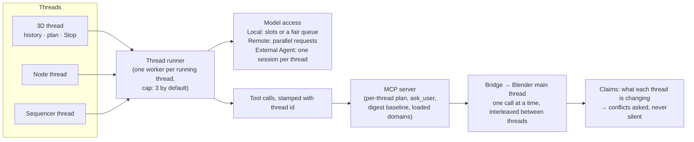
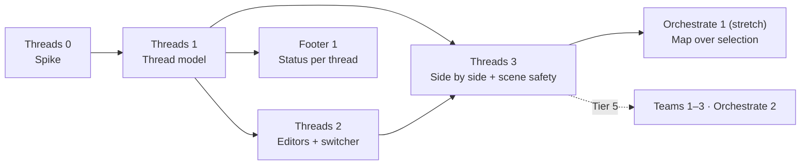

# Tier 4o — Orchestration layer: threads per editor, side by side (#71)

**Status**: 📝 For review (2026-10-21). New tasks **Threads 0–3**; Footer 1 becomes
thread-aware; Orchestrate 2 and agent teams move to Tier 5 and are rebuilt on threads.
**Clean room**: our own design from the add-on's current code and Blender's own
behaviour (undo stack, main-thread execution); spike probes before code.

## 1. The problem

You build a scene in the 3D View, tidy a node group in the Node Editor and translate a
text strip in the Sequencer. Those are three separate trains of thought. Today they are
**one conversation**:

| Today (main @ b89d568) | Where | Effect |
|---|---|---|
| One conversation history | `agent_controller._agent_state.conversation_history` | The node question lands in the middle of the scene build; every turn carries the other jobs' context |
| One turn at a time | `run_conversation_turn` re-entrancy guard (`_agent_state.turn_active`) | The Sequencer job waits until the 3D build finishes |
| One Stop, one Queue | module-level `_stop_event`, `_message_queue` | Stop in the Node Editor stops the 3D build |
| One chat shown everywhere | `ui_chat._CHAT` (the chat being shown); every sidebar draws the same chat state | The Sequencer sidebar shows the 3D conversation |
| One plan, one pending question, one scene lock | Engine 6 tools, co-work scene lock | A question from one job blocks the others |

The sidebars (#298, #325) already tag each message with the editor it came from — the
seam is there; the state behind it is still single.

## 2. What a thread is

A **thread** is one conversation that can run **alongside the others**: its own history,
engine session, Stop, Queue, plan, pending question/approval, Workshop and status. It is
the same thing as a chat in the History panel (Chat 7) — a thread is simply a chat that is
*live* in an editor.

```
            ┌────────────── Blender window ──────────────┐
 3D View    │ Coworker ▸ 🧊 Scene build   ● Thinking 3/7 │  ← thread A
 Node Ed.   │ Coworker ▸ 🔗 Rock material  ✔ Done         │  ← thread B
 Sequencer  │ Coworker ▸ 🎞 Translate titles ⏸ Waiting    │  ← thread C (asks you)
            └────────────────────────────────────────────┘
 Status bar:  Coworker  🧊 3/7 · 🔗 ✔ · 🎞 ⏸ 1 question     (Footer 1)
```

### 2.1 Which thread an editor shows

1. **Each editor kind has its own thread** in a window: the 3D View thread, the Node
   Editor thread, the Sequencer thread, the Text Editor thread… Two 3D Views share one.
2. **Right-click operators start in that editor's thread**: *Translate…* on a strip goes to
   the Sequencer thread; *Explain This* in the Node Editor goes to the Node thread.
3. **The sidebar header names the thread** (icon + title + status) with three buttons:
   *New thread here*, *Switch…* (pick any chat from History), *Open in Coworker editor*.
   *New thread here* pins that one area to a fresh thread (two 3D Views, two jobs).
4. **The Coworker editor shows every live thread** as a list on its left toolshelf
   (icon, title, editor, status, unread dot) and the chosen one in the center. It is the
   overview, not a fourth conversation.
5. **Saved per .blend**: reopening a file brings back each editor's last thread
   (extends Chat 7's `last_for_blend` with the editor kind). Area pins fall back to the
   editor kind after a reload.

### 2.2 What stays shared

The engine choice and settings, the bridge, the MCP server, permissions, and **the scene
itself**. Each thread sees the others in one cheap line of its context ("Other threads:
Node Editor is editing *Rock Material*") so it does not trample them.

### 2.3 Context folders (Chat 10, #367)

Each thread can carry **folders** next to its attachments: a reference-image folder, a
brief, a texture set, the `textures/` next to the .blend. The agent lists, searches and
reads them on demand with three read-only tools (every engine); paths outside the
thread's folders are refused. The scene build's thread can hold the moodboard folder
while the Sequencer thread holds the subtitles script: folders belong to the job, like
the history.

## 3. Running side by side



### 3.1 The model, per engine

| Engine | Side by side how | Trade-off |
|---|---|---|
| **Local** (llama-server) | Default **one slot**: threads take turns per request in a fair queue; a waiting thread shows *Waiting for the model*. Option **Run threads side by side** starts llama-server with 2–3 slots | Slots split the context window (32K ÷ 2 = 16K each) and memory bandwidth; the spike measures tok/s and quality on the 7–14B presets. Connects to Runtime 3 (parallel slots) |
| **Remote** | Parallel requests | Rate limits: a 429 backs off that thread only |
| **External Agent** (ACP) | One ACP **session** per thread on the same agent process (`session/new`); fall back to one process per thread if an agent can't run sessions concurrently | The spike checks OpenCode and Claude Code |
| **External Harness** | The outside client is one thread, *External*, read-only as today | — |

Smaller histories are a win on their own: a node-tidy thread no longer carries the scene
build's 20 tool results, which matters most on Local 16K.

### 3.2 Blender, one call at a time

Blender only changes data on its main thread, and the bridge already runs one call at a
time there. Threads therefore **interleave at tool-call granularity**; they never run
Python against Blender truly at once. What threads add:

- **Thread id on every call.** Our loop sends it as a header; each ACP session gets an MCP
  URL with its thread id; the MCP server stamps it into the bridge payload the same way
  #85 stamps the window session. Plan, `ask_user`, scene digest *since*, loaded tool
  domains (Engine 7), `read_tool_output` handles and the scene checkpoint become
  per-thread on the server.
- **Claims.** Write tools record what they change (object, node tree, strip, text block,
  collection). A thread's claims last for its running turn. When another thread's tool
  wants to write something claimed, that call **waits for the other turn** or asks you
  (*"The 3D thread is changing Cube — wait / go ahead"*). Generated code
  (`execute_blender_code`) can't be analysed precisely, so it counts as a whole-scene
  write: it waits while another thread is mid-write on a claim it might touch, and its
  own changes are claimed after it runs (from the depsgraph updates).
- **A per-editor scope by default.** The Node thread's tools default to the active tree,
  the Sequencer thread's to its scene's strips, the Text thread's to its text block (Chat 4
  context chip, *Use editor context only*). Most real conflicts disappear here.

### 3.3 Undo and Revert with several threads

Blender has **one linear undo stack** per file. Threads must respect it:

1. Every undo step is named with its thread: *Coworker (3D): add campfire*, so
   *Edit ▸ Undo History* shows who did what.
2. **Revert this turn** is offered directly when no other thread has pushed undo steps
   since that turn began (the common case).
3. Otherwise Revert offers what is true: *Revert both turns* (it walks back through the
   other thread's steps and tells that thread), or a **scoped restore** where we keep our
   own snapshot (a node tree, a text block, the strips of a scene — copied at turn start
   by the scene checkpoint), or *Cancel*. Never a silent partial revert.

### 3.4 Stop, questions and approvals

- **Stop** stops that thread only; the status-bar popover has *Stop all*.
- A thread that asks a question or an approval **pauses alone**; the others keep going.
  Its editor's sidebar shows the card; the status bar shows a pulse and the count; the
  popover can answer simple ones (Allow / Deny, a choice).
- A thread that finishes in an editor you aren't looking at shows an unread dot in that
  editor's Coworker tab and in the Coworker editor's list.

### 3.5 Limits and settings

| Setting | Default |
|---|---|
| Running threads at once | 3 (queued beyond that) |
| Local: run threads side by side (slots) | Off (1 slot, fair queue) |
| One thread per editor kind | On (off = one shared thread, today's behaviour) |
| Conflicts | Ask (or: always wait) |

## 4. How the rest of orchestration fits

| Piece | Where now |
|---|---|
| **Threads 0–3** | Tier 4 — the orchestration layer this release ships |
| **Footer 1** status bar | Tier 4, now thread-aware (one row per live thread) |
| **Orchestrate 1** map over selection | Tier 4 *stretch*: runs inside a thread, one undo |
| **Orchestrate 2** missions with checkpoints | **Tier 5**, with teams: a mission becomes a thread that spawns helper threads per step |
| **Teams 1–3** (planner → specialists → validator, co-pilot, critic) | **Tier 5**, built on threads: a planner thread starts specialist threads in the right editors and reads their results; the co-pilot and the critic are background threads |
| Handing off between threads ("ask the Node thread to…") | Tier 5, with teams |

## 5. Tasks



### Threads 0 — Spike (S)
- **What**: measure, don't build. (1) llama-server with 1 vs 2–3 slots on two presets:
  tok/s, context per slot, a quick-challenge score. (2) OpenCode and Claude Code: two ACP
  sessions prompting at once on one process. (3) Two threads interleaving tool calls
  through the bridge with a fake engine; undo history names; what `undo_history` does when
  steps interleave. (4) A list of every module-level singleton that has to become
  per-thread (start from §1's table).
- **Done when**: findings and numbers in this doc (§6); the per-thread state list frozen.

### Threads 1 — The thread model (M→L)
- **What**: a bpy-free `threads.py`: `Thread` (id, chat id, editor kind, engine session,
  history, queue, stop event, plan, pending question/approval, status, claims) and a
  `ThreadRegistry` (create, get by editor/area, list live, cap). Move today's globals in
  `agent_controller` / `engine_loop` / `chat_state` behind it; **one thread behaves
  exactly like today** (the "one shared thread" setting). Thread id stamped on MCP calls;
  the server keeps plan / ask_user / digest / domains / handles per thread.
- **Done when**: all existing tests and the quick challenges pass unchanged with one
  thread; new bpy-free tests run two threads on the fake engine with separate histories,
  queues and Stop.
- **Note**: touches `agent_controller.py` and `ui_chat.py` heavily — the board's
  one-open-PR rule applies; schedule it between the other agent's PRs.

### Threads 2 — Threads in the editors (M)
- **What**: §2.1: each editor kind's sidebar shows its own thread; the header (icon,
  title, status, *New thread here*, *Switch…*, *Open in Coworker editor*); right-click
  operators start in their editor's thread; the Coworker editor's thread list with unread
  dots; saved per .blend.
- **Done when**: a 3D question and a node question asked from their sidebars land in two
  chats in History; reopening the .blend restores both.

### Threads 3 — Side by side, safely (L)
- **What**: the thread runner (cap, fair model queue, Local slots option, one ACP session
  per thread, Remote back-off per thread); claims and conflict asking; per-thread undo
  names and the Revert rules of §3.3; Stop all; the "other threads" context line.
- **Done when** (the user's example, Test 7): a scene build in the 3D View, a node-group
  tidy and a strip translation run at the same time on Remote and on External Agent, and
  on Local with the fair queue; each finishes in its own chat; Stop in one leaves the
  others running; a deliberate conflict (both threads renaming the same object) asks
  instead of overwriting; Revert in one thread never silently undoes another.

### Footer 1 — Agent status in the status bar (S, after Threads 1)
- One compact item: an icon per live thread with its state (*3/7*, ✔, ⏸ + pulse when it
  waits for you); the popover lists threads with Stop / answer / focus; click focuses that
  thread's editor. With one thread it looks like the original Footer 1.

## 6. Spike findings

*(Threads 0 fills this in.)*

## 7. Risks

| Risk | Mitigation |
|---|---|
| The refactor of the global turn state breaks the turn loop | Threads 1 keeps one-thread behaviour identical; quick challenges + benchmarks on every engine before merge |
| Local models get slower or dumber with slots | Default stays one slot + fair queue; slots are opt-in with measured numbers |
| Interleaved undo surprises artists | Named steps per thread; Revert only offers true options (§3.3) |
| Semantic conflicts claims can't see (thread A deletes what B reads) | The "other threads" context line; deletes of claimed data always ask |
| More UI | One header row per sidebar; the overview lives in the Coworker editor and the status bar |
