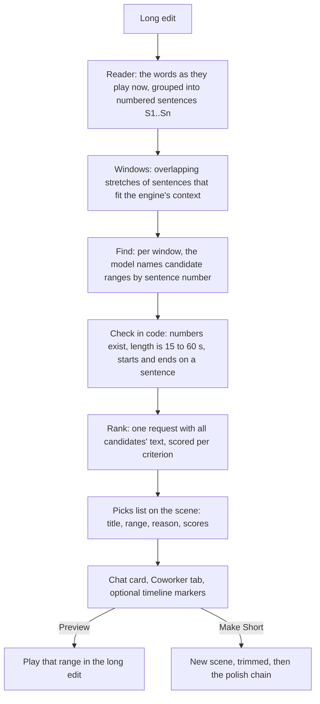

# Tier 4v, part 2 — Highlights and Suggest Edits (design)

**Status**: 📝 Proposal (2026-11-18), for the maintainer to accept or change. No code yet.
**Covers**: Video 8, Highlights (#571) and Video 5, Suggest Edits (#378). They share one
pipeline, so they are designed together.
**Builds on**: local transcription (#375), Remove Silences (#331, #539), Make Vertical
(#333) and Reframe layouts (#606), Auto Captions (#376, #594), Edit by Transcript (#498).
**Clean room**: our own design. No prompt, text or scoring rule is taken from another
tool or service.

## 1. What the artist gets

Two buttons in the Sequencer's Coworker tab, and the same through the chat.

| Button | You have | You get |
|---|---|---|
| **Find Highlights** | A long edit: a podcast, tutorial, talk or showcase | A short list of pieces under 60 seconds, each with a title, its length and one line saying why it was picked. **Preview** plays it in the long edit. **Make Short** builds it as its own scene, already cut, vertical and captioned. The long edit is never changed. |
| **Suggest Edits** | Any edit, long or short | Up to five concrete edits (tighten these pauses, drop this retake, punch in here, add a hook title, this caption style, this vertical layout). Each one has **Apply**, which is one undo. |

Rules that hold for both:

- **Nothing is built or changed until you press a button on a suggestion.**
- **Every result is ordinary Sequencer data**: scenes, strips, keys. You can fix any of it
  by hand, or with Reframe, Edit by Transcript and the caption tools.
- **It says why, never "viral".** A pick comes with its reason and its scores, not a promise.
- **Local keeps everything on the machine.** With a Remote engine the dialog says that the
  transcript text is sent to that service. No frames or audio are sent in the first version.

## 2. The idea that makes it robust: the model picks sentences, the code does the rest

A language model is good at judging which part of a talk is interesting. It is bad at
timestamps, and a small Local model is worse. So the model never sees or returns a time.

- The **reader** turns the transcript into sentences with numbers. Each sentence knows its
  start and end frame on the timeline as it plays today, after every cut and move
  (`transcript_edit.timeline_words` already gives this).
- The model answers with numbers only: "S214 to S231". The code turns that into frames,
  measures the length, and rejects anything that is too long, too short or not there.
- A wrong answer costs one retry of one window. It cannot produce a cut in the wrong place.

## 3. The pieces

### 3.1 Reader (new, no Blender needed for its core)
- Input: the timeline words of the scene (word, start frame, end frame, strip, and the
  speaker track if the captions were made per speaker).
- Sentences: split at sentence punctuation, and at any pause longer than 0.7 s where the
  transcript has no punctuation. A sentence longer than 20 s is split at its longest pause.
- Per sentence, cheap facts the code can count: seconds, words per second, filler words,
  pause before it, question mark, a number in it, speaker change. These go to the model as
  short hints and are used for the value-density score, so the model does not have to guess them.
- No transcript yet: the button offers to transcribe first (the existing wand). Parts of the
  edit without speech are skipped and the result says how much was skipped.

### 3.2 Windows
- A one-hour talk is about 9 000 words, about 12 000 tokens. That fits a 32K Local context
  in one request only on paper: with the instructions and room for the answer it is tight,
  and the 8K fallback context cannot do it at all.
- So the size of a window follows the engine: about a third of its context, at most about
  2 400 words (16 minutes of speech). Windows overlap by one minute, so a piece that crosses
  a border is seen whole in one of them. A one-hour talk is four or five requests.
- Each request is made directly by the wand (the way Follow Subject asks today), not through
  the agent's chat. The chat's history and tool list are not in it, so the whole context
  is free for the transcript.

### 3.3 Asking for a checked answer (new shared helper)
There is no such helper today; Follow Subject parses its one number by hand. Highlights,
Suggest Edits and later wands need a real one:

- `ask_json(messages, schema)`: sends the request with the schema where the engine's server
  can enforce it (llama.cpp does; many Remote models do), and otherwise asks for JSON only.
- Every answer is checked against the schema in our code, whatever the server promised.
- One retry, with the error named, when the check fails. After that the window is skipped
  and counted in the result ("1 of 5 parts could not be read").
- **External Agent engine**: the add-on cannot send a direct request there. The button then
  hands the job to the agent as a prepared message, and the agent uses the same chat tools
  (3.7). The checks and the picks list are the same code either way.

### 3.4 Find, then rank (two passes)
- **Find** (per window): "name up to three ranges that would stand alone as a short".
  Answer per range: first sentence, last sentence, a five-word label. Nothing else.
  Keeping this answer tiny is what makes a small Local model reliable at it.
- **Check** (code): see section 2. Overlapping candidates from neighbouring windows are
  merged. A range a little over 60 s is trimmed back to the last sentence that fits, if it
  still ends on a full stop.
- **Rank** (one request): the text of all surviving candidates, usually 10 to 20 pieces of
  up to 150 words. The model scores each on the criteria (3.5), writes a title, the hook
  line and one sentence of reason. The total is added up in code from those scores and the
  weights of the chosen kind of video, so the order can be explained and tuned.
- One pass would be cheaper, but it asks a small model to read 16 minutes, choose, score
  and write titles in one answer. Two passes keep each answer short and checkable.

### 3.5 What makes a piece worth a short
Each criterion is scored 0 to 3 by the model, except the last, which the code counts.

| Criterion | The question asked |
|---|---|
| Hook | Do the first three seconds make you want the rest: a question, a bold claim, a number, a surprise? |
| Stands alone | Does it make sense without the minute before it? No "as I said", no "this" pointing at nothing. |
| Complete | Is there a setup and a payoff, ending on a finished sentence? |
| One idea | Is it a single tip, story or opinion? |
| Energy | Is there laughter, disagreement, excitement, a strong opinion (from the words; from the sound later)? |
| Teases the long video | Does it open a topic the full video answers? |
| Value density | Few fillers and pauses, quotable lines (counted by the code). |

The weights depend on the **kind of video**, chosen in the dialog (or "Auto", decided in
the rank request from the first minutes):

- **Podcast or interview**: an exchange between speakers, a story. Stands alone and Energy weigh most.
- **Tutorial**: one tip with a result. Complete and One idea weigh most.
- **Talk or lecture**: a claim and its proof. Hook and Complete weigh most.
- **Showcase or trailer**: little speech; see 3.9.

The criteria, the weights and the two prompts live in one editable skill chapter
(`skills/video_highlights.md`), so a channel can tune them without touching code.

### 3.6 The picks list: one store, three views
- The picks are stored on the scene (a small JSON text: range in sentence numbers and in
  frames, title, hook, reason, scores, state). They survive saving and reopening.
- **Chat card**: a new card kind with one row per pick (title, length, reason) and the
  buttons Preview, Make Short, Dismiss. Today a new card needs its own branch in the chat
  code; this adds a small general "list card" that Suggest Edits uses too.
- **Coworker tab**: the same list as a panel, so it is there after the chat has moved on.
- **Timeline markers** (a switch, off by default): one marker pair per pick on the long
  edit, removable in one click. Markers are the only thing Highlights ever adds to the long edit.
- **Preview** sets the preview range to the pick, plays, and puts the range back afterwards.
- If the long edit is cut after the picks were made, the picks are placed again from their
  sentence numbers. A pick whose sentences are gone is shown as "no longer in the edit".

### 3.7 Make Short
- A copy of the scene (the method Make Vertical uses, with the fix that keeps a copy on
  save), then everything outside the range is removed, strips crossing its borders are
  trimmed, and the rest moves to frame 1. Named `Short 01: <title>`, tagged with the scene
  and range it came from.
- A copy and trim, not "a new scene with only some strips": effects, channels, colour and
  audio settings come along for free, and strips only point at media, so the file barely
  grows. The build issue measures it on an edit of 500 strips before settling this.
- The transcript comes along by itself, because it is stored per media file, not per scene.
- **Polish chain**, each step optional and each an existing wand:
  1. Remove Silences, with a tighter setting than for a long edit.
  2. Make Vertical, with the layout the kind of video suggests (Reframe, #606, to change it).
  3. Auto Captions, in the style last used.
  4. A hook title over the first three seconds, from the pick's hook line.
- One undo removes the whole short. Its steps are reported in one line each.
- Rendering is left to the artist in the first version (see section 6).

### 3.8 Chat tools
- `suggest_highlights(kind, max_seconds, count)`: runs the pipeline, returns the picks.
- `read_edit_sentences(first, count)` and `propose_highlights(picks)`: the same pipeline in
  two steps, for an agent that reads the sentences itself (the External Agent path). The
  proposals go through the same checks.
- `make_short(pick, steps)`.
- So *"find me three shorts in this podcast and build the best one"* works in the chat.

### 3.9 Without speech
Films, music videos and showcases say little, so the transcript cannot find their moments.
The first version says so and stops ("not enough speech to pick from"). A later version
looks at the footage with the vision model through contact sheets; it is listed in section 6.

## 4. Suggest Edits on the same pipeline (#378)

Suggest Edits is the same machine pointed at a different question. It uses the reader, the
checked answer, the list card and "apply as one undo".

- The model chooses from a **fixed menu of edit kinds**, and points at sentences or words by
  number. It never writes code or frame numbers. Each kind maps to one existing tool.

| Edit kind | What the model gives | What applies it |
|---|---|---|
| Tighten pauses | Nothing, or a stretch of sentences | Remove Silences |
| Drop a retake, a false start or filler | The sentences or words to drop | Edit by Transcript |
| Punch in for emphasis | One sentence | A short scale key on the picture strip |
| Hook title | The line | A text strip over the first seconds |
| Caption style and motion | A style and animation from the list | Auto Captions |
| Vertical layout | A layout from the list | Reframe (#606) |
| Chapters | A sentence and a title per chapter | Timeline markers (the open box of #542) |

- Up to five suggestions, the recommended ones marked. Each row: what, why, Preview where
  it makes sense, Apply. "Apply the recommended ones" applies them in a safe order (cuts
  first, then layout, then captions), still one undo each.
- A suggestion that no longer fits after an earlier one was applied is checked again before
  it runs, and greyed out if its sentences are gone.
- On a fresh short from Make Short this is the natural next click: the short is built, and
  Suggest Edits proposes how to make it better.

## 5. How we know the picks are good, without private footage

- **A written test transcript**: a made-up one-hour "podcast" and a made-up tutorial, written
  by us, with strong moments planted at known places (a clear question and answer, a story
  with a punchline, a tip with a result) and weak stretches around them (small talk,
  half sentences, references to earlier parts).
- **Unit tests** use a stand-in model with fixed answers: they test the reader, the windows,
  the checks, the merge, the ranking sum and the placing after cuts. They need no model.
- **A model check outside the unit suite**: the real Local model (and a Remote one when
  asked) on the written transcripts. Target: at least four of the six planted moments are in
  the top five, and no pick starts or ends in the middle of a sentence (the code guarantees
  the second). This is run when the prompts or criteria change, and its numbers go into the PR.
- **Hand test** on real footage by the maintainer, as with the other video tools.

## 6. Decisions asked of the maintainer

| # | Question | Proposal |
|---|---|---|
| 1 | One pass or two? | Two: find per window, then rank once. |
| 2 | Where do picks show? | Stored on the scene; shown as a chat card and in the Coworker tab; timeline markers as a switch. |
| 3 | How is the short's scene made? | Copy the scene and trim. |
| 4 | Can a short join two places (setup at 12:10, payoff at 14:30)? | Not in the first version. The stored pick already allows a list of ranges, so it can come later without a new format. |
| 5 | Presets | Length 15 / 30 / 60 s (default 60), count 3 to 10 (default 5), kind of video (Auto), polish steps on by default. |
| 6 | Video without speech | First version stops with a clear message. Vision path later. |
| 7 | Rendering the shorts | Left to the artist first. A "Render all shorts" queue later. |
| 8 | What a Remote engine receives | Transcript text only, said in the dialog. |
| 9 | Which release | Not 1.1.44, which is in hand testing. Proposed as the main feature of 1.1.45. |

## 7. Build plan (issues to file once this is accepted)

| Step | Issue to file | Size | Needs |
|---|---|---|---|
| H1 | Reader: numbered sentences, windows, `read_edit_sentences` | M | — |
| H2 | `ask_json`: schema-checked answers on Local and Remote, one retry | S | — |
| H3 | Find and rank, the criteria chapter, the written test transcripts and the model check | M | H1, H2 |
| H4 | Picks list: scene store, list card in the chat, Coworker tab panel, markers, Preview | M | H1 |
| H5 | Make Short: copy and trim, the polish chain | M | H4 |
| H6 | Chat tools and the External Agent path | S | H3, H5 |
| S1 | Suggest Edits (#378, rescoped onto H1, H2, H4): the menu, checks, Apply | M | H1, H2, H4 |

H1 and H2 can start together; H3 and H4 follow in parallel; then H5, H6 and S1.

Later, Tier 5: a short joined from two places; the vision path for footage without speech;
energy from the sound (laughter, loudness); a render queue for all shorts; picks tuned per
platform (length and safe areas).

## 8. Risks

- **A small Local model picks dull pieces.** The checks guarantee well-formed picks, not
  interesting ones. The written test transcripts measure this before any real footage, and
  the criteria chapter is there to tune. If a model scores below the target, the dialog can
  recommend a stronger engine for this wand.
- **Time on Local.** Four or five window requests and one rank request for an hour of talk.
  To be measured in H3 on the reference card (RTX 3080) and stated in the dialog, with a
  progress line and a working Stop.
- **Bad transcripts.** Wrong words and missing punctuation hurt sentence borders. The pause
  rule covers missing punctuation; a transcript with very low word confidence gets a warning
  before the run.
- **Long edits with many cuts.** Sentences are built from the words as they play now, so a
  heavily cut edit gives short, choppy sentences. That is the edit's real state; the reader
  reports the number of sentences so the artist sees it.
