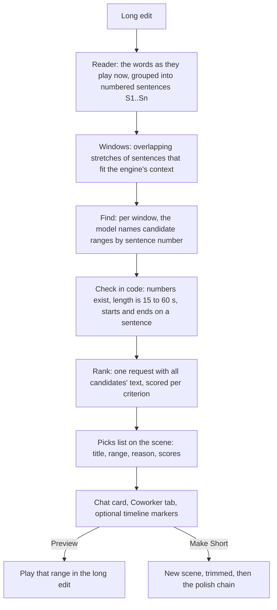

# Tier 4v, part 2 — Highlights and Suggest Edits (design)

**Status**: ✅ Accepted by the maintainer on 2026-11-18, with the decisions in section 6. Highlights is planned for **1.1.45**; 1.1.44 is frozen for hand testing. Suggest Edits is shelved to Tier 5 (section 4). No code yet.
**Covers**: Video 8, Highlights (#571). Video 5, Suggest Edits (#378), was designed with it and is now shelved (section 4).
**Builds on**: local transcription (#375), Remove Silences (#331, #539), Make Vertical
(#333) and Reframe layouts (#606), Auto Captions (#376, #594), Edit by Transcript (#498).
**Clean room**: our own design. No prompt, text or scoring rule is taken from another
tool or service.

## 1. What the artist gets

Two buttons in the Sequencer's Coworker tab, and the same through the chat.

| Button | You have | You get |
|---|---|---|
| **Find Highlights** | A long edit: a podcast, tutorial, talk or showcase | A short list of pieces under 60 seconds, each with a title, its length and one line saying why it was picked. **Preview** plays it in the long edit. **Make Short** builds it as its own scene, already cut, vertical and captioned. The long edit is never changed. |
| **Suggest Edits** | Any edit, long or short | Up to five concrete edits (tighten these pauses, drop this retake, punch in here, add a hook title, this caption style, this vertical layout). Each one has **Apply**, which is one undo. |

Rules that hold for both:

- **Nothing is built or changed until you press a button on a suggestion.**
- **Every result is ordinary Sequencer data**: scenes, strips, keys. You can fix any of it
  by hand, or with Reframe, Edit by Transcript and the caption tools.
- **It says why, never "viral".** A pick comes with its reason and its scores, not a promise.
- **Local keeps everything on the machine.** With a Remote engine the dialog says that the
  transcript text is sent to that service. No frames or audio are sent in the first version.

## 2. The idea that makes it robust: the model picks sentences, the code does the rest

A language model is good at judging which part of a talk is interesting. It is bad at
timestamps, and a small Local model is worse. So the model never sees or returns a time.



- The **reader** turns the transcript into sentences with numbers. Each sentence knows its
  start and end frame on the timeline as it plays today, after every cut and move.
- The numbers are only the handle for one conversation with the model. What is **stored**
  for a pick is the media file and the transcript's word positions (3.6), because a single
  cut renumbers every later sentence.
- The model answers with numbers only: "S214 to S231". The code turns that into frames,
  measures the length, and rejects anything that is too long, too short or not there.
- A wrong answer costs one retry of one window. It cannot produce a cut in the wrong place.

## 3. The pieces

### 3.1 Reader (new, no Blender needed for its core)
Today's `transcript_edit.timeline_words` is not enough: it reads one media file at a time,
only top-level strips, and Edit by Transcript refuses the cases it cannot map. Highlights
needs a reader for the **whole scene**, and it is the first thing to build:

- It walks every sound-carrying strip of the edit and places each transcript word where it
  plays now (word, start frame, end frame, media file, word position in that file's
  transcript, and the speaker track if the captions were made per speaker).
- **Several media files**: words from all of them are merged by time.
- **The same speech twice at once** (two microphones, camera sound plus recorder): where two
  files speak over the same frames, one is kept, the one with the higher word confidence,
  and the result says so. Otherwise the sentences would come out interleaved.
- **A clip used twice**: both uses are kept, each as its own sentences, since each plays.
- **Muted strips and muted channels** are skipped.
- **Retimed strips** (speed changes): the first version skips them and reports how much of
  the edit that was, as the captions do today. Mapping words through a speed change is its
  own task.
- **Inside meta strips**: skipped in the first version, and reported.
- Sentences: the lines Edit by Transcript already makes (`transcript_edit.render`: sentence
  punctuation, or a pause of 0.8 s), so Suggest Edits can hand a sentence straight to the
  transcript editor's cut. A sentence longer than 20 s is split at its longest pause.
- Per sentence, cheap facts the code can count: seconds, words per second, filler words,
  pause before it, question mark, a number in it, speaker change. These go to the model as
  short hints and are used for the value-density score, so the model does not have to guess them.
- No transcript yet: the button offers to transcribe first (the existing wand). Parts of the
  edit without speech are skipped and the result says how much was skipped.

### 3.2 Windows
- A one-hour talk is about 9 000 words, about 12 000 tokens. That fits a 32K Local context
  in one request only on paper: with the instructions and room for the answer it is tight,
  and the 8K fallback context cannot do it at all.
- So the size of a window follows the engine. The real context size is read from the
  running server (the Local preset can be anything from 4K to 128K; 32K is the default).
  A window is at most about 2 400 words (16 minutes of speech), and smaller when the
  context is: instructions, the sentence numbers and hints (about as many tokens again as
  the words) and room for the answer must fit with a margin. On a 32K context a one-hour
  talk is four or five requests; on 8K about ten.
- Windows overlap by one minute, so a piece that crosses a border is seen whole in one of them.
- The **rank** request is sized the same way: when the candidates do not fit one request
  (small contexts, many candidates), they are ranked in groups and the group winners once more.
- Each request is made directly by the wand (the way Follow Subject asks today), not through
  the agent's chat, so the chat's history and tool list are not in it. To verify in the
  build: on a Local server with one slot, a wand request may push the chat's cached prompt
  out, which costs the chat one full re-read afterwards (the subject of #546 and #590).
- Thinking is switched off for these requests where the engine allows it: the answers are
  short lists, and thinking would use the room the transcript needs.

### 3.3 Asking for a checked answer (new shared helper)
There is no such helper today; Follow Subject parses its one number by hand. Highlights,
Suggest Edits and later wands need a real one:

- `ask_json(messages, schema)`: sends the request with the schema where the engine's server
  can enforce it, and otherwise asks for JSON only. Two things to settle first, in the
  build: our request function cannot pass extra fields today (`llm_transport`), so it needs
  that; and whether the llama.cpp build we ship enforces a schema on the chat endpoint has
  to be probed, not assumed.
- Every answer is checked against the schema in our code, whatever the server promised.
- One retry, with the error named, when the check fails. After that the window is skipped
  and counted in the result ("1 of 5 parts could not be read").
- **External Agent and External Harness engines**: the add-on cannot send a direct request there. The button then
  hands the job to the agent as a prepared message, and the agent uses the same chat tools
  (3.7). The checks and the picks list are the same code either way.

### 3.4 Find, then rank (two passes)
- **Find** (per window): "name up to three ranges that would stand alone as a short".
  Answer per range: first sentence, last sentence, a five-word label. Nothing else.
  Keeping this answer tiny is what makes a small Local model reliable at it.
- **Check** (code): see section 2. Overlapping candidates from neighbouring windows are
  merged. A range a little over 60 s is trimmed back to the last sentence that fits, if it
  still ends on a full stop.
- **Rank** (one request): the text of all surviving candidates, usually 10 to 20 pieces of
  up to 150 words. The model scores each on the criteria (3.5), writes a title, the hook
  line and one sentence of reason. The total is added up in code from those scores and the
  weights of the chosen kind of video, so the order can be explained and tuned.
- One pass would be cheaper, but it asks a small model to read 16 minutes, choose, score
  and write titles in one answer. Two passes keep each answer short and checkable.

### 3.5 What makes a piece worth a short
Each criterion is scored 0 to 3 by the model, except the last, which the code counts.

| Criterion | The question asked |
|---|---|
| Hook | Do the first three seconds make you want the rest: a question, a bold claim, a number, a surprise? |
| Stands alone | Does it make sense without the minute before it? No "as I said", no "this" pointing at nothing. |
| Complete | Is there a setup and a payoff, ending on a finished sentence? |
| One idea | Is it a single tip, story or opinion? |
| Energy | Is there laughter, disagreement, excitement, a strong opinion (from the words; from the sound later)? |
| Teases the long video | Does it open a topic the full video answers? |
| Value density | Few fillers and pauses, quotable lines (counted by the code). |

The weights depend on the **kind of video**, chosen in the dialog (or "Auto", decided in
the rank request from the first minutes):

- **Podcast or interview**: an exchange between speakers, a story. Stands alone and Energy weigh most.
- **Tutorial**: one tip with a result. Complete and One idea weigh most.
- **Talk or lecture**: a claim and its proof. Hook and Complete weigh most.
- **Showcase or trailer**: little speech; see 3.9.

The criteria, the weights and the two prompts live in one editable skill chapter
(`skills/video_highlights.md`), so a channel can tune them without touching code.

### 3.6 The picks list: one store, a panel of its own
- The picks are stored on the scene as one custom property holding JSON. Per pick: the
  media file's key and the first and last word position in its transcript (this is the
  identity, it does not change when the edit is cut), the frames it had when found, a
  signature of the timeline at that moment (as Edit by Transcript keeps), title, hook,
  reason, scores, state. They survive saving and reopening.
- **A Highlights panel** in the Sequencer's Coworker tab is the home of the list, built like
  the transcript tools: one row per pick with its title, length and reason, and the buttons
  Preview, Make Short and Dismiss, each with an icon. It works the same in Blender and in
  Bforartists.
- The chat gets a short text summary of the picks with a pointer to the panel. A list card
  with buttons in the chat is not part of the first version.
- **Timeline markers** (a switch, off by default): one marker pair per pick on the long
  edit, removable in one click. Markers are the only thing Highlights ever adds to the long edit.
- **Preview** sets the preview range to the pick, plays, and puts the range back afterwards.
- If the long edit is cut after the picks were made, the signature no longer matches. The
  picks are then placed again from their words: still whole and in order means new frames;
  partly cut away means "changed, check it"; gone means "no longer in the edit". Preview and
  Make Short always check this first, the way Apply in Edit by Transcript refuses stale text.
- **One look for every wand panel.** Highlights adds a third kind of wand panel after the
  transcript and caption tools. Before it is built, a short rule set is written and applied
  to the existing ones: where options go, where results go, the order and wording of
  buttons, icons on every choice, the tooltip line. It is its own small issue (W0 in section 7).

### 3.7 Make Short (the result is ready to render)
- **Not destructive.** A short is a copy of the scene (the method Make Vertical uses, with
  the fix that keeps a copy on save; that function gets a name and tag of its own instead
  of the fixed " Vertical") whose **frame range is set to the pick**. Nothing is deleted:
  the rest of the edit is still there outside the range, so the artist can widen or move
  the short by dragging the range. The borders sit in the pause before the first and after
  the last word, not on the word.
- **Trim to Range** is a separate button in the panel for when a clean scene is wanted: it
  removes what lies outside the range and moves the rest to frame 1. It deletes strips
  wholly outside, trims those crossing a border, and refuses, naming the strip, only when
  such a strip cannot be trimmed. It is optional and can come after the first version.
- Named `Short 01: <title>`, tagged with the scene and words it came from. The picks list
  and a vertical tag are not inherited by the copy.
- The transcript comes along by itself, because it is stored per media file, not per scene.
- **Polish chain**, each step optional, each an existing wand, each limited to the range:
  1. Remove Silences, with a tighter setting than for a long edit. It needs a "this frame
     range only" mode, which it does not have today.
  2. Make Vertical inside the short (not a second copy), 9:16, with the layout the kind of
     video suggests. Reframe (#606) changes it afterwards. Square is left for later.
  3. Auto Captions, in the style last used.
  4. A hook title over the first three seconds, from the pick's hook line (a small new tool).
- **Output set for the common case**: the short's render settings are set to an MP4 file
  with H.264 video and AAC sound, named after the short, next to the .blend. Pressing
  Render Animation gives a file ready to upload. Rendering itself stays the artist's click
  in the first version.
- One undo removes the whole short. That holds because the wands push no undo of their own
  when called from one operator, with two conditions: the transcript must exist before
  (transcribing runs as its own job with its own undo), and a tracked layout is not part of
  the chain (Follow Subject works in the background and pushes its own). The steps are
  reported in one line each.

### 3.8 Chat tools
- `suggest_highlights(kind, max_seconds, count)`: starts the pipeline as a background job,
  like a render, and answers at once; the agent polls it with the existing job status tool.
  A run takes minutes, which a single tool call must not block.
- `read_edit_sentences(first, count)` and `propose_highlights(picks)`: the same pipeline in
  two steps, for an agent that reads the sentences itself (the External Agent path). The
  proposals go through the same checks.
- `make_short(pick, steps)`.
- So *"find me three shorts in this podcast and build the best one"* works in the chat.

### 3.9 Without speech (timelapses, showcases, music videos)
The transcript cannot find the moments of footage that says nothing, so this needs its own
way of looking. It would not be random, but it would be a weaker judge than the transcript
path, and it is honest to say so in the dialog.

- **What the code can measure without any model**, from small sampled frames: how much the
  picture changes (motion, and for a timelapse the stretch where the most happens), cuts,
  sharpness, brightness and colour range, and from the sound the loud and quiet parts and
  the beat. This already gives sensible candidates: the busiest continuous stretch, the
  stretch between two cuts with the most change, the part where the music lifts.
- **What a vision model adds**: it looks at a contact sheet per candidate and says which
  look best and what they show (a finished piece, a reveal, a face), with a reason. This
  is the "pretty shots" judgement. On Local it needs a model that can see; on a Remote
  engine the frames would leave the machine, which the dialog must say.
- **Timelapse preset**: the usual short from a timelapse is not a cut-out but the whole
  thing, or its best stretch, sped up to fit the length, ending on the finished result.
  So the kind "Timelapse" offers that: pick the stretch, set the speed to land on 15, 30 or
  60 seconds, and hold the last frame for a moment.
- **Order of work**: the first version of Highlights is the speech path and stops with a
  clear message on footage without speech. The measured signals and the Timelapse preset
  are the next step (V1 in section 7). The vision ranking comes after that (V2).

## 4. Suggest Edits (#378): shelved to Tier 5, as a wizard

Decided on 2026-11-18: not built with Highlights. An editor usually knows what they want;
what they need is the slog taken away. So Suggest Edits should not guess five edits, it
should ask, then do. The maintainer will first look at how other editors offer this.

The shape to design later:

1. **Suggest Edits** opens a wizard.
2. **What do you want to do?** Remove fluff, tighten, balance the colour of the shots to a
   reference frame, organise and pick takes, order the shots to a script, insert B-roll.
3. **How?** Long shots or short and punchy, with or without transitions, and so on,
   depending on the answer to 2.
4. **Confirm**, and Coworker does the edit in context, as one piece of work that can be undone.

Ideas noted for it: finding retakes and similar shots and grouping the strips by colour, so
the editor picks the take. The pieces Highlights builds are what such a wizard would stand
on: the scene reader, the checked answers, the wand panel rules and the range-limited wands.

## 5. How we know the picks are good, without private footage

- **A written test transcript**: a made-up one-hour "podcast" and a made-up tutorial, written
  by us, with strong moments planted at known places (a clear question and answer, a story
  with a punchline, a tip with a result) and weak stretches around them (small talk,
  half sentences, references to earlier parts).
- **Unit tests** use a stand-in model with fixed answers: they test the reader, the windows,
  the checks, the merge, the ranking sum and the placing after cuts. They need no model.
- **A model check outside the unit suite**: the real Local model (and a Remote one when
  asked) on the written transcripts. Target: at least four of the six planted moments are in
  the top five, and no pick starts or ends in the middle of a sentence (the code guarantees
  the second). This is run when the prompts or criteria change, and its numbers go into the PR.
- **Hand test** on real footage by the maintainer, as with the other video tools.

## 6. Decisions (maintainer, 2026-11-18)

| # | Question | Decided |
|---|---|---|
| 1 | One pass or two? | Two: find per window, then rank once. |
| 2 | Where do picks show? | A dedicated Highlights panel in the Coworker tab, like the transcript tools; markers as a switch. Wand panels get one clear set of presentation rules. |
| 3 | How is the short's scene made? | A copy of the scene with its frame range set to the pick, not destructive; cutting away the rest is a separate, optional step. The result is ready to render. |
| 4 | A short joined from two places | Out of scope for now. |
| 5 | Presets | Length 15 / 30 / 60 s (default 60), count 3 to 10 (default 5), kind of video (Auto), polish steps on by default. |
| 6 | Video without speech | Not in the first version; planned as its own steps (3.9): measured signals and a Timelapse preset first, vision ranking after. |
| 7 | Rendering | Left to the artist; the short's output is preset to MP4 (H.264, AAC). |
| 8 | What leaves the machine | Whatever engine Coworker is set to receives the transcript text: nothing with Local, the chosen provider with Remote or an external agent. The dialog says which. |
| 9 | Which release | 1.1.45. 1.1.44 is frozen after the work already running, for hand testing. |
| 10 | Aspect | Vertical (9:16). Square later. |
| 11 | Suggest Edits | Shelved to Tier 5 as a wizard (section 4). |

## 7. Build plan (1.1.45)

| Step | Issue | Size | Needs | Done when |
|---|---|---|---|---|
| W0 (#610) | Wand panels: one set of presentation rules, applied to the existing panels | S | — | The rules are written down and the transcript, caption and reframe panels follow them. |
| H1 (#611) | Scene reader: every speaking strip, merged, numbered sentences, windows; `read_edit_sentences` | L | — | On made-up edits (two media files, two microphones, a clip used twice, a muted and a retimed strip) the sentences are in playing order, none doubled, and the skipped parts are reported. |
| H2 (#612) | `ask_json`: schema-checked answers on Local and Remote, one retry; request function passes extra fields; schema support of the shipped llama.cpp probed | M | — | A fake server and the real Local server both return checked answers; a wrong answer is retried once and then reported. |
| H3 (#613) | Find and rank, the criteria chapter, the written test transcripts (with made-up word times) and the model check; time measured on the reference card | M | H1, H2 | At least four of six planted moments in the top five on the written transcripts; time per hour of talk stated. |
| H4 (#614) | Picks store on the scene, re-placing after cuts, the Highlights panel, Preview, markers | M | H1, W0 | Picks survive save and reopen; after a cut they are placed again or marked changed or gone; the panel works in Blender and Bforartists. |
| H5 (#615) | Make Short: named scene copy with its range set, range-limited Remove Silences, the hook title tool, the polish chain, MP4 output preset, one undo | M | H4 | A pick becomes a short scene that renders to an MP4 as it is; one undo removes it; the long edit is unchanged. |
| H6 (#616) | Chat tools as a background job, and the External Agent and Harness path | M | H3, H5 | *"Find three shorts and build the best one"* works on Local, Remote and External Agent. |

W0, H1 and H2 can start together; H3 and H4 follow in parallel; then H5; then H6.

After that:

| Step | What | Needs |
|---|---|---|
| H7 | Trim to Range: cut a short's scene down to its range | H5 |
| V1 | Footage without speech: measured signals (change, cuts, sound), the Timelapse preset | H4, H5 |
| V2 | Vision ranking of candidates from contact sheets | V1 |

Later, Tier 5: a short joined from two places; energy from the sound (laughter); words
through speed changes and inside metas; a render queue for all shorts; picks tuned per
platform; square output; the Suggest Edits wizard (section 4).

## 7a. The two answers the model gives (sketch; the wording of the prompts is settled in H3)

Find, per window:
```json
{"candidates": [{"first": 214, "last": 231, "label": "why we dropped the old rig"}]}
```
`first` and `last` are sentence numbers shown in that window; at most three candidates;
`label` at most eight words. Anything else in the answer is ignored.

Rank, per group of candidates (each shown with a letter and its text):
```json
{"picks": [{"id": "C", "title": "The rig we threw away", "hook": "We deleted six months of work.",
            "reason": "A clear story with a payoff that needs no context.",
            "scores": {"hook": 3, "alone": 3, "complete": 2, "one_idea": 3, "energy": 2, "tease": 1}}],
 "kind": "podcast"}
```
Scores are whole numbers 0 to 3; `kind` is only read when the dialog says Auto. Titles and
hooks are cut to a fixed length in code. The prompts state the criteria of 3.5 in our own
words and are stored in the skill chapter.

## 8. Risks

- **A small Local model picks dull pieces.** The checks guarantee well-formed picks, not
  interesting ones. The written test transcripts measure this before any real footage, and
  the criteria chapter is there to tune. If a model scores below the target, the dialog can
  recommend a stronger engine for this wand.
- **Time on Local.** Four or five window requests and one rank request for an hour of talk.
  To be measured in H3 on the reference card (RTX 3080) and stated in the dialog, with a
  progress line and a working Stop.
- **Bad transcripts.** Wrong words and missing punctuation hurt sentence borders. The pause
  rule covers missing punctuation; a transcript with very low word confidence gets a warning
  before the run.
- **Long edits with many cuts.** Sentences are built from the words as they play now, so a
  heavily cut edit gives short, choppy sentences. That is the edit's real state; the reader
  reports the number of sentences so the artist sees it.
