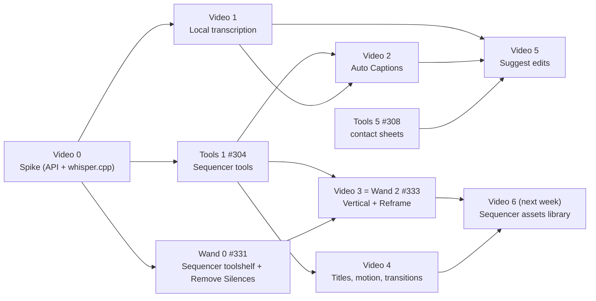

# Tier 4v — Video week: an artist-friendly Sequencer (captions, vertical, text, suggestions)

**Status**: 📝 Planned (2026-10-25, re-ordered the same day): **after the architecture work.** The Sequencer core (Video 0–3, Tools 1, Wand 0) is **1.1.44** (after #430; 1.1.43 became a hardening release, 2026-11-13); titles, Suggest (Video 4–5) and the assets library (Video 6) come later, with the asset work in Bforartists. Threads ship first in 1.1.42.
**Goal**: by the end of the week, a talking-head clip becomes a **captioned vertical
short** in a few clicks, with no model needed for the basics, and Coworker can
**suggest** the edit. Next week: the **Sequencer assets** library (looks, blur fill,
titles, transitions) on top.
**Clean room**: our own design from the 5.x Python API (bundled docs in
`mcp/blmcp/data/api`) and live probes. Out-of-the-box video apps are the
*inspiration* for the feel, not a feature list to match.

## 1. What the artist gets

```
Sequencer ▸ toolshelf tab "Coworker" (Bforartists) / Strip, View, Add menus (Blender)
┌──────────────────────────────┐
│ [🗨 Auto Captions]  [▯ Vertical] │   ← one click each, preview → apply → one undo
│ [🔇 Remove Silences] [T Titles ▾] │
│ [⇄ Transitions ▾]  [✨ Suggest]  │   ← Suggest asks the active engine; the rest need no model
└──────────────────────────────┘
```

| Button | What happens | Needs a model? |
|---|---|---|
| **Auto Captions** | Transcribes the selected clips locally (whisper.cpp), lays the words out as styled text strips (clean, bold pop, word-by-word), safe-area aware; **Export SRT**; captions can be **Translated** with the existing right-click Translate | No (speech model only) |
| **Vertical** | 9:16 output; each shot reframed with an editable **Reframe** compositor modifier (centre crop, or **Blur Fill**: the shot sits over a blurred copy); optional *Follow subject* per shot | No (Follow subject: vision, optional) |
| **Remove Silences** | Cuts the quiet ranges from the selected clips and closes the gaps | No |
| **Titles ▾** | **Lower thirds** (name + role, topic, location) and **title cards** (hook title, chapter card, end card), each with **entrance and exit** animations (pop, slide up, fade, typewriter-feel by words) | No |
| **Transitions ▾** | Cross, dip to black, wipe, zoom punch-in, whip; applied between selected strips | No |
| **Suggest** | Reads the transcript, the silences and a contact sheet of the footage; proposes cuts, punch-ins, B-roll spots, a hook title and captions style as **suggestion buttons**; applying one is one undo | Yes (active engine) |

Every action also exists as an **MCP tool**, so the chat (any engine) can do it:
"caption this in Spanish, bold pop style, then make it vertical".

## 2. What the 5.x API gives us (probed live in Blender 5.2.4 by Video 0, §6)

| Need | API | Note |
|---|---|---|
| Editable per-shot effects | `strip.modifiers.new(name, type='COMPOSITOR')` → `SequencerCompositorModifierData.node_group`; per-shot values in `mod.properties.inputs.<Socket_N>.value` (keyframable) | **The key piece**: reframe, blur fill, looks, vignette, grain as **one shared compositor node group per kind**, the per-shot values on each modifier, editable afterwards. Re-fetch `mod.properties.inputs` on every access (a kept handle crashed 5.2.4) |
| Text styling | `TextStrip`: `font`, `font_size`, `color`, `use_bold` / `use_italic`, `use_box` / `box_color` / `box_margin` / `box_roundness`, `use_outline` / `outline_*`, `use_shadow` / `shadow_*`, `anchor_x/y`, `alignment_x`, `location`, `wrap_width` | Enough for clean and bold caption styles |
| Animation | keyframes on strip properties (`location`, `font_size`, `color` index 3, `blend_alpha`, `transform.*`) | Entrance / exit presets are keyframe recipes; all four probed PASS |
| Transitions | `sequencer.effect_strip_add` (cross, gamma cross, wipe), `fades_add`, retiming transitions; `strips.new_effect(…, input1=, input2=)` | Plus compositor-based ones (zoom / whip) |
| Templates as assets | `sequencer.add_scene_strip_from_scene_asset('INVOKE_DEFAULT', …)` in a Sequencer area (EXEC passes through) | **Titles and animated templates as scene assets** — the basis of next week's library. Background / tools: `libraries.load(…, assets_only=True)` + `strips.new_scene` |
| Captions out | `sequencer.export_subtitles` (UI only, needs an active text strip) | We write SRT ourselves (background-safe); no SRT import exists |
| Cuts | `Strip.split(frame, split_method)`, `left_handle` / `right_handle` / `content_start` writes; ops `split`, `gap_remove`, `connect`, `strip_transform_fit` | Remove Silences, assemble. 5.2 renamed the frame properties (`frame_final_*` deprecated, gone in 6.0) |
| Audio | `aud.Sound.file(path).data()` (numpy), `Sound.file(src).write(…16 kHz mono WAV…)`, `sound.mixdown` | Silence finder 7 ms for 2 min; the 16 kHz WAV for whisper without ffmpeg |
| Sequencer scene | `window.workspace.sequencer_scene` | What the Sequencer shows and its ops poll on (not `context.scene`) |

## 3. Local speech: whisper.cpp, the same way we run llama.cpp

**Decision (frozen by Video 0, §6.3)**: **whisper.cpp's `whisper-server`**, managed like
`llama-server`: one-click download, model presets, start/stop, health check.
MIT-licensed code and models; same ggml family we already ship.

| Piece | Plan |
|---|---|
| Binary | From the newest whisper.cpp release **with assets** (the tagged `v1.9.5` has none; the build prerelease `b5454` has them): CPU `whisper-bin-x64.zip` (8.9 MB); NVIDIA `whisper-bin-win-cuda-12.4.0-x64.zip` (685 MB, self-contained), 11.8 for old drivers. Both contain `whisper-server.exe`. **No Vulkan build for Windows**; BLAS is not faster. Match asset names by pattern (they changed between builds) |
| Models | Presets **base / small / large-v3-turbo** measured (148 MB / 488 MB / 1.62 GB); default **small on CPU** (17 s per 2 min), **large-v3-turbo with CUDA** (1.3 s per 2 min); tiny / medium listed, not measured |
| Timestamps | Word-level from **DTW**: server started with `-nfa --dtw <preset>`, request `max_len=1` + `split_on_word=true`, word start = `t_dtw` / 100 − 0.24 s (mean error 0.10 s). **No whisper VAD**: it breaks DTW times; silences come from our own RMS finder on the samples (7 ms per 2 min) and feed **Remove Silences** |
| Audio in | A 16 kHz mono WAV written by Blender (`aud.Sound.file(media).write(…)`); whisper refuses mp4 and its `--convert` needs ffmpeg |
| Language | `auto` or picked; whisper's own *translate to English* as an option; any other language through our Translate; `prompt` with project names (fixes "Bforartists") |
| Remote | OpenAI-compatible `/v1/audio/transcriptions` with the Remote API key, where the provider supports it (whisper-server is **not** that endpoint: it serves `POST /inference`) |
| Manager | `whisper_manager.py`, mirroring `llm_manager.py` (download with progress / cancel / disk check, `start_whisper_server`, `transcribe(path) -> words`) on its own port from `shared.effective_ports`; ready = `GET /health` 200 (0.5–1.6 s) |

The transcript is kept per media file, model and language (JSON next to the .blend in a
`coworker_transcripts/` folder, keyed by a fast content hash of the media file; format
`bfa_coworker.transcript/1`, §6.4), so captions, silences and Suggest share it and it's never
computed twice.

## 4. Tasks



### Video 0 — Spike (#374, S, Monday)
Probe in Bforartists 5.3: the compositor strip modifier from Python (create a node group,
attach, change an input), text-strip keyframes, `add_scene_strip_from_scene_asset`,
`export_subtitles`, reading sound samples. Download whisper.cpp on Windows: which assets,
`whisper-server` flags, word timestamps + VAD on a 2-minute clip, speed on CPU vs GPU.
**Done when**: findings in §6; the whisper route and the caption data format are frozen.
**Done 2026-11-14** in Blender 5.2.4 (§6); Bforartists 5.3 re-check of the **(5.3?)** rows left
to the maintainer.

### Tools 1 — Sequencer tools (#304, M, Mon–Tue)
As written in the issue, plus `split_strip`, `remove_gaps` and `add_text_strip` (with a
style dict), so captions, silences and titles share one tested tool layer.

### Video 1 — Local transcription (#375, M, Tue–Wed)
`whisper_manager.py` (§3) + Preferences rows (download, model preset, device, language) +
MCP tool `transcribe_strip(strip, language)` → words with times, cached. **Done when** a
2-minute talking-head clip transcribes locally with word times in under a minute on GPU,
and the second call is instant.

### Video 2 — Auto Captions (#376, M, Wed–Thu)
Words → caption lines (max chars, max duration, break on pauses / punctuation) → text
strips on a captions channel with a **style preset** (Clean, Bold Pop, Word-by-word with
the current word highlighted, Boxed). Safe area for 9:16 and 16:9; **Export SRT**,
**Import SRT**; Translate works on the caption channel. Tool `add_captions(strips, style,
language)`. **Done when** the clip gets readable, in-sync captions in each style, one undo,
and an SRT that plays in VLC.

### Video 3 — Vertical + Reframe (#333 rescoped, M, Thu)
9:16 output; per strip a **Reframe** compositor modifier (offset, zoom, *Blur Fill* on/off),
editable afterwards; *Follow subject*: sample frames, ask vision for the subject's x
position per shot, smooth it into keyframes. Remove Silences ships in Wand 0.
**Done when** a 16:9 edit becomes 9:16 with one click (centre or blur fill) and each shot's
framing can be dragged afterwards.

### Video 4 — Titles, motion and transitions (#377, M, Thu–Fri)
First **lower thirds and title cards** built from text + colour strips (a name / role lower
third, a hook title, an end card), so Video 6 can turn them into scene assets. Entrance / exit recipes as keyframe presets on text and image strips (fade, pop, slide up,
slide out, scale punch), a **zoom punch-in** on a cut, and transitions between selected
strips (cross, dip to black, wipe, whip via a compositor group). Tools
`animate_strip(strip, entrance, exit)` and `add_transition(a, b, kind)`. **Done when** a
title enters and exits with each preset and two clips get each transition, one undo each.

### Wand 0 — Sequencer toolshelf + Remove Silences (#331, S, Mon–Tue)
The spike becomes the **Coworker** tab in the Sequencer toolshelf (Bforartists) and entries
in the Strip / View / Add menus (Blender), with the six buttons of §1 wired as each video
task lands. Remove Silences as written.

### Video 5 — Suggest edits (#378, M, Fri)
The Sequencer's **Suggest**: transcript + silence map + a contact sheet (Tools 5) →
the active engine proposes up to five edits as suggestion buttons (cut these 3 pauses,
punch in at 0:12, hook title "…", captions Bold Pop, make it vertical); each applies
through the tools above as one undo. This is a slim, Tier 4 slice of *Edit from Footage*
(Tier 5). **Done when** on the test clip it proposes at least three sensible edits and each
applies cleanly on Local and Remote.

### Video 6 — Sequencer assets library (#379, L, next week)
A shipped asset library, built with the other add-on's asset work in mind:
compositor-modifier node groups (**Blur Fill**, **Reframe**, **Looks** (warm, cool,
film), **Vignette**, **Grain**, **Glow**, **Shake**, a **safe-area guide**), **lower thirds
and title cards** as scene assets (name / role lower thirds, topic and location tags, hook
titles, chapter cards, end cards, each with entrance / exit and editable text and colours),
and **transitions**. Each carries agent metadata (description, tags,
inputs with ranges) so Coworker can pick and drive them (procedural first, master §0).
Browse from the Asset Browser and the toolshelf's *Titles ▾ / Transitions ▾ / Looks ▾*.

## 5. The week

| Day | Work | Test |
|---|---|---|
| Mon 26 | Video 0 spike; Wand 0 toolshelf; Tools 1 starts | Probes pass in Bforartists 5.3 |
| Tue 27 | Tools 1; Video 1 manager + download | Tool listing; a clip transcribes |
| Wed 28 | Video 1 done; Video 2 captions | Captions in sync, SRT exports |
| Thu 29 | Video 3 vertical + reframe; Video 4 starts | 16:9 → 9:16, framing editable |
| Fri 30 | Video 4; Video 5 suggest; **Test V** | The talking-head clip → captioned vertical short |

**Test V (you)**: three talking-head clips → Remove Silences → Auto Captions (Bold Pop) →
Vertical (Blur Fill) → a title with entrance / exit → a transition → Suggest → render.
Local engine for Suggest, plus one run on Remote. Then next week: Video 6.

## 6. Spike findings

Video 0 (#374), run 2026-11-14 in **Blender 5.2.4 LTS portable** on Windows 11 (Ryzen 9
7950X 16 cores, RTX 4090 24 GB, driver 610.88). **Bforartists 5.3 is not checked here**
(the maintainer's side); rows marked **(5.3?)** use APIs that are new or changing and must
be re-checked there. Scripts, raw results and the rerun recipe: `_misc/spikes/video/`.
Test media (generated, nothing downloaded): a 125 s System.Speech clip with 15 sentences and
0.4–4 s pauses, plus the synthesizer's own word-start times as ground truth, and a 1920×1080
24 fps H.264 + AAC movie with that speech muxed in.

### 6.1 Sequencer API

| Probe | Result | API that worked | Fallback / note |
|---|---|---|---|
| Strip collections | PASS | `scene.sequence_editor_create()`; `ed.strips` (top level), `ed.strips_all` (incl. meta contents), `ed.active_strip`, `ed.meta_stack`, `ed.channels` | `sequences` / `sequences_all` are **gone** in 5.2 |
| The sequencer scene | PASS | The Sequencer shows `window.workspace.sequencer_scene` (context `sequencer_scene`), not `context.scene`; factory startup has it `None`. Ops poll on it | Tools must set it (`win.workspace.sequencer_scene = scene`) or read it instead of `context.scene` **(5.3?)** |
| Create strips without ops | PASS | `ed.strips.new_movie(name, path, channel, frame_start, fit_method='FIT')`, `new_sound(name, path, ch, f)` (also on an .mp4 = its audio track), `new_effect(name, type, ch, f, length=N, input1=, input2=)`, `new_scene(name, scene, ch, f)`, `new_image`, `new_meta`, `new_clip`, `new_mask`; `ed.strips.remove(strip)` | `fit_method` is applied once from the **current** render size (a FIT movie made on a 1920×1080 scene stays scale 1 after switching to 1080×1920) |
| Strip types | PASS | `strip.type` MOVIE / SOUND / COLOR / TEXT / SCENE / ADJUSTMENT → RNA `MovieStrip`, `SoundStrip`, `ColorStrip`, `TextStrip`, `SceneStrip`, `AdjustmentStrip`. `new_effect` types: CROSS ADD SUBTRACT ALPHA_OVER ALPHA_UNDER GAMMA_CROSS **COMPOSITOR** MULTIPLY WIPE GLOW COLOR SPEED MULTICAM ADJUSTMENT GAUSSIAN_BLUR TEXT COLORMIX | A COMPOSITOR *effect strip* exists too (not probed) |
| Frame properties | PASS, **renamed** | New: `left_handle` / `right_handle` (int, timeline frames, end exclusive; writable = trim), `duration` (= right − left), `content_start` (float, writable = move; was `frame_start`), `content_end`, `content_duration`, `left_handle_offset` / `right_handle_offset` (were `frame_offset_*`), `content_trim_start/end`, `animation_offset_start/end`. Writes of `content_start`, `left_handle`, `right_handle` verified with DeprecationWarning as error | Old `frame_start`, `frame_final_start/end/duration`, `frame_duration`, `frame_offset_start/end` still work but warn *"expected to be removed in Blender 6.0"*: use the new names **(5.3?)** |
| Cut without ops | PASS | `right = strip.split(frame=501, split_method='SOFT'|'HARD')` returns the right part; then `right.left_handle = …` trims, `right.content_start -= n` closes a gap, `strip.channel = 3`. Also `Strip.swap`, `move_to_meta`, `strip_elem_from_frame`, `invalidate_cache` | `sequencer.split` / `gap_remove` ops not needed for Remove Silences |
| Compositor modifier: build + attach | PASS | `ng = bpy.data.node_groups.new(name, 'CompositorNodeTree')`; `ng.interface.new_socket(name, in_out='INPUT'|'OUTPUT', socket_type='NodeSocketColor'|'NodeSocketFloat')` (first Color input = the strip image, Color output = result); nodes `NodeGroupInput`, `NodeGroupOutput`, `CompositorNodeTransform` (inputs Image, X, Y, Angle, Scale, Interpolation, Extension X/Y), `CompositorNodeBlur` (inputs Image, Size, Type, Extend Bounds, Separable: settings are sockets now); `mod = strip.modifiers.new(name, type='COMPOSITOR')` → `SequencerCompositorModifierData`; `mod.node_group = ng`. Modifier types: BRIGHT_CONTRAST COLOR_BALANCE COMPOSITOR CURVES HUE_CORRECT MASK TONEMAP WHITE_BALANCE SOUND_EQUALIZER PITCH ECHO | The output is **not clipped** to the strip's rect: a zoomed result fills the whole 9:16 canvas (good for Blur Fill) |
| Compositor modifier: change an input | PASS | **Per-modifier values**: `getattr(mod.properties.inputs, sock.identifier).value = 2.0` (identifier `Socket_1`…, like the geometry-nodes modifier in 5.2). Keyframable: `item.keyframe_insert("value", frame=f)` → scene fcurve `sequence_editor.strips_all["movie"].modifiers["Reframe"].properties.inputs.Socket_1.value`. The interface `default_value` only seeds *new* modifiers; changing it later does not reach existing ones | So: **one shared node group per effect kind, per-shot values on each modifier** (not a group per shot). **Crash (5.2.4)**: a `mod.properties.inputs` handle kept across `ng.interface.new_socket()` and read again → `EXCEPTION_ACCESS_VIOLATION`; `bl_rna` / `dir()` on a fresh inputs object crashed once too. Finish the interface before assigning, re-fetch `mod.properties.inputs` on every access, never cache it **(5.3?)** |
| Compositor modifier: speed at 1080×1920 | PASS | Final render (`render.render(write_still=True)`): 0.09 s no modifier; 0.12–0.36 s with Transform zoom 2 + Blur 40 (first use compiles once: 0.6–1.1 s); `scene.render.compositor_device` GPU ≈ CPU (0.11–0.12 s). UI preview, cache off, per frame: no modifier 49 ms, zoom 42 ms, zoom + blur 40 **145 ms** | Blur Fill at full size ≈ 7 fps preview: blur a downscaled copy inside the group, or 50 % preview size (risk §7 holds, mild) |
| Text strip keyframes | PASS | `tx.keyframe_insert("location"|"font_size"|"blend_alpha", frame=f)`, alpha `tx.keyframe_insert("color", index=3, frame=f)` → scene fcurves `sequence_editor.strips_all["caption"].location` [0/1], `.font_size`, `.color[3]`, `.blend_alpha`; mid frames interpolate. 5.x layered actions: fcurves are in `action.layers[*].strips[*].channelbags[*].fcurves` | Renaming a strip breaks its fcurve paths (name-keyed) |
| Text style names | PASS | `font` (`bpy.data.fonts.load(path)`), `font_size` (60), `color` RGBA, `use_bold`, `use_italic`, `use_box`, `box_color`, `box_margin` (0.01), `box_roundness`, `use_outline`, `outline_color`, `outline_width` (0.05), `use_shadow`, `shadow_color`, `shadow_angle`, `shadow_offset`, `shadow_blur`, `location` (0–1 of the frame), `wrap_width`, `anchor_x` LEFT/CENTER/RIGHT, `anchor_y` TOP/CENTER/BOTTOM, `alignment_x` LEFT/CENTER/RIGHT (no `alignment_y`); op `sequencer.text_strip_style_preset_add` exists | — |
| `sequencer.export_subtitles` | PASS, **UI only** | `export_subtitles(filepath=…)` under `temp_override(window, area=<SEQUENCE_EDITOR>, region=<WINDOW>)` with the workspace sequencer scene set **and an active TEXT strip** (`ed.active_strip = text_strip`); exports *all* text strips as plain SRT (`1` / `00:00:00,000 --> 00:00:01,000` / text / blank). Background: poll always fails ("Context missing sequencer scene" / "context is incorrect"). **No import** op exists | Write SRT ourselves (trivial, works in background and in MCP tools): the recommended path for #376; Import SRT is ours anyway |
| `sequencer.add_scene_strip_from_scene_asset` | PASS with INVOKE | Exists in 5.2 (props: move_strips, frame_start, channel, replace_sel, overlap, overlap_shuffle_override, skip_locked_or_muted_channels, asset_library_type, asset_library_identifier, relative_asset_identifier). `add_scene_strip_from_scene_asset('INVOKE_DEFAULT', asset_library_type='LOCAL', relative_asset_identifier='Scene/CW Lower Third', frame_start=100, channel=8, move_strips=False)` in a Sequencer area → FINISHED, a SceneStrip on a **duplicate** scene (`CW Lower Third.001`); `/` and `\` both work. Template: `scene.asset_mark()`. EXEC (no `'INVOKE_DEFAULT'`) always returns PASS_THROUGH, also with `context.asset` set. Background: poll fails | Works everywhere: `with bpy.data.libraries.load(path, link=False, assets_only=True) as (src, dst): dst.scenes = [name]` → `ed.strips.new_scene(name, dst.scenes[0], ch, f)` (the strip takes the template scene's own frame range: set its `frame_end`). Custom libraries not tested **(5.3?: check from the Add menu / asset shelf)** |
| Audio samples | PASS | `import aud`; `aud.Sound.file(path)` (WAV, or an mp4's audio), `.specs` → (rate, channels), `.length` (samples), `.data()` → numpy float32 (samples, channels): 125 s at 44.1 kHz stereo = 44 MB, 0.09 s; the mp4's 48 kHz stereo 0.26 s; `.resample(16000, False).rechannel(1).data()` → 8 MB, 0.11 s. numpy 2.3.4 is bundled. `bpy.data.sounds.load(path)`: `Sound.samplerate`, `.channels` ('STEREO'), `.use_mono`, `.factory` | — |
| Silence finder | PASS | RMS in 20 ms windows on 16 kHz mono, < −40 dBFS for ≥ 0.35 s: **7 ms** for 125 s, 35 ranges, every scripted pause found (sentence gaps 0.4–4 s and the synthesizer's comma pauses) | Matches the 4m Remove Silences defaults (−40 dB, 0.4 s) |
| 16 kHz WAV for whisper, no ffmpeg | PASS (some `aud` paths fail) | `aud.Sound.file(src).write(out, 16000, aud.CHANNELS_MONO, aud.FORMAT_S16, aud.CONTAINER_WAV, aud.CODEC_PCM)` (write resamples itself; works from an mp4); `bpy.ops.sound.mixdown(filepath=, container='WAV', codec='PCM', format='S16', mixrate=16000, channels='MONO')` (scene range, all audible strips, 0.9 s for 125 s, works in background); `data()` + stdlib `wave` (5 ms) | Fails with *"filling the audio frame failed with ffmpeg"*: `write(… WAV, PCM)` on a `resample()`/`rechannel()` chain or on `aud.Sound.buffer(…)` (FLAC on the chain works). Use `Sound.file(src).write(…)`, `data()` + `wave` as the fallback |
| One preview frame to a file | PASS | Background: `scene.render.filepath = …; bpy.ops.render.render(write_still=True)` (sequencer output, 0.09 s at 1080×1920). UI: `bpy.ops.render.opengl(sequencer=True, write_still=True)` FINISHED (0.11–0.28 s) once the workspace sequencer scene is set | `render.opengl(sequencer=True)` returns CANCELLED in background: use `render.render` there (contact sheets) |
| UI timing gotcha | — | An area type change only takes effect after the event loop runs: change the area in one timer tick, call its ops in a later one | — |

### 6.2 whisper.cpp on Windows

**Release assets.** The latest *tagged* release `v1.9.5` (2026-10-06) has **no assets**; the
Windows builds ship on the build prerelease of the same day, **`b5454`** (the release notes
link it as "Nightly build"). Names changed between builds (b5130: `whisper-cublas-12.4.0-bin-x64.zip`;
b5454: `whisper-bin-win-cuda-12.4.0-x64.zip`), so match by pattern, not a fixed name.

| Asset (b5454) | Size | Has `whisper-server.exe` / `whisper-cli.exe` | Note |
|---|---|---|---|
| `whisper-bin-x64.zip` | 8,928,640 | yes / yes | CPU; `ggml-cpu-*.dll` per ISA (sse42 … alderlake, cascadelake, icelake), picked at run time |
| `whisper-blas-bin-x64.zip` | 21,715,607 | yes / yes | CPU + OpenBLAS (51 MB dll); **not faster** here (base 7.2 vs 6.9 s, small 17.2 vs 17.9 s) |
| `whisper-bin-win-cuda-12.4.0-x64.zip` | 684,913,404 | yes / yes | NVIDIA; self-contained (`cudart64_12`, `cublas64_12`, `cublasLt64_12`, `ggml-cuda.dll` 570 MB) |
| `whisper-bin-win-cuda-11.8.0-x64.zip` | 284,761,231 | (not downloaded) | Older drivers |
| `whisper-bin-Win32.zip`, `whisper-blas-bin-Win32.zip`, `whisper-bin-win-cpu-arm64.zip`, `whisper-bin-win-cuda-13.4-arm64.zip`, `whisper-bin-win-opencl-adreno-arm64.zip` | 4–291 MB | — | 32-bit / ARM |
| **Vulkan for Windows x64** | — | **none shipped** | AMD / Intel GPUs fall back to CPU |

Each zip also carries `whisper-stream`, `whisper-bench`, `whisper-vad-speech-segments`,
`parakeet-cli` and test executables; only `Release/whisper-server.exe` (and `whisper-cli.exe`
for probes) is run. Models (Hugging Face `ggerganov/whisper.cpp`, `ggml-<name>.bin`): base
147,951,465 B, small 487,601,967 B, large-v3-turbo 1,624,555,275 B; VAD model
`ggml-org/whisper-vad` `ggml-silero-v5.1.2.bin` 885,098 B.

**Speed on the 125 s clip** (`-t 8 -l en`; CLI uses beam 5 by default, the server greedy):

| Model | CPU CLI, token times | CPU CLI + DTW (`-nfa`) | CPU server + DTW | GPU CLI, token times | GPU CLI + DTW | GPU server + DTW |
|---|---|---|---|---|---|---|
| base | 4.3 s | 6.9 s | 5.2 s | 1.4 s | — | — |
| small | 11.4 s | 17.9 s | 16.7 s | 2.0 s | 2.4 s | 1.4 s |
| large-v3-turbo | 43.9 s | 70.0 s | — | 2.6 s | 3.0 s | **1.3 s** |

Model load 0.1 s (base CPU) – 1.3 s (turbo CUDA). The **first CUDA run ever** on the machine
took 31.8 s wall (one-time; every later launch ~1.5 s). `--dtw` needs flash attention off
(`-nfa`), otherwise it is silently disabled (*"dtw_token_timestamps is not supported with
flash_attn - disabling"*); that costs ~55 % on CPU.

**Word timestamps vs the synthesizer's word starts** (≈190 of 204 words matched):

| Mode | Flags | Start error | Verdict |
|---|---|---|---|
| Token times, one word per segment | `-ml 1 -sow` | mean 0.6–0.9 s, ~0.5 s early, max 1.8–4.8 s | Too loose for captions |
| + VAD | `--vad -vm ggml-silero-v5.1.2.bin` | mean 0.24–0.44 s, max 4.3–5.6 s | Better on average, bad outliers |
| **DTW** | `-ml 1 -sow -nfa --dtw base|small|large.v3.turbo` | steady **+0.24 s lag**; after −0.24 s: turbo mean 0.10 / p90 0.19 / max 0.34 s; small 0.10 / 0.17 / 0.92; base 0.14 / 0.27 / 1.2 | **Use this** |
| DTW + VAD | both | 20–41 s off: `t_dtw` stays in VAD-compressed time (segment times are remapped, DTW times are not) | **Never combine** |

**Audio input.** whisper-cli/server read WAV, FLAC, MP3, OGG (miniaudio decodes and
resamples: a 44.1 kHz stereo WAV was transcribed with correct times). MP4 is refused (CLI exit
11 "failed to read audio"; server HTTP 400 "Invalid request"); the server's `--convert` needs
ffmpeg on PATH (absent here). Blender does the conversion (§6.1, 16 kHz WAV row).

**whisper-server HTTP API.**
- `GET /health` → connection refused while the model loads, then `200 {"status":"ok"}` (no
  503 phase): ready after 0.5 s (CPU), 1.1 s (CUDA small), 1.6 s (CUDA turbo).
- `POST /inference` (path settable with `--inference-path`), multipart form: `file`,
  `response_format` = json | text | srt | vtt | verbose_json, `language` (code or `auto`),
  `prompt`, `temperature`, `max_len`, `split_on_word` (all tested except temperature).
- **Not OpenAI-compatible by default**: `/v1/audio/transcriptions` → 404; no
  `timestamp_granularities`; no `model` field.
- `verbose_json`: `{task, language: "english", duration, text, segments: [{id, text, start,
  end, tokens: [ids], words: [{word, start, end, t_dtw, probability}], temperature,
  avg_logprob, no_speech_prob}], detected_language, detected_language_probability,
  language_probabilities: {"en": …}}`. `words` are **tokens** (punctuation separate, a
  leading space starts a word); with `max_len=1` + `split_on_word=true` each non-empty segment
  is one word (empty segments carry no `words`). `t_dtw` is in 10 ms units, `-1` without DTW.
- `prompt` fixes names: "Bforartists" came out right with `prompt=Blender, Bforartists, …`,
  as "for artists" / "4 artists" without.

**Fallback** (`faster-whisper` wheels) not checked: whisper.cpp works, so it is not needed.

### 6.3 Frozen: the whisper route

- **Builds**: from the newest GitHub release *that has assets* (`GET /repos/ggml-org/whisper.cpp/releases`,
  today `b5454` = v1.9.5): always the CPU build (`^whisper-bin-x64\.zip$`, 8.9 MB); with an
  NVIDIA GPU (`nvidia-smi`) the CUDA 12 build (`^whisper-bin-win-cuda-12\.[\d.]+-x64\.zip$`,
  older name `^whisper-cublas-12\.[\d.]+-bin-x64\.zip$`, 685 MB), CUDA 11.8 for old drivers.
  No BLAS, no Vulkan (none for Windows). Each archive in its own folder; run only
  `Release/whisper-server.exe`.
- **Server, not CLI** (managed like `llama-server`):
  `whisper-server.exe -m <ggml-model.bin> --host 127.0.0.1 --port <whisper port from shared.effective_ports> -t <min(8, cores)> -nfa --dtw <preset>`;
  ready = `GET /health` 200.
- **Model presets**: `base` (148 MB, fast CPU), `small` (488 MB, **default on CPU**, 17 s per
  2 min), `large-v3-turbo` (1.62 GB, **default with CUDA**, 1.3 s per 2 min). DTW preset
  names: `base`, `small`, `large.v3.turbo` (tested); whisper.cpp also lists tiny / medium /
  `.en` variants (not measured).
- **Request**: `POST /inference` with `file` = a 16 kHz mono S16 WAV that Blender writes
  (`aud.Sound.file(media).write(…)`), `response_format=verbose_json`, `max_len=1`,
  `split_on_word=true`, `language=<code|auto>`, optional `prompt` (names from the project).
- **No VAD in whisper** (it breaks DTW times). Silences come from our RMS finder on the same
  samples (Remove Silences, caption line breaks).
- **Words**: start = first token's `t_dtw` / 100 − 0.24 s; end = the next word's start, at
  most 1.0 s after the start (clip at a silence start when captioning). Reference converter:
  `_misc/spikes/video/transcript_from_whisper.py`. Result on the test clip (turbo): mean
  |start error| 0.10 s, p90 0.19 s, max 0.34 s.
- **Remote**: unchanged (OpenAI-style `/v1/audio/transcriptions` with
  `timestamp_granularities[]=word`); not probed (no paid API).

### 6.4 Frozen: the transcript format

One JSON file per media file, model and language, cached at
`<blend dir>/coworker_transcripts/<media.key>.<model>.<language>.json` (unsaved .blend: the
add-on's cache folder). `media.key` = first 16 hex of sha1(size + first MiB + last MiB): fast
on multi-GB movies, stable across renames and moves. Times are **seconds in the media file**,
not the timeline: timeline frame = `strip.content_start + t × scene_fps` for media at the
scene's frame rate (a retimed strip or another media fps needs that factor too; not probed),
visible where `left_handle ≤ frame < right_handle`.

```json
{
  "$schema": "https://json-schema.org/draft/2020-12/schema",
  "title": "bfa_coworker.transcript/1",
  "type": "object",
  "required": ["schema", "media", "engine", "language", "words"],
  "properties": {
    "schema":   {"const": "bfa_coworker.transcript/1"},
    "media":    {"type": "object", "required": ["path", "key", "duration_s"],
                 "properties": {"path": {"type": "string"}, "key": {"type": "string", "pattern": "^[0-9a-f]{16}$"},
                                "size": {"type": "integer"}, "duration_s": {"type": "number"}}},
    "engine":   {"type": "object", "required": ["name", "model"],
                 "properties": {"name": {"type": "string"}, "version": {"type": "string"}, "build": {"type": "string"},
                                "model": {"type": "string"}, "route": {"type": "string"},
                                "timing": {"enum": ["dtw", "token", "remote"]}, "dtw_offset_s": {"type": "number"}}},
    "language": {"type": "string", "description": "ISO 639-1 code, e.g. en"},
    "created":  {"type": "string", "format": "date-time"},
    "words":    {"type": "array", "items": {"type": "object", "required": ["w", "start", "end"],
                 "properties": {"w": {"type": "string", "description": "the word with its punctuation"},
                                "start": {"type": "number"}, "end": {"type": "number"},
                                "p": {"type": "number", "description": "lowest token probability"}}}}
  }
}
```

Real sample (125 s clip, CUDA, large-v3-turbo): `_misc/spikes/video/sample_transcript.json`
(199 words). Captions (#376) build lines from `words`; Remove Silences and Suggest read the same
file, so nothing is transcribed twice.

## 7. Risks

| Risk | Mitigation |
|---|---|
| whisper.cpp ships no Windows `whisper-server` build | **Retired** (Video 0): every Windows x64 zip has it. New, smaller: the binaries sit on build prereleases, not the tagged release, and asset names change → pick the newest release with a matching asset by pattern |
| The compositor strip modifier is slow at 1080×1920 previews | Measured (Video 0): 42 ms per preview frame for a zoom, 145 ms with a 40 px blur. Blur Fill: blur a downscaled copy inside the group, or 50 % preview size |
| `mod.properties.inputs` crashes 5.2.4 when a handle outlives an interface change | Build the group interface before assigning it; re-fetch `mod.properties.inputs` on every access; never store it |
| Window-only operators (`export_subtitles`, `add_scene_strip_from_scene_asset`) | Our own SRT writer; `libraries.load` + `strips.new_scene` for templates in tools / background |
| Word-by-word captions make hundreds of strips | One strip per caption line, the highlighted word drawn by a second strip per line; or a compositor text group if the API allows (probe) |
| Follow subject is unreliable on small local models | Off by default; centre crop and blur fill never need a model |
| Week overrun | Order is by value: Captions and Vertical first; Suggest and Titles can slide to Monday |
