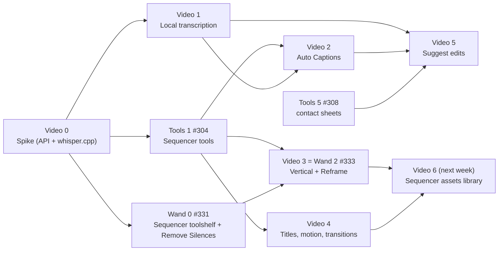

# Tier 4v — Video week: an artist-friendly Sequencer (captions, vertical, text, suggestions)

**Status**: 📝 For review (2026-10-25). Week 43–44 priority lane, ahead of Threads.
**Goal**: by the end of the week, a talking-head clip becomes a **captioned vertical
short** in a few clicks, with no model needed for the basics, and Coworker can
**suggest** the edit. Next week: the **Sequencer assets** library (looks, blur fill,
titles, transitions) on top.
**Clean room**: our own design from the 5.x Python API (bundled docs in
`mcp/blmcp/data/api`) and live probes. Out-of-the-box video apps are the
*inspiration* for the feel, not a feature list to match.

## 1. What the artist gets

```
Sequencer ▸ toolshelf tab "Coworker" (Bforartists) / Strip, View, Add menus (Blender)
┌──────────────────────────────┐
│ [🗨 Auto Captions]  [▯ Vertical] │   ← one click each, preview → apply → one undo
│ [🔇 Remove Silences] [T Titles ▾] │
│ [⇄ Transitions ▾]  [✨ Suggest]  │   ← Suggest asks the active engine; the rest need no model
└──────────────────────────────┘
```

| Button | What happens | Needs a model? |
|---|---|---|
| **Auto Captions** | Transcribes the selected clips locally (whisper.cpp), lays the words out as styled text strips (clean, bold pop, word-by-word), safe-area aware; **Export SRT**; captions can be **Translated** with the existing right-click Translate | No (speech model only) |
| **Vertical** | 9:16 output; each shot reframed with an editable **Reframe** compositor modifier (centre crop, or **Blur Fill**: the shot sits over a blurred copy); optional *Follow subject* per shot | No (Follow subject: vision, optional) |
| **Remove Silences** | Cuts the quiet ranges from the selected clips and closes the gaps | No |
| **Titles ▾** | **Lower thirds** (name + role, topic, location) and **title cards** (hook title, chapter card, end card), each with **entrance and exit** animations (pop, slide up, fade, typewriter-feel by words) | No |
| **Transitions ▾** | Cross, dip to black, wipe, zoom punch-in, whip; applied between selected strips | No |
| **Suggest** | Reads the transcript, the silences and a contact sheet of the footage; proposes cuts, punch-ins, B-roll spots, a hook title and captions style as **suggestion buttons**; applying one is one undo | Yes (active engine) |

Every action also exists as an **MCP tool**, so the chat (any engine) can do it:
"caption this in Spanish, bold pop style, then make it vertical".

## 2. What the 5.x API gives us (from the bundled docs; Video 0 probes it live)

| Need | API | Note |
|---|---|---|
| Editable per-shot effects | `SequencerCompositorModifierData.node_group` (strip modifier type *Compositor*) | **The key piece**: reframe, blur fill, looks, vignette, grain as compositor node groups on a strip, editable afterwards |
| Text styling | `TextStrip`: `font`, `font_size`, `color`, `use_box` / `box_color` / `box_margin` / `box_roundness`, `use_outline` / `outline_*`, `use_shadow` / `shadow_*`, `anchor_x/y`, `location`, `wrap_width` | Enough for clean and bold caption styles |
| Animation | keyframes on strip properties (`location`, `font_size`, `color` alpha, `blend_alpha`, `transform.*`) | Entrance / exit presets are keyframe recipes |
| Transitions | `sequencer.effect_strip_add` (cross, gamma cross, wipe), `fades_add`, retiming transitions | Plus compositor-based ones (zoom / whip) |
| Templates as assets | `sequencer.add_scene_strip_from_scene_asset` | **Titles and animated templates as scene assets** — the basis of next week's library |
| Captions out | `sequencer.export_subtitles` | SRT export of text strips, built in |
| Cuts | `split`, `gap_remove`, `connect`, `strip_transform_fit` | Remove Silences, assemble |
| Audio | `Sound` / `aud` | Video 0 probes how to read samples for silence detection |

## 3. Local speech: whisper.cpp, the same way we run llama.cpp

**Decision (proposed)**: **whisper.cpp's `whisper-server`**, managed like
`llama-server`: one-click download, model presets, start/stop, health check.
MIT-licensed code and models; same ggml family we already ship.

| Piece | Plan |
|---|---|
| Binary | Download the Windows build (CPU / CUDA / Vulkan) from the whisper.cpp releases; **Video 0 checks** which assets the current release ships and whether `whisper-server.exe` is in them. Fallback: `faster-whisper` wheels into `vendor/deps` (heavier) |
| Models | Presets **tiny / base / small / medium / large-v3-turbo** (GGML, from Hugging Face), with sizes and a recommended default (small or turbo) |
| Timestamps | Word-level: `--split-on-word --max-len 1` (or token timestamps), VAD on (`--vad`) to skip silence and feed **Remove Silences** |
| Language | `auto` or picked; whisper's own *translate to English* as an option; any other language through our Translate |
| Remote | OpenAI-compatible `/v1/audio/transcriptions` with the Remote API key, where the provider supports it |
| Manager | `whisper_manager.py`, mirroring `llm_manager.py` (download with progress / cancel / disk check, `start_whisper_server`, `transcribe(path) -> words`) on its own port from `shared.effective_ports` |

The transcript is kept per strip (JSON next to the .blend in a `coworker_transcripts/`
folder, keyed by the media file's hash), so captions, silences and Suggest share it and
it's never computed twice.

## 4. Tasks



### Video 0 — Spike (#374, S, Monday)
Probe in Bforartists 5.3: the compositor strip modifier from Python (create a node group,
attach, change an input), text-strip keyframes, `add_scene_strip_from_scene_asset`,
`export_subtitles`, reading sound samples. Download whisper.cpp on Windows: which assets,
`whisper-server` flags, word timestamps + VAD on a 2-minute clip, speed on CPU vs GPU.
**Done when**: findings in §6; the whisper route and the caption data format are frozen.

### Tools 1 — Sequencer tools (#304, M, Mon–Tue)
As written in the issue, plus `split_strip`, `remove_gaps` and `add_text_strip` (with a
style dict), so captions, silences and titles share one tested tool layer.

### Video 1 — Local transcription (#375, M, Tue–Wed)
`whisper_manager.py` (§3) + Preferences rows (download, model preset, device, language) +
MCP tool `transcribe_strip(strip, language)` → words with times, cached. **Done when** a
2-minute talking-head clip transcribes locally with word times in under a minute on GPU,
and the second call is instant.

### Video 2 — Auto Captions (#376, M, Wed–Thu)
Words → caption lines (max chars, max duration, break on pauses / punctuation) → text
strips on a captions channel with a **style preset** (Clean, Bold Pop, Word-by-word with
the current word highlighted, Boxed). Safe area for 9:16 and 16:9; **Export SRT**,
**Import SRT**; Translate works on the caption channel. Tool `add_captions(strips, style,
language)`. **Done when** the clip gets readable, in-sync captions in each style, one undo,
and an SRT that plays in VLC.

### Video 3 — Vertical + Reframe (#333 rescoped, M, Thu)
9:16 output; per strip a **Reframe** compositor modifier (offset, zoom, *Blur Fill* on/off),
editable afterwards; *Follow subject*: sample frames, ask vision for the subject's x
position per shot, smooth it into keyframes. Remove Silences ships in Wand 0.
**Done when** a 16:9 edit becomes 9:16 with one click (centre or blur fill) and each shot's
framing can be dragged afterwards.

### Video 4 — Titles, motion and transitions (#377, M, Thu–Fri)
First **lower thirds and title cards** built from text + colour strips (a name / role lower
third, a hook title, an end card), so Video 6 can turn them into scene assets. Entrance / exit recipes as keyframe presets on text and image strips (fade, pop, slide up,
slide out, scale punch), a **zoom punch-in** on a cut, and transitions between selected
strips (cross, dip to black, wipe, whip via a compositor group). Tools
`animate_strip(strip, entrance, exit)` and `add_transition(a, b, kind)`. **Done when** a
title enters and exits with each preset and two clips get each transition, one undo each.

### Wand 0 — Sequencer toolshelf + Remove Silences (#331, S, Mon–Tue)
The spike becomes the **Coworker** tab in the Sequencer toolshelf (Bforartists) and entries
in the Strip / View / Add menus (Blender), with the six buttons of §1 wired as each video
task lands. Remove Silences as written.

### Video 5 — Suggest edits (#378, M, Fri)
The Sequencer's **Suggest**: transcript + silence map + a contact sheet (Tools 5) →
the active engine proposes up to five edits as suggestion buttons (cut these 3 pauses,
punch in at 0:12, hook title "…", captions Bold Pop, make it vertical); each applies
through the tools above as one undo. This is a slim, Tier 4 slice of *Edit from Footage*
(Tier 5). **Done when** on the test clip it proposes at least three sensible edits and each
applies cleanly on Local and Remote.

### Video 6 — Sequencer assets library (#379, L, next week)
A shipped asset library, built with the other add-on's asset work in mind:
compositor-modifier node groups (**Blur Fill**, **Reframe**, **Looks** (warm, cool,
film), **Vignette**, **Grain**, **Glow**, **Shake**, a **safe-area guide**), **lower thirds
and title cards** as scene assets (name / role lower thirds, topic and location tags, hook
titles, chapter cards, end cards, each with entrance / exit and editable text and colours),
and **transitions**. Each carries agent metadata (description, tags,
inputs with ranges) so Coworker can pick and drive them (procedural first, master §0).
Browse from the Asset Browser and the toolshelf's *Titles ▾ / Transitions ▾ / Looks ▾*.

## 5. The week

| Day | Work | Test |
|---|---|---|
| Mon 26 | Video 0 spike; Wand 0 toolshelf; Tools 1 starts | Probes pass in Bforartists 5.3 |
| Tue 27 | Tools 1; Video 1 manager + download | Tool listing; a clip transcribes |
| Wed 28 | Video 1 done; Video 2 captions | Captions in sync, SRT exports |
| Thu 29 | Video 3 vertical + reframe; Video 4 starts | 16:9 → 9:16, framing editable |
| Fri 30 | Video 4; Video 5 suggest; **Test V** | The talking-head clip → captioned vertical short |

**Test V (you)**: three talking-head clips → Remove Silences → Auto Captions (Bold Pop) →
Vertical (Blur Fill) → a title with entrance / exit → a transition → Suggest → render.
Local engine for Suggest, plus one run on Remote. Then next week: Video 6.

## 6. Spike findings

*(Video 0 fills this in.)*

## 7. Risks

| Risk | Mitigation |
|---|---|
| whisper.cpp ships no Windows `whisper-server` build | Build once in CI and host it in our releases, or fall back to `faster-whisper` wheels |
| The compositor strip modifier is slow at 1080×1920 previews | Proxies at 50%; Blur Fill at lower internal resolution; Video 0 measures |
| Word-by-word captions make hundreds of strips | One strip per caption line, the highlighted word drawn by a second strip per line; or a compositor text group if the API allows (probe) |
| Follow subject is unreliable on small local models | Off by default; centre crop and blur fill never need a model |
| Week overrun | Order is by value: Captions and Vertical first; Suggest and Titles can slide to Monday |
