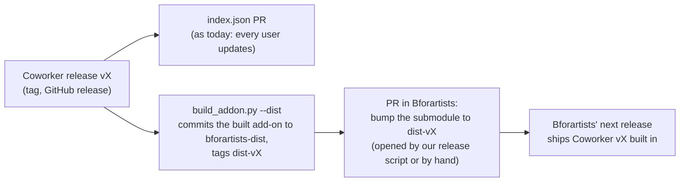

# Tier 4x — Ship Coworker inside Bforartists (built-in copy + update repository, no installer)

**Status**: 🚧 In progress (2026-11-07). Bundle 0 spike done (§5); the submodule design is planned (§6). Earlier: 📝 For review (2026-10-25, revised the same day). This week's priority, next to
the video week. Issue #380. Bundle 0 (spike) done on 2026-11-07: built-in copy route confirmed,
see §5.
**Rule**: no PR is merged automatically, in this repo or in Bforartists'. Every PR waits
for your review.

## 1. Goal

Bforartists ships with Coworker **out of the box, switched off**, without freezing it to
the Bforartists release cycle. Bforartists doesn't need the Coworker Installer for this:
it can set up at build time everything the installer does on first run. Only one step is
left, the hand-over to an updatable copy, and Coworker does that itself.

| Piece | Where | How |
|---|---|---|
| **The built-in copy** | Bforartists' read-only **System** extensions repository (in the install folder) | The build unpacks `bfa_coworker-<version>.zip` from the submodule's pinned release. Off by default; on in Preferences like any bundled add-on. Works offline |
| **The update repository** | Bforartists' **default preferences** | *Bforartists Coworker* (`…/Draise14/bfa_coworker/main/extensions/index.json`) registered like extensions.blender.org, *Check for Updates on Startup* on |
| **The hand-over** | Coworker's own Updates box | When a newer version is listed: **Enable Updates** installs it into the update repository (settings kept), switches to it, and leaves the built-in copy off as a fallback |
| **Plain Blender users** | — | Keep using the Coworker Installer (#86), unchanged |

```
Bforartists repo
 └─ (submodule) bfa_coworker @ v1.1.41
        │  build step: unpack releases' bfa_coworker-1.1.41.zip
        ▼
 <install>/<version>/extensions/system/bfa_coworker      (built-in copy, off by default)
 default prefs: repository "Bforartists Coworker" ──► extensions/index.json (async updates)
        │  a newer version is listed → Coworker's Updates box: [Enable Updates]
        ▼
 <user>/extensions/<coworker repo>/bfa_coworker          (updatable copy, now the one in use)
```

## 2. Why the hand-over is needed

The built-in copy lives in the install folder, which is read-only, so it can't be updated
in place. An update has to go into the update repository's folder in the user's profile,
and then the same Coworker (`bfa_coworker`) exists in two repositories. Today the
installer avoids that by moving Coworker into the update repository on first run; here
Coworker does it the moment there is something to update to.

## 3. Open questions the spike answers

| Question | What we check | If it fails |
|---|---|---|
| Does Bforartists 5.3 load extensions from the System repository? | Unpack Coworker there in a 5.3 build; it lists, enables, runs | Ship it as a core add-on instead (needs a small `bl_info` shim) |
| **Same id in two repositories** | Install a newer `bfa_coworker` into the update repository while the System copy exists: does Bforartists warn, refuse, or allow only one enabled? | If it refuses: keep the installer route (ship the installer instead of Coworker) |
| Switching copies | Disable System copy → enable repository copy in one step, with settings kept (`settings_transfer.py`) | Ask for a restart |
| Default repository | Register the update repository in Bforartists' default preferences (`userdef_default` / startup prefs) | Coworker registers it on first enable |
| Offline | Built-in copy enables and runs with no network | — |

## 4. Tasks

### Bundle 0 — Spike (#380, S)
The five checks of §3 in a Bforartists 5.3 build. **Done when** each has a result written
up here and the route (built-in copy + hand-over, or installer) is chosen.

### Bundle 1 — Enable Updates in Coworker (S)
Coworker knows it's the built-in copy (its path is inside the System repository). The
Updates box (`preferences._draw_updates`) shows *Built in to Bforartists* and, when the
update repository lists a newer version, **Enable Updates**: install into that repository
(the extensions install operators, addressed by repository directory as in #95; probe the
exact call), restore settings
(`settings_transfer`), disable the built-in copy, enable the new one. bpy-free tests for
the decision ("which copy is in use, is there a newer one"); a by-hand check in a
Bforartists build.
**Done when** a built-in 1.1.41 hands over to 1.1.42 from the repository with settings
kept, and stays updatable afterwards.

### Bundle 2 — The submodule in Bforartists (M) · *planned 2026-11-07, see §6*
A **dist branch** of this repo, submoduled into Bforartists at
`release/extensions/system/bfa_coworker`; small CMake and C changes in Bforartists.
A **PR to Bforartists for you to review**; nothing merges by itself.
**Done when** a fresh Bforartists build has Coworker available offline (off by default),
and turning it on and then updating reaches the next Coworker release without a new
Bforartists build.

### Bundle 3 — Release routine (S)
Each Coworker release: tag → GitHub release → `extensions/index.json` PR (as today) →
`build_addon.py --dist` commits the built add-on to the dist branch → a submodule-bump
PR in Bforartists for its next release. Documented in `extensions/README.md` and
`BUNDLING.md`.

## 6. How the submodule works (plan, 2026-11-07)

### 6.1 What we found

| Fact | Where | Consequence |
|---|---|---|
| Bforartists already ships five extensions as **git submodules** | `.gitmodules`: `scripts/addons_contrib/space_view3d_pie_menus`, `…_3d_navigation`, `…_copy_attributes`, `io_mesh_stl`, `io_scene_3ds` | Submodules are an accepted pattern there |
| CMake installs `release/extensions/` into every build | `source/creator/CMakeLists.txt`: `install(DIRECTORY ${CMAKE_SOURCE_DIR}/release/extensions DESTINATION ${TARGETDIR_VER})` | A folder at `release/extensions/system/bfa_coworker` becomes the **System** extension the Bundle 0 spike tested, with no new build step |
| That install has no `.git` exclude | same rule | A submodule's `.git` file would be copied into the install: add `PATTERN ".git" EXCLUDE` |
| This repo **tracks every release zip** | `releases/`: 195 MB at 1.1.41, ~26 MB more per release | Submoduling this repo's main branch would pull all of that into every Bforartists clone |
| The source is **not** what gets installed | the built add-on is 71 MB / 7,368 files; 52 MB of it is `vendor/deps` | Bforartists' build would need pip, network access and our vendoring: too much to ask of it |
| `vendor/deps` is **Windows-only** today | compiled wheels (`cp312-win_amd64`: pydantic-core, cryptography, pywin32) | A Linux or macOS Bforartists build must not ship them; their deps must also match the Python version of that Bforartists build |

### 6.2 The design: a dist branch, submoduled shallow

This repo stays the development home (why it's separate: a complex add-on with its own
release pace, tests and vendoring). For Bforartists we publish a **second, slim branch**
in the same repo, `bforartists-dist`, holding only **what gets installed**:

```
bforartists-dist @ dist-v1.1.42           (one commit per release, nothing else)
├── bfa_coworker/                         the built add-on without vendor/deps
│   ├── blender_manifest.toml             (version 1.1.42)
│   ├── __init__.py …  vendor/blmcp/      pure Python, plus precompiled .pyc (spike)
└── deps/
    ├── windows_x64/                      vendor/deps for Windows (today)
    ├── linux_x64/                        later, when its vendored build exists
    └── macos_arm64/                      later
```

In Bforartists:

```
.gitmodules
[submodule "release/extensions/system/bfa_coworker"]
    path = release/extensions/system/bfa_coworker
    url = https://github.com/Draise14/bfa_coworker.git
    branch = bforartists-dist
    shallow = true                        # only the pinned commit, never the history
```

- **Shallow and pinned:** the superproject pins one dist commit (a tag `dist-v1.1.42`), so
  a clone fetches only that tree, about 25 MB compressed, never `releases/` or the history.
- **CMake (small change):** install `bfa_coworker/` into `extensions/system/bfa_coworker`,
  and `deps/<this platform>/` into its `vendor/deps`; if this platform has no deps folder,
  skip Coworker on that platform and say so in the build log. Exclude `.git`.
- **C (three changes, from the spike):** `add_default_coworker()`, its call in
  `add_defaults_all()`, and versioning that adds the *Bforartists Coworker* repository
  (module `BforartistsCoworker`) only when its URL isn't there yet.
- **Off by default.** It updates through *Get Extensions*, with Coworker's **Enable
  Updates** hand-over (Bundle 1).

### 6.3 The routine (how it splices in, every release)



1. **Coworker release** as today (tag, release, `index.json` PR). Users of any Bforartists
   build get it through *Get Extensions*.
2. **`build_addon.py --dist`** (new): split the built add-on into `bfa_coworker/` +
   `deps/windows_x64/`, precompile `.pyc`, commit to `bforartists-dist`, tag `dist-vX`.
   An idempotent script, so a release can be re-published.
3. **Bump in Bforartists:** a one-line submodule PR (`git -C release/extensions/system/bfa_coworker
   fetch --depth 1 origin tag dist-vX && git checkout dist-vX`). **Never auto-merged.**
   Cadence: whenever Bforartists prepares a release, take the latest Coworker; in between,
   nobody needs to bump, because updates are async.
4. **Checks before a bump:** the dist tree's version equals the tag, `deps/<platform>` matches
   the Bforartists build's Python version, and a CI smoke test enables the System copy
   headless.

### 6.4 Clean-up in this repo (before the first dist)

- **Stop tracking `releases/*.zip`**: they belong on GitHub releases, which
  `extensions/index.json` already points at. The history keeps them, but neither the dist
  branch nor a shallow submodule ever fetches them. `releases/` moves to `.gitignore`.
- `BUNDLING.md` for Bforartists maintainers: what the submodule is, how to bump it, what the
  CMake rule does, and how to check a platform.

### 6.5 Risks

| Risk | Mitigation |
|---|---|
| Linux / macOS builds have no Coworker deps | CMake skips Coworker on a platform without `deps/<platform>`; per-platform vendoring is its own task |
| Python version drift (deps are `cp312`) | The bump check compares the dist's ABI tag with the Bforartists build's Python; mismatches block the bump |
| A 25 MB-per-release dist branch grows | Shallow submodule clones fetch one commit; the branch can be squashed later without breaking pinned tags |
| `make update` in Bforartists prunes `scripts/addons_contrib` (`prune_stale_files`, inherited from Blender) | We use `release/extensions/system`, which it doesn't touch; check `make update` keeps the submodule |
| Two copies enabled at once | Bundle 1 enforces a single enabled copy (spike) |

## 5. Bundle 0 results (spike, 2026-11-07)

**Verdict: go with the built-in copy + hand-over.** Bforartists has no problem with the same
id in two repositories. It doesn't warn and doesn't refuse; it treats them as two separate
add-ons and lets both be enabled at once. So keeping it to one copy is Coworker's job,
and Bundle 1 can do that. The spike also found a bug that is already live: the settings
restore of #86 does nothing on Blender/Bforartists 5.x (details under 3).

**How it was tested.** Bforartists dev build 5.4.0 Alpha (`9fbfb5e931bb`, built 2026-10-30;
there is no 5.3 build on this machine). The extensions code it runs is the same as Blender's
`blender-v5.3-release` branch, apart from refactors and BFA additions (diffs checked for
`addon_utils.py`, `preferences.cc`, `appdir.cc`, `bl_extension_ops.py`). The published
1.1.41 zip was unpacked into a throwaway System folder, and a "1.1.42" (the same zip with
the manifest version bumped) was installed into the update repository. Two
`--background --offline-mode` runs (`phase1`, then a restart, `phase2`), once with the
System folder read-only (like Program Files) and once writable (like a portable zip).
Scripts, isolation details and raw results are in `_misc/spikes/bundle/`. Source citations
are to `Bforartists_sync` @ `d2ddb782e55`, and to Coworker 1.1.41.

### 1. Do System-repository extensions load? Yes. Read-only? Mostly, and Python can get round it.

- **Source.** The *System* repository is one of the three defaults
  (`preferences.cc:453-466`, `BKE_preferences_extension_repo_add_default_system`;
  existing prefs get it from `versioning_userdef.cc:1525`). Its folder is
  `BLENDER_SYSTEM_EXTENSIONS` (an environment variable, else `<install>/<ver>/extensions`,
  `appdir.cc:704-714`) plus the module name `system` (`preferences.cc:521-552`). So the
  build step unpacks to **`<install>/<ver>/extensions/system/bfa_coworker/`**. The dev
  build already ships `5.4/extensions/system/readme.txt`.
- **Live.** `bl_ext.system.bfa_coworker` 1.1.41 is listed and **off by default**. It
  enables offline (`FINISHED`, 44/44 classes registered) from a read-only folder.
- **Read-only, enforced by the UI and operators:**
  - *Install from Disk* can't target System: the repository list leaves it out
    (`bl_extension_ops.py:107-114`). Live: `enum "system" not found in ('user_default', 'blender_org')`.
  - *Uninstall* is shown greyed out, with "System extensions are read-only and cannot be
    uninstalled" (`bl_extension_ops.py:3945-3962`, `bl_extension_ui.py:2201-2203`).
  - There's no "Remove Repository & Files" for it (`space_userpref.py:2476-2481`).
  - The System repository never has a remote URL, so **the built-in copy never shows an
    update** (that is why we need the hand-over).
- **Read-only, not enforced from Python:** `bpy.ops.extensions.package_uninstall(repo_directory=<system>)`
  - fails on the read-only folder ("lock directory could not be created" for `.blender_ext`);
  - **succeeds on a writable (portable) install: the built-in copy was deleted.**
    Coworker must never call it on the System copy.
- **Coworker writes into its own folder.** On enable, `_get_vendor_deps_dir`
  (`agent_controller.py:2140-2169`) moves `vendor/deps` to `~/.cache/bfa_coworker/vendor_deps`.
  - Read-only: the rename fails, the copy works, and the `rmtree` silently fails. The log
    still says "copy+remove successful". Harmless.
  - Writable: the System copy loses its `vendor/deps` (live: `system_vendor_deps_present: false`).
    Works, but the "pristine fallback" depends on the cache from then on.
  - Python also can't write `.pyc` files into a read-only folder, so every start
    recompiles. Bundle 2 should precompile at build time.

### 2. Same id in two repositories: allowed, with no warning, and both can be enabled. The copy enabled last wins.

- **Source.** An extension's module is `bl_ext.<repo module>.<id>` (`addon_utils.py:1454-1478`).
  Two repositories give two different add-ons, `bl_ext.system.bfa_coworker` and
  `bl_ext.BforartistsCoworker.bfa_coworker`.
  - Nothing checks across repositories: `addon_utils.enable` (`:339`), the install
    operators (they check only the target repository), and *Get Extensions* (lists each
    repository's local/remote packages separately, `bl_extension_ui.py:1056-1080`).
  - `error_duplicates` only covers legacy add-ons (`addon_utils.py:213-233`).
  - So in *Get Extensions* the update repository offers Coworker as **"Install"** even
    while the built-in copy is installed. Installing it has *Enable on Install* on by
    default, and then both copies are on.
- **Live.** Installing 1.1.42 into the update repository: `FINISHED`. Both copies are
  listed, with `error_duplicates` and extension warnings both empty. Enabling the second
  while the first is on also gives `FINISHED`, and both are then "enabled" in preferences. But:
  - **The copy enabled last owns every class** (44/44). The other copy keeps 1/44 (its
    AddonPreferences, whose `bl_idname` is the package name, so they don't collide). It
    has no operators or panels but is still "enabled", so its timers and servers would
    still run. In the GUI that means two auto-starts on the same ports.
  - Console: about 200 `Info: Registering … class … has been registered before, unregistering previous`
    lines, plus `warning: registered duplicate command "bfa_coworker", this will be inaccessible`.
  - **Disabling the losing copy leaves the winner intact** (44/44 afterwards, tested in
    both orders). So "enable new, disable old" works, and so does "disable old, enable new".
  - **At startup the order of `preferences.addons` decides** (`addon_utils.py:76-83`
    enables in that order). Live: with `[repo, system]` the **older built-in 1.1.41 won**
    over 1.1.42; with `[system, repo]` the repository copy won.
  - Both copies keep their own, separate settings.

### 3. Switching copies with settings kept: Bforartists can switch, but Coworker 1.1.41 loses the settings on 5.x.

- Preferences are stored under the full module name, so the two copies have
  **separate** settings: `bl_ext.system.bfa_coworker` and `bl_ext.BforartistsCoworker.bfa_coworker`.
  Disabling an add-on (`addon_disable`, `default_set=True`) **removes its entry** from
  `preferences.addons`. Live: switching back to the built-in copy brings it up with
  defaults, so the fallback needs the restore too.
- Coworker writes the backup correctly on disable. Live: `bfa_coworker_settings.json`
  held `host`/`port` = `spike.host.380`/`9381`.
- **Restore does nothing on 5.x.**
  - Blender 5.0 moved `bpy.props` storage into "system" ID properties (commit `7276b2009a88`).
    `AddonPreferences` now has *only* system ID properties (`rna_userdef.cc:5105`), so
    `prefs[key] = value`, which `settings_transfer.apply` and `restore_once` use, raises
    `TypeError: bpy_struct[key] = val: id properties not supported for this type`
    (`bpy_rna.cc:3765-3769`, reproduced live).
  - Every key is skipped, the `settings_restored` flag is never set, and no message is
    printed. Live: the repository copy came up with `localhost`/`9876`.
  - **This affects the Coworker Installer route (#86) today as well.**
- **What works:** writing to `prefs.bl_system_properties_get(do_create=True)[key]`. That is
  the same storage the properties read from, and it doesn't fire the update callbacks.
  Live: 71 settings applied, `host`/`port` read back as `spike.host.380`/`9381`. The rest of
  `settings_transfer` (dump, enum to int mapping, skipping unknown keys) can stay.
- The switch itself is clean in one session, with no restart needed: disable the System
  copy, enable the repository copy, 44/44 registered, no duplicate warnings.

### 4. Default repository entry: yes, in C. It takes three changes in Bforartists.

1. `BKE_preferences_extension_repo_add_default_coworker()` in `preferences.cc`, a copy of
   `..._add_default_remote` (`:434-444`):
   - name **"Bforartists Coworker"**, module **`BforartistsCoworker`**;
   - `remote_url` = `UPDATE_REPO_URL`;
   - `flag |= USE_REMOTE_URL | SYNC_ON_STARTUP`.

   The module must be exactly what *Add Remote Repository* and the Coworker Installer make
   from that name. `userpref_ops.cc:476-497` and `strncpy_py_module` (`preferences.cc:369-389`)
   drop the space. Live: `module: "BforartistsCoworker"`, not the `Bforartists_Coworker`
   that `settings_transfer.py`'s docstring claims. With the same module, existing setups
   and Coworker's `update_repo_of_this_install` (which matches by URL) line up.
2. Call it from `BKE_preferences_extension_repo_add_defaults_all` (`:460-466`). That covers
   new profiles and *Load Factory Settings*, and is reached from `blendfile.cc:1602`.
3. For existing `userpref.blend` files: a `versioning_userdef.cc` block under the next
   subversion. BFA already reuses Blender's numbers this way, e.g. `502, 15` at `:1875`.
   Guard it with `BKE_preferences_extension_repo_find_by_remote_url_prefix(userdef, URL, false)`
   (`preferences.cc:593`), so a repository the installer added isn't added twice.

The same thing done at runtime persisted fine. Live: the repository added in phase 1 came
back after the restart with URL, module and *Check for Updates on Startup*. Sync on startup
still waits for online access, like extensions.blender.org.

### 5. Offline enable: yes.

- Live, `--offline-mode` (`online_access: false`): the built-in copy enables and registers
  fully.
- `extensions.package_install` and `repo_sync_all` poll **False** offline
  (`bl_extension_ops.py:3327-3335`); `package_install_files` polls True.
- Two consequences:
  - **Enable Updates is an online-only action.** Hide or grey it while
    `bpy.app.online_access` is False.
  - In the GUI, Coworker's own auto-start of the bridge and agent is skipped while online
    access is off (`preferences.py:112-122`, `__init__.py:224-226`). The add-on is usable;
    the servers start by hand.

### What Bundle 1 must handle

1. **Fix the settings restore for 5.x.** Write through `bl_system_properties_get(do_create=True)`.
   Add a bpy-free test with a fake that raises on `__setitem__`, the way 5.x does. This
   fixes the installer route (#86) too, and could ship as a hotfix ahead of the rest.
2. **Detect "built in"**: `__package__` is in the repository whose `source == 'SYSTEM'`
   (`bl_ext.system.bfa_coworker`).
3. **Enable Updates (online only):**
   1. Make sure the update repository exists (by URL) and its folder exists.
   2. Sync it.
   3. `package_install(repo_directory=…, pkg_id="bfa_coworker", enable_on_install=False)`.
      Address the repository by directory (#95); not `install_files` into System, which is impossible.
   4. Save the settings (dump from the live prefs).
   5. Disable the System copy.
   6. Enable the new copy.
   7. Restore the settings.

   All of this works without a restart. Never uninstall the System copy.
4. **Make sure only one copy is on.** Bforartists won't do this:
   - On `register()`, if another `bl_ext.*.bfa_coworker` is enabled, the newer copy wins.
     It disables the other (deferred with a timer, not inside `register`) and keeps the settings.
   - If the built-in copy is the one registering while a newer copy is on, it should
     step aside rather than shadow the newer one.
   - This covers both "Install" in *Get Extensions* and the startup-order case, where the
     older built-in copy won.
5. **Fallback:** "Use Built-in Copy" (switch back) needs the same save/restore, because
   disabling drops a copy's preferences entry.
6. **Vendor deps:** stop moving `vendor/deps` out of a System install (read only from it,
   or copy without deleting). Check that the cache gets refreshed when a newer copy brings
   different deps. Today the move is skipped once `~/.cache/bfa_coworker/vendor_deps`
   exists, which affects every update, not just this one.

For Bundle 2: precompile `.pyc` files at build time (the folder is read-only at runtime),
use the three C changes of §5.4, and unpack to `<install>/<ver>/extensions/system/bfa_coworker`.
