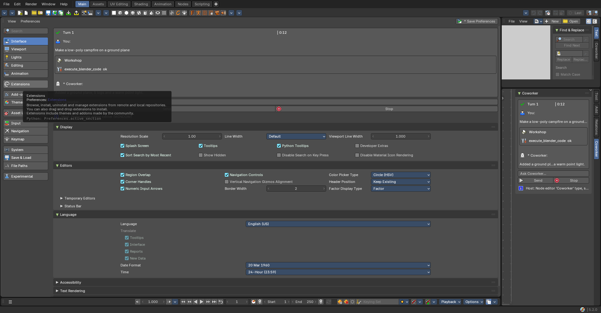

# Coworker editor: which Blender editor hosts it? (#26, board "Editors 1")

**Date**: 2026-10-19 · **Build**: Bforartists 5.3 dev build (based on Blender 5.3.0 Alpha)
**Prototype**: `_misc/spikes/coworker_editor_spike.py` (throwaway; run it with
`bforartists --factory-startup --python _misc/spikes/coworker_editor_spike.py -- <out_dir>`)
**Raw results**: `findings.json` · **Screenshots**: `both_options.png`, `real_preferences_unaffected.png`

## Question

Python add-ons can't create a new kind of editor (that needs C). Which existing editor
gives us a Coworker editor that is as **native and themed** as possible, with the
**center drawn by Python panels** if we can (the maintainer's first preference), and GPU
drawing only as a last resort?

## What was tried and what happened

| Option | Own entry in the Editor Type menu | Center | Verdict |
|---|---|---|---|
| **1. Preferences-editor clone**: a Python panel in the Preferences editor's center, shown only in areas flagged as "Coworker" | No (the area is a Preferences editor) | Our panel draws full-width and fully themed, **but Blender's own Preferences panels for the active section (Display, Editors, Language...) draw underneath it**, along with the section list and *Save Preferences*. The active section is global, so there's no clean way to hide them; patching Blender's panels would also change your real Preferences | ❌ |
| **2. Node editor with a custom "Coworker" tree type** | ✅ **"Coworker" with its own icon**, checked through the Editor Type menu's own item list | The chat lives in native panels in its own **Coworker** sidebar tab, which code can open; the node header can be hidden. The canvas beside it stays free | ✅ **Recommended** |
| 3. Text Editor sidebar (today's approach) | No | Chat in the sidebar | Works, but no dedicated editor |

Also checked: when a Preferences area is **not** flagged as Coworker (your real
Preferences), our panel stays out of it. The area-scoped `poll` works
(`real_preferences_unaffected.png`). The leak in option 1 only goes the other way.

## Decision

**Build the Coworker editor as a custom node-tree editor type "Coworker" (option 2).**

- You pick it from the Editor Type menu like any other editor, in any area or window.
- The chat is native panels (`layout.box()`, `prop`, operators), so it follows the theme
  and survives Blender updates. No GPU drawing.
- Its header can be hidden; a small Coworker header (branding, Start/Stop) can replace it.

## Known limits (to handle in "Editors 4")

- **Sidebar width**: Python can't set a region's width. The sidebar opens at ~280 px and
  you drag it wider once; Blender then remembers it per area. The setup button will say so.
- **The canvas** next to the sidebar is a node canvas. For now it shows nothing (or a
  hint). It fits later uses: the Goal & Plan as nodes, or the Tier 5 moodboard, which
  already plans a node-editor canvas.
- A tree datablock isn't needed for the editor to open with our type (checked: the area
  switched to the type with no tree). Whether a tree is created later is a build decision.
