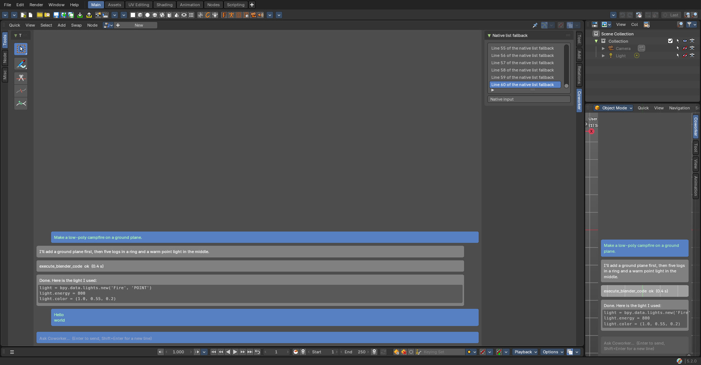
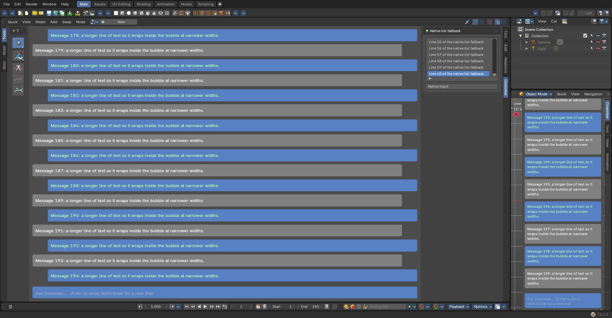

# GPU chat: one themed chat module, full editor + compact sidebars (board "GPU 0")

**Date**: 2026-10-19 · **Build**: Bforartists 5.3 dev build (Blender 5.3.0 Alpha)
**Prototype**: `_misc/spikes/gpu_chat_spike.py` (throwaway), run with
`bforartists --factory-startup --enable-event-simulate --python _misc/spikes/gpu_chat_spike.py -- <out_dir>`.
Event simulation lets the script really type into the prototype.
**Raw results**: `findings.json` · **Screenshots**: `center_and_compact_after_typing.png`, `200_messages_scrolled_zoomed.png`

## Why

Python panels can't give the chat what chat users expect: newest message at the bottom
with the input **pinned** under it, **Enter to send / Shift+Enter for a new line**, and a
working `@` list. The Preferences-editor clone was ruled out in "Editors 1". The question
here: can **one GPU-drawn module**, coloured and sized from the user's theme, draw the chat
in the Coworker editor's center **and** compactly in any editor's sidebar, with the same
look and behaviour?

## Results

| Question | Result |
|---|---|
| Themed drawing | ✅ Message boxes from the theme's widget colours (box, selected, text field) and roundness, sized by UI scale. Bforartists' bundled **DejaVuSansMono** loads for code blocks |
| Center chat in the Coworker node editor | ✅ Full width, newest at the bottom, **input pinned at the bottom**, clipped scroll area |
| Typing | ✅ Simulated "Hello", **Shift+Enter**, "world", **Enter** arrived as one two-line message; the input cleared |
| Keyboard capture | ✅ While typing, `N` (the node editor's *toggle sidebar*) did **not** fire; Backspace removed the typed "n". 27 of 29 events were consumed by the chat |
| Scroll and zoom | ✅ Mouse wheel scrolls from the bottom up; **Ctrl+wheel zooms** the chat only |
| Speed | ✅ **~1.3 ms per frame for 200 messages**, with no layout caching yet |
| Compact chat in a sidebar | ✅ The same module paints the 3D View's **Coworker tab**, also over the transparent sidebar (Region Overlap); the tab strip stays usable |
| Native fallback (scrolling list) | ✅ Selecting the last row scrolls Blender's list to it, so a native "pinned" log works where painting doesn't |
| Toolshelf (left) | ⚠️ Our panel registers in the node editor's left region, but Bforartists draws that region as a narrow icon toolbar (the panel shows as a collapsed "T"). Toolshelf actions should be **icon buttons**, or the user widens the shelf |
| Opening a file | ⚠️ The input capture (a modal operator) stops on file load, and so do non-persistent timers. Fix: a persistent `load_post` handler restarts it in every window |
| Sidebar tab selection | ⚠️ `region.active_panel_category` can only be set **after the region has drawn once**; set it one redraw later |
| IME (Chinese / Japanese / Korean) | ❌ Not available in a self-drawn field (Blender doesn't expose IME to Python). Needs a small "edit in a native box" button |

## Decision

**Go.** Build **one chat module** (`ui_gpu/`) used in two sizes:

- **Full**: the center of the Coworker editor (the custom "Coworker" node-editor type from
  "Editors 1"); the left toolshelf holds icon actions (templates, wizards), the right
  sidebar holds native property panels (session, model, plan).
- **Compact**: the "Coworker" tab of the 3D View sidebar (and later other editors' sidebars).

Both read the same chat data (Engine 3's message shapes), so every engine and both sizes
always show the same conversation.

## Build notes (from the spike)

1. Layout bpy-free and unit-tested (wrapping, boxes, hit areas); only a thin layer touches `gpu` / `blf`.
2. Measure text with `blf.dimensions` and cache layouts per message and width; the spike redrew everything every frame and was still fast.
3. Triangles, not triangle fans (not every GPU backend has them); scissor-clip the message area.
4. One input modal per window, restarted by a persistent `load_post` handler; pass every event through unless the chat has focus.
5. Read theme values every draw (the user can switch themes); scale = UI scale × pixel size × chat zoom.
6. The IME fallback button and keyboard focus (click to focus, Esc to leave) are part of the input task.
